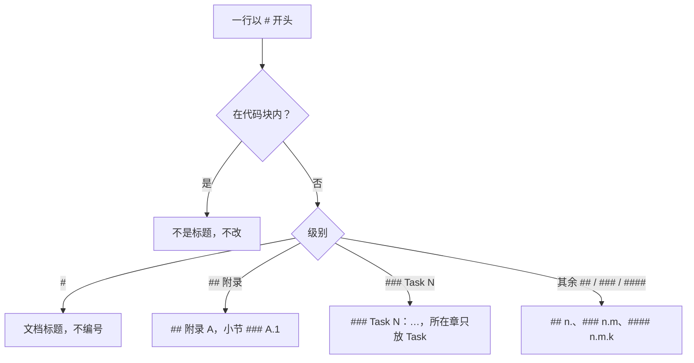
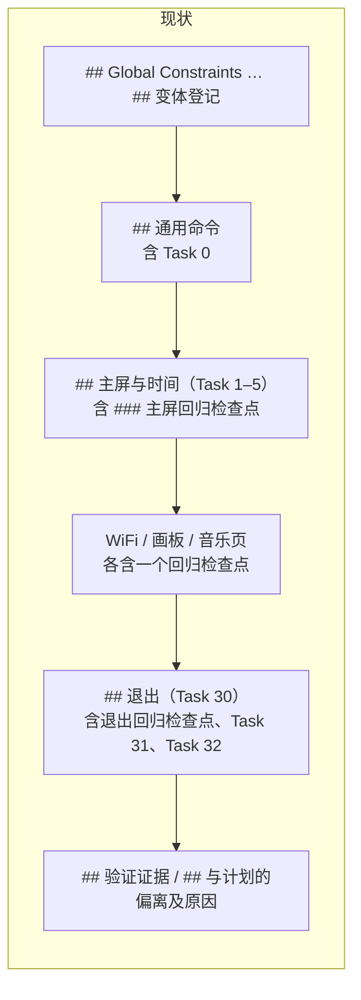
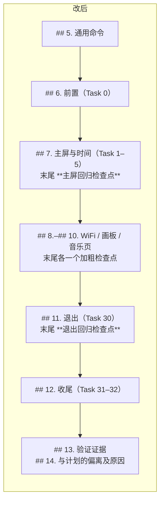

# Luckfox Pico LVGL Example — 历史 plan 标题编号与 Task 编号统一设计规格

- **日期**：2026-10-14
- **状态**：已落地；§8 QA 结论均按推荐执行，验证证据见 plan
- **分支**：`pi/heading-numbers`（起点 `origin/dev` `85a6dd4`，即 PR #10 合入）
- **范围来源**：PR #10 plan [`2026-10-10-lvgl-example-board-test-followups.md`](../plans/2026-10-10-lvgl-example-board-test-followups.md) §6.1「另开 docs PR：历史 spec 与 plan 标题补序号」
- **关联计划**：[`../plans/2026-10-14-lvgl-example-heading-numbers.md`](../plans/2026-10-14-lvgl-example-heading-numbers.md)

---

## 1. 概述与目标

PR #10 起，spec 与 plan 按作者个人 `~/.pi/agent/AGENTS.md` 的规则给标题编号。PR #10 之前的 8 份 plan 大多没有编号，PR #10 plan §6.1 把补序号留给单独的 docs PR，即本 PR。

目标：

1. 8 份历史 plan 的标题符合 §2.1 的规则，标题文字除序号、冒号外不变；两个特例的处理见 §3.4、§3.5。
2. 文中按章节号、附录号引用本文件的地方随标题同步，不留失效引用。
3. 只改标题与相关引用（含 10-06 plan 代码块注释中的附录引用、PR #10 plan 表格中的 Task 号），另在 PR #10 plan 加两句说明（§6.1 的状态行、「编号顺序」表后的说明）；其余正文、表格、代码块不动，按 §4 的还原比较逐行核对。
4. 仓库 `AGENTS.md` 写明编号规则，Cursor Cloud Agent 也能读到（§3.8）。
5. plan 的 Task 号只用数字、从 0 或 1 起连续；唯一不连号的 PR #10 plan 改为连号，引用同步（§3.9，Q17）。

**简称**：历史 plan 按文件名中的日期简称，如「10-01 plan」即 PR #8 的 plan（`2026-10-01-lvgl-example-fix-existing-defects.md`），「10-06 plan」即 PR #9 的 plan（`2026-10-06-lvgl-example-cloudagent-align-luckfox-pico.md`）；各份 plan 对应的 PR 见 §2.2。

**不在本规格范围**：PR #10 plan §6.2–§6.7 的代码、CI 与交互改动（理由见 §6）；spec 与 plan 的正文改写或精简；已合并 PR 正文中的链接（§2.3 实测没有指向历史 plan 标题的锚点）。

## 2. 背景

### 2.1 标题编号规则

作者个人 `~/.pi/agent/AGENTS.md`「superpowers spec 与 plan 标题编号」（2026-10-10 确认）：

- `##` 写成 `## 2. 背景`，`###` 写成 `### 2.2 小节`，`####` 写成 `#### 2.2.1 小节`；最多用到四级标题，引用写成 §2.2.1。
- plan 的 Task 标题保持 `### Task N：…`，Task 号即序号，不再叠章节号；Task 以外的小节照常编号，且不与 Task 混在同一章。
- 附录写成 `## 附录 A`，附录内小节写成 `### A.1`，与正文分开编号。
- 代码块内以 `#` 开头的行不是标题。
- （2026-10-15 补充，Q17、Q18）Task 号只用数字，从 0 或 1 起逐个加 1；精简 plan 删掉 Task 后，后面的 Task 重新编号；执行中途插入 Task 时按位置插入，后面的 Task 顺延并同步引用，不确定时用 grilling 询问。



### 2.2 现状（2026-10-14，`origin/dev` `85a6dd4`）

按 §2.1 逐行检查（代码块内跳过）。9 份 spec 全部符合，章节号连续、子节号与所在章一致，没有附录；PR #10 的 plan 符合 Q17 之前的规则，Task 编号不符合 Q17 补充的连号规则（见下文「Task 编号」）。其余 8 份 plan 的情况：

| plan | PR | 缺序号的 `##`、`###` | Task 标题用半角冒号 | Task 所在章 |
|---|---|---|---|---|
| `2026-07-24-…-cloudagent-env` | #1 | 3 | 7 / 7 | Task 1–7 在 `## Global Constraints` 内 |
| `2026-09-20-…-grilling-skill` | #3 | 5 | 5 / 5 | Task 1–5 在 `## File Structure` 内 |
| `2026-09-21-…-github-actions-ci` | #4 | 7 | 6 / 6 | Task 1–6 在 `## File Structure` 内 |
| `2026-09-25-…-wifi-detect` | #5 | 6 | 7 / 7 | Task 1–7 在 `## File Structure` 内 |
| `2026-09-27-…-brightness-slider` | #6 | 5 | 13 / 13 | Task 1–13 在 `## File Structure` 内 |
| `2026-09-28-…-native-tests` | #7 | 6 | 13 / 13 | Task 1–13 在 `## File Structure` 内 |
| `2026-10-01-…-fix-existing-defects` | #8 | 18 | 33 / 33 | Task 0 在 `## 通用命令` 内；Task 31–32 在 `## 退出（Task 30）` 内；5 个回归检查点与 Task 同章 |
| `2026-10-06-…-cloudagent-align-luckfox-pico` | #9 | 6（`### A1`–`### A6`），另有 `## 9. 附录：…` | 10 / 10 | 已有 `## 4. Tasks` |
| 合计 | | 56 + 1 | 94 | 7 份需要调整 |

「缺序号」一列与 PR #10 plan §6.1 的统计一致（56 处）。后两列与下面的「Task 编号」是本次新查出的问题，PR #10 plan §6.1 未列：

- **Task 编号**（Q17 时补查）：10 份 plan 中只有 PR #10 的 plan 不连号，为 `0 1 2 2b 3 … 11 14 15 17 18 21`。缺的 12、13、16、19 是文档与几轮验证、rebase 的 Task，20 并入了音乐 [9/10]；精简 plan 时这些 Task 被删去，结果并入 §4 验证证据，后面的 Task 没有重新编号。10-01 plan 与 PR #10 plan 从 Task 0 起，其余从 Task 1 起；除 PR #10 plan 外均连号，PR #10 plan 按 §3.9 改号后为 0–17。
- **Task 所在章**：旧模板在 `## File Structure`（或 `## Global Constraints`）之后直接接 `### Task 1`，没有单独的 Tasks 章。只给 `##` 补序号，这些 Task 在目录里就成了「File Structure」的小节，违反「不与 Task 混在同一章」。
- **半角冒号**：规则写的是 `### Task N：…`（全角冒号），PR #10 的 plan 已照此书写；8 份历史 plan 共 94 个 Task 标题用 `: `。

10-01 plan 的结构（简化）：



### 2.3 引用与链接

- **章节号引用**：基线 `85a6dd4` 中 428 行含 `§` 引用。spec 引用的 `plan §n` 只有 PR #10 spec 指向 PR #10 plan，两者都不改；历史 plan 引用的都是 spec 章节号。7 份历史 plan 原先没有序号，不存在按序号引用它们的地方；10-06 plan 已有 `## 1.`–`## 8.`，本 PR 不改这 8 章的序号，只有附录见下一条。
- **按名称引用**：如「验证证据」「与计划的偏离及原因」「主屏回归检查点」，标题文字不变，引用仍然成立。
- **附录引用**：10-06 plan 中「附录 A1」等共 18 处（正文 9 处，代码块内脚本注释 9 处），另有正文「（§9）」1 处指向附录所在章；附录开头的脚本索引表第一列另有 `A1`–`A6` 6 格（初版统计按「附录 A1」搜索而漏掉，合并前由 Codex 审查指出，见 Q15）。
- **锚点链接**：仓库内没有指向 `plans/*.md#…` 的链接。PR #1–#10 的正文与评论中只有 PR #10 正文一处 `plans/2026-10-10-…#65-ci-增加变体检验`，指向 PR #10 plan，该 plan 的章节号本 PR 不能改动（§3.7）。
- **Task 号引用**：PR #10 plan 的 Task 号只在该 plan 内被引用：Architecture、§2–§6 与附录 A、C 共 63 处正文引用，其中 62 处随改号同步（56 处号码变化），1 处（Architecture 的「Task 13」）指向已删去的 Task；另有 18 个 Task 标题；PR #10 的 spec、19 个提交说明、PR 正文与评论都没有引用，spec 中唯一的「Task 32」指 PR #8 的 plan。仓库内与 PR #1–#11 正文也没有指向其 Task 标题锚点的链接。

## 3. 设计（以 §8 QA 结论为准）

### 3.1 改动范围

- 8 份历史 plan：标题行、插入的 Task 章标题、10-01 plan 的 5 个回归检查点、10-06 plan 的附录引用。
- PR #10 plan：§6.1 开头加一行状态说明（Q6）；Task 改为连号，同步正文引用与「编号顺序」表首列，并在表后加一句说明（Q17、Q19）。
- 仓库 `AGENTS.md`：写入编号规则（Q7）。
- 9 份 spec、`README.md`、代码不动。

### 3.2 普通章节补序号

`##` 按出现顺序编号 `## 1.`、`## 2.`…，其下非 Task 的 `###` 编号 `### n.1`、`### n.2`…。例：`## Global Constraints` → `## 1. Global Constraints`，10-01 plan 的 `### 真机遗留问题` → `### 14.1 真机遗留问题`。

### 3.3 Task 所在章（Q2）

在第一个 `### Task` 前插入 `## n. Tasks`，与 PR #9、PR #10 的 plan 一致；原先的 `## File Structure`、`## Global Constraints` 只留自己的正文。适用于 07-24、09-20、09-21、09-25、09-27、09-28 六份 plan。

10-01 plan 按页面分章（`## 主屏与时间（Task 1–5）` 等），这些章本身就是 Task 章，不再插入 `## Tasks`；只有两处 Task 落在别的章里，各插入一章：

- Task 0 原在 `## 通用命令` 内，前面插入 `## 6. 前置（Task 0）`。
- Task 31、Task 32 原在 `## 退出（Task 30）` 内，前面插入 `## 12. 收尾（Task 31–32）`。

### 3.4 特例 1：10-01 plan 的回归检查点（Q3）

**位置**：`2026-10-01-lvgl-example-fix-existing-defects.md`（PR #8 的 plan）。5 个回归检查点（主屏、WiFi、画板、音乐页、退出）原为 `###` 标题，各自位于对应页面的 Task 章末尾：

```text
## 主屏与时间（Task 1–5）
### Task 1 … ### Task 5
### 主屏回归检查点      ← 不是 Task，却和 Task 同章
## WiFi（Task 6–14）
```

**为什么不能直接套规则**：规则对 Task 以外的小节有两条要求，在这里互相冲突。

- 「Task 以外的小节照常编号」：就地编成 `### 7.1 主屏回归检查点`，就违反下一条。
- 「不与 Task 混在同一章」：要满足这条，只能把检查点挪到单独一章。但检查点是执行顺序上的关口：该页最后一个 Task 完成后，先跑 [H]、[X]、[M] 并推送，才开始下一页的 Task。挪走后，plan 的结构与当时的执行顺序对不上。

PR #10 plan §6.1 因此把它列为特例，留待开 PR 时讨论。

**处理**：在原位把 `### 主屏回归检查点` 改为加粗段落 `**主屏回归检查点**`。它不再是标题，上面两条都不涉及；位置与执行顺序不变；「验证证据」表按名称引用（如「主屏回归检查点（第 5 个 fix 提交）」）不受影响。代价是 GitHub 目录（Outline）中不再列出这 5 项。规则没有留例外。



### 3.5 特例 2：10-06 plan 的附录（Q4）

**位置**：`2026-10-06-lvgl-example-cloudagent-align-luckfox-pico.md`（PR #9 的 plan）。附录原写成 `## 9. 附录：未入库的验证脚本`，小节为 `### A1`–`### A6`。

**为什么单列**：这一处按规则改没有冲突，单列是因为改动超出标题本身。

- 附录不再占用章号，正文章节到 `## 8.` 为止；正文中「附录 A1–A6（§9）」的「§9」随之失效。
- 「附录 A1」等引用共 18 处，其中 9 处在代码块里的脚本注释中。本 PR 原则上不改代码块，是否同步这 9 处要由作者决定。

**处理**：按规则改。

- `## 9. 附录：未入库的验证脚本` → `## 附录 A：未入库的验证脚本`。
- `### A1`–`### A6` → `### A.1`–`### A.6`，附录开头脚本索引表第一列的 `A1`–`A6` 同步改为 `A.1`–`A.6`（Q15）。
- 18 处「附录 A1」→「附录 A.1」，包括代码块内的注释（只改注释文字，不改脚本逻辑）；「附录 A1–A6（§9）」→「附录 A.1–A.6」。

### 3.6 Task 标题冒号（Q5）

94 个 `### Task N: ` 统一为 `### Task N：`。Task 标题末尾的「（已完成）」等保留。

### 3.7 PR #10 plan §6.1（Q6）

不删除 §6.1、不改其标题：作者引用过 §6.1 的锚点，PR #10 正文引用了 §6.5 的锚点，删掉 §6.1 会使后续小节号前移、锚点失效。在 §6.1 开头加一行状态说明，指向本 PR 与本 spec，并注明特例 1 的最终处理与 §6.1 暂定的不同。

### 3.8 仓库 `AGENTS.md`（Q7）

在 `## Cursor Cloud specific instructions` 下新增 `### 文档（spec 与 plan）`，写明标题编号、Task 号规则（Q17、Q18）与 QA 条目格式，使 Cursor Cloud Agent 也按同一规则书写。

### 3.9 Task 编号连号（Q17）

PR #10 plan 按现有顺序重新编号：0、1、2 不变，`2b`→3，3–11→4–12，14→13，15→14，17→15，18→16，21→17。

- 改 18 个 Task 标题，并同步该 plan 内对本 plan Task 的 62 处正文引用（56 处号码变化），包括「Task 14、17、21」「Task 2、3、4」这类列举。改号脚本最初报「替换 80 处」，是标题与正文引用合计；Q19 加入表格后报 98 处，再加表格首列 18 行（Q22）。
- §2「编号顺序」表的首列只写数字、没有「Task」字样，同样按对照表换号（16 行）；改号前的 Task 12（`docs(readme)`）、13（收尾）两行早在精简时删去了标题，首列改为「—」，表后加一句说明（Q19）。
- 不改 §6.1 中的「Task 1–5」：它指 PR #8 的 plan。
- Architecture 中「请作者真机复测（Task 13）」指向的 Task 早已删去，改为「（结果见 spec §3.5）」。
- 检查脚本改为核对 Task 号只用数字、从 0 或 1 起逐个加 1，并核对正文「Task N」与首列为 Task 的表格只引用本文件存在的 Task（Q19）；规则写入 `AGENTS.md` 与 §2.1。

### 3.10 不改的内容

- 9 份 spec：已符合规则。
- 标题文字：除序号、冒号与 §3.4 的加粗外不改；中英文混用（如 `Global Constraints`、`Execution Handoff`）保留。
- 一级标题、代码块内的 `#` 行（10-06 plan 的附录引用注释除外）、`- [x] **Step n:**` 等列表与加粗小标题。
- spec 与 plan 以外的文档：`AGENTS.md`、`README.md`、`README_CN.md`、`tests/README.md` 与 `lib/` 下 vendored 的 README 不加序号（Q13、Q14）。

## 4. 验证

1. **规则检查**：脚本逐份检查全部 spec 与 plan，标题、代码块、表格与行内代码由 CommonMark 解析器（markdown-it-py，含 GFM 表格扩展）识别，标题文字、表头与引用都取自解析后的渲染文字（Q28、Q30、Q31）；原始 HTML 中的 `<h1>`–`<h6>` 按错误报出，HTML 块中注释以外的文字也参与引用检查（Q33）；引用按渲染后的连续文字检查，同一段落内的软换行、HTML 标签两侧的文字连起来看，空白按 HTML 规则合并（Q34）：代码块外的 `##`、`###`、`####` 都有序号或是 Task、附录；标题不得位于引用块或列表内，代码块必须闭合，闭合按解析结果判断，引用块、列表内的围栏同样适用（Q28、Q29）；章节号连续，子节号与所在章、节一致，`###`、`####` 的末级从 1 连续编号，`###` 只能出现在有效的 `## n.` 或 `## 附录` 之下，`####` 只能出现在有效的 `### n.m`（附录为 `### A.m`）之下（这几项检查由 Codex 指出后补上，见 Q16、Q25、Q26）；单独的 `##` 等空标题按缺序号报错，不用 Setext 标题（Q26、Q27）；Q16–Q34 中指出过的写法整理为 68 个样例，由 plan 附录 A.5 的 `check-samples.sh` 回归（Q28–Q34）；Task 所在章只有 Task，Task 号只用数字、从 0 或 1 起连续（Q17），正文、Task 定义以外的标题与 Task 表格只引用本文件存在的 Task（Q19、Q24），章标题写明的 Task 范围与该章实际的 Task 一致（Q24）；不超过四级。脚本全文放在 plan 附录，不入库。
2. **改动只在标题**：把改后的 8 份 plan 还原（去掉序号、冒号改回半角、删除插入的章标题、加粗检查点改回 `###`、附录写法与引用改回），与 `origin/dev` 逐行一致；PR #10 plan 删去 §6.1 的状态行与「编号顺序」表后的说明，Task 号与该表首列按 §3.9 的对照表改回后，与 `origin/dev` 逐行一致。
3. **引用**：10-06 plan 中 `rg '附录 A[0-9]'` 为 0（PR #10 plan §6.1 与本 spec、plan 描述旧写法的地方保留）；检查脚本另查有附录的文件中，代码块外未加点的附录编号（「附录 A1」、表格首列 `| A1 |`）为 0（Q15）；插入的 Tasks 章不影响按名称引用。
4. **渲染**：在 GitHub 上打开 10-01、10-06 与 PR #10 三份 plan，目录（Outline）层级正确，PR #10 plan 的 Task 锚点为 `task-0…`–`task-17…`，PR 正文中的锚点链接可以跳转。

## 5. 提交与 PR

- 分支 `pi/heading-numbers`，PR 指向 `dev`：开发时为草稿，合并前改为 ready；执行者不合并。
- 提交（Q9），开发过程中按需提交，最后用 `git rebase` 整理为：
  1. `docs(superpowers): 📝 统一历史 plan 的标题编号与 Task 编号`：8 份 plan，以及 PR #10 plan 的 §6.1 状态行与 Task 连号。初稿标题为「历史 plan 标题补序号」，加入 Task 连号后改为现名（Q17）。
  2. `docs(agents): 📝 写明 spec 与 plan 的标题编号规则`：仓库 `AGENTS.md`。
  3. `docs(superpowers): 📝 新增历史 plan 标题编号与 Task 编号统一 spec 与 plan`。初稿标题为「新增历史 plan 标题补序号 spec 与 plan」，与 spec、plan 的文档标题一起按 Q18 改名；文件名 `2026-10-14-lvgl-example-heading-numbers*.md` 不变，以免 PR #10 plan §6.1、`AGENTS.md` 与 PR 正文中的链接失效。
- PR 标题：与第 1 个提交相同，`docs(superpowers): 📝 统一历史 plan 的标题编号与 Task 编号`。

## 6. 与 PR #10 plan §6 其余后续事项的关系

| 小节 | 内容 | 是否并入本 PR | 理由 |
|---|---|---|---|
| §6.2 | Load 自动添加 `network={}` 块 | 否 | 改变写配置的行为，要写测试并上板 |
| §6.3 | `wpa_supplicant not reachable` 时圆环一直转 | 否 | 代码修复，要追查启停条件 |
| §6.4 | 歌曲列表换成从顶部排列的列表 | 否 | 先定交互，牵涉生成代码、6 个测试文件与重新上板 |
| §6.5 | CI 增加变体检验 | 否 | `ci(github-actions)` 另开 PR，要在 runner 上验证耗时与稳定性 |
| §6.6 | 单次动作按钮的按下反馈 | 否 | 交互改动，要截图与上板 |
| §6.7 | 触摸读取处理 `SYN_DROPPED` | 否 | 代码修复，要补回放测试 |

本 PR 只改文档，不需要编译、测试或上板；混入任一项都会让审查从「逐行核对标题」变成代码审查，也会让合并依赖 CI 与真机。可以一起做的只有同属文档规范的小事，见 Q5、Q6、Q7。

## 7. 风险

- **锚点失效**：插入 Tasks 章、补序号后，历史 plan 的锚点全部变化（如 `#验证证据` → `#5-验证证据`）。§2.3 实测仓库内与 PR 正文没有这类链接；仓库外的书签会失效，可接受。
- **与执行记录对不上**：插入章节会改变 plan 的结构。插入的只有 `## n. Tasks` 一类章标题，Task 与检查点的顺序和内容不变（§3.4）。
- **PR #10 plan 的 Task 锚点**：Task 改号后，其标题锚点变化（如 `#task-14歌曲列表不再循环重复…` → `#task-13…`）。§2.3 实测没有指向它们的链接。
- **其他分支冲突**：当前没有其他未合并的分支改动这 9 份 plan。

## 8. QA（grilling 记录）

问句与推荐取自问答原文；「答」是作者回答经润色后的版本，意思与原回答一致。会话中第 1 轮的问题从 Q1 编起，依次对应本节 Q2–Q9；作者对第 1 轮统一回答「均遵循推荐」。Q10 为作者提问、执行者作答，标「答（执行者）」。Q11、Q12 是作者询问 PR 正文措辞后的第 2 轮问题，作者回答「全部遵循推荐」。Q13、Q14 为合并前作者提问、执行者作答。Q15、Q16 记录合并前 Codex 审查的结果与处理；Q17 由 Codex 第 3 轮意见引出，作者回答「遵循推荐」；Q18 为作者追问 PR #10 编号的由来；Q19–Q21 记录 Codex 第 4–6 轮意见；Q22 记录合并前最终检查，Q23–Q34 记录其后 Codex 第 7–18 轮意见。

**Q1. 是否单独开 PR；本 PR 还做哪些**

- 问：PR #10 plan §6.1 是否单独开 docs PR？§6.2–§6.7 有没有可以一起做的？
- 推荐：单独开；§6.2–§6.7 都不并入（§6）。同属文档规范、可以一起做的是 Q5（Task 冒号）、Q6（PR #10 plan §6.1 状态）、Q7（规则写进仓库 `AGENTS.md`）。
- 答：作者在提出任务时已打算单独开 PR，并要求指出可以一起完成的事项；按推荐执行。

**Q2. Task 所在章**

- 问：7 份旧 plan 的 Task 落在 `## File Structure`、`## Global Constraints` 等章内。A 在第一个 Task 前插入 `## n. Tasks`；B 只补序号，不调整结构。10-01 plan 的 Task 0（在 `## 通用命令` 内）与 Task 31–32（在 `## 退出（Task 30）` 内）：A1 分别插入 `## n. 前置（Task 0）`、`## n. 收尾（Task 31–32）`；A2 不动。
- 推荐：A + A1。
- 答：同意推荐。

**Q3. 特例 1：10-01 plan 的 5 个回归检查点**

- 问：A 就地编号（如 `### 7.1 主屏回归检查点`），作为规则的例外；B 挪到单独一章；C 改为原位的加粗段落标题 `**主屏回归检查点**`。
- 推荐：C。不违反规则，位置与执行记录一致；代价是 GitHub 目录里不再列出这 5 项。
- 答：同意推荐。

**Q4. 特例 2：10-06 plan 的附录引用**

- 问：「附录 A1」等共 18 处，正文 9 处、代码块内脚本注释 9 处（如 `"""V1 静态检查（plan 附录 A1）。`）。A 全部改为「附录 A.1」；B 只改正文。
- 推荐：A。注释不是机器读取的内容，改后 `rg '附录 A[0-9]'` 可以作为检查项。
- 答：同意推荐。

**Q5. Task 标题冒号**

- 问：94 个 `### Task N: ` 是否统一为 `### Task N：`？
- 推荐：统一，规则原文就是全角冒号，PR #10 plan 也这样写。
- 答：同意推荐。

**Q6. PR #10 plan §6.1 的处理**

- 问：A 标题不动，开头加一行「已由 PR #11 完成」；B 删除 §6.1（§6.2 起前移，PR #10 正文的 `#65-ci-增加变体检验` 锚点失效）；C 不动。
- 推荐：A。
- 答：同意推荐。

**Q7. 把编号规则写进仓库 `AGENTS.md`**

- 问：规则只在作者个人 `~/.pi/agent/AGENTS.md`，Cursor Cloud Agent 读不到。是否在仓库 `AGENTS.md` 加一节，写明 spec 与 plan 的标题编号规则？
- 推荐：加，3–4 行，单独一个 `docs(agents)` 提交。
- 答：同意推荐。

**Q8. 检查脚本是否入库**

- 问：A 放 plan 附录，不入库（PR #10 的惯例）；B 入库为 `tests/tools/` 下的脚本并加进 CI。
- 推荐：A。加进 CI 属于 §6.5 一类的 CI 改动，另议。
- 答：同意推荐。

**Q9. 提交拆分与 PR 标题**

- 问：8 份 plan 一个提交，还是每份一个？PR 标题用 `docs(superpowers): 📝 历史 plan 标题补序号`？
- 推荐：标题改动一个提交（加上 Q6）；Q7 若做则单独 `docs(agents)`；spec 与 plan 最后一个提交。PR 标题如上。
- 答：同意推荐。

**Q10. 两个特例在哪里，为什么不能直接按规则执行**

- 问（作者）：前面说的特例在哪里？为什么不能按规则执行？
- 答（执行者）：特例 1 在 PR #8 的 plan，5 个回归检查点位于各页面的 Task 章末尾；规则的「Task 以外的小节照常编号」与「不与 Task 混在同一章」在这里冲突：就地编号违反后者，挪到单独一章又与执行顺序对不上。按 Q3 改为加粗段落后不再是标题，两条都满足，没有留例外。特例 2 在 PR #9 的 plan，按规则改没有冲突，单列只是因为附录引用要同步，其中 9 处在代码块的注释里；按 Q4 全部同步。
- 结论：作者要求把这两个特例的位置、原因与处理记入文档，见 §3.4、§3.5。

**Q11. 同一份历史 plan 的叫法**

- 问：背景：作者问 PR 正文措辞为何与历史 PR 不一致、是否受中文写作 skill 影响。执行者对比 PR #8–#10 后答：skill 的「」引号、中英文空格、一段一行等规则本仓库早已在用，不是差异的来源；差异来自起草时没有对照历史 PR，其中之一是同一份 plan 混用「PR #8 plan」「10-01 plan」「PR #8 的 plan」。问：A 一律写「PR #8 的 plan」（与 PR #10 一致）；B 首次出现写全称与文件名，之后用日期简称「10-01 plan」。
- 推荐：B 用于 spec、plan（要逐个列 8 份文件，日期简称便于对照文件名）；PR 正文与提交说明只提到 PR #8、#9 的 plan，用 A。
- 答：同意推荐。
- 结论：spec §1 定义简称，§2.2 表格补 PR 列；plan 首次出现写全称；PR 正文与提交说明写「PR #8 的 plan」。

**Q12. PR 正文与提交说明是否按历史 PR 修改**

- 问：对比结果：PR 正文的章节结构与 PR #10 一致，但概述首句缺主语（历史为「本 PR 处理…」）且把整条规则塞进括号，第 2 节标题为「改动」（PR #8、#9 为「修复清单」「改动清单」）。提交说明的标题格式与历史一致，正文只列改了什么，缺少历史提交中的原因与「详见 spec §…、Q…」（PR #10 的 19 个提交中 17 个有）；`Co-authored-by` 在 PR #10 中已不再使用，本 PR 同样不加。问：是否按此修改 PR 正文、改写 3 个提交的正文，并统一 Q11 的叫法？
- 推荐：全部修改；改写用 `git rebase`，前后核对树不变后强推。
- 答：同意推荐，修改后把对比结果重新整理，发到 PR 评论区。
- 结论：PR 正文与 3 个提交说明已按上述修改；对比结果见 PR #11 评论。

**Q13. `AGENTS.md` 是否加序号**

- 问（作者）：`AGENTS.md` 是否建议加序号？如果建议，新建提交修改；可以查最佳实践与官方文档。
- 答（执行者）：不建议，不新建提交。
  - 官方文档不要求编号：agents.md 的 FAQ 写明 AGENTS.md 没有必填字段，「Use any headings you like; the agent simply parses the text you provide.」（<https://agents.md/>）；Cursor 建议为 Cloud Agent 专设一节，标题示例为 `Cursor Cloud specific instructions`（<https://cursor.com/docs/cloud-agent/setup>，2026-10-15 查阅）。文档没有说该标题会被逐字匹配，但本仓库 `AGENTS.md` 写明「保留该英文章节标题作为工具约定锚点」，加序号会偏离这一约定。
  - 作者的编号规则只覆盖 spec、plan 与 PR 正文。
  - `AGENTS.md` 每次会话自动加载、小节常有增删（本 PR 就新增了一节），编号后每次增删都要重排。仓库内没有按章节号引用 `AGENTS.md` 的地方，只有 PR #9 的 spec 按名称引用「AGENTS.md 的 Cloud Agent 小节」。
  - 姊妹仓库 `yuangezhizao/luckfox-pico` 的 `AGENTS.md`（`dev` 分支）同样不编号，两边结构一致。
- 结论：`AGENTS.md` 保持不编号；作者要求把本条记入 spec。

**Q14. 除 spec、plan 与 `AGENTS.md` 外，还有没有要加序号的文档**

- 问（作者）：除了 spec、plan 和 `AGENTS.md`，是不是没有需要加序号的文档了？
- 答（执行者）：没有。`git ls-files '*.md'` 中，除 20 份 spec 与 plan 外：

  | 文档 | 来源 | 处理 |
  |---|---|---|
  | `README.md`、`README_CN.md` | Luckfox 上游 2024 年的原文，本仓库只在 PR #10 改过内容 | 不加：不在规则范围内，加了会与上游写法分叉，GitHub 会自动生成目录 |
  | `tests/README.md` | PR #7 新增的测试说明 | 不加：与 `AGENTS.md` 一样随代码维护，不在规则范围内，没有按章节号引用它的地方 |
  | `lib/` 下 6 个 README | vendored 的 LVGL、lv_drivers | 不改 |
  | `AGENTS.md` | 本仓库 | 不加，见 Q13 |

  规则覆盖的另外两类都已有序号：spec 与 plan 由本 PR 补齐（§4）；PR #1–#10 的正文此前已补，PR #11 的正文与评论也已编号。
- 结论：本 PR 的改动范围不变；作者要求把本条记入 spec。

**Q15. 合并前 Codex 审查的两条意见**

- 问：作者在 PR #11 请 Codex 审查最终提交，安全审查无问题，代码审查留下两条 P2 行评论，作者问是否属实、是否修复。
  - 10-06 plan 附录开头的脚本索引表第一列仍为 `A1`–`A6`，与改后的 `### A.1`–`### A.6` 对不上，且「附录引用已全部同步」的结论漏掉这 6 格。
  - 本 PR plan 的 Architecture 写的是 Task 1–6，正文只有 Task 1–5；合并前精简 plan 时 Task 重新编号，这一行没有同步。
- 答（执行者）：两条都属实，按作者审查模板的分级都会误导读者，属 Important，建议合并前修复。漏掉第 1 条是因为只按「附录 A1」搜索与替换，表格里只写 `A1`；以更宽的模式复查 8 份历史 plan、PR #9 的 spec 与 `AGENTS.md`，同类遗漏只有这 6 格。
- 答：按建议修复；在 Codex 的两条行评论下回复处理结果，不标记已解决。
- 结论：补改 6 格；`renumber.py`、`restore-check.py` 同步表格首列，`check-headings.py` 新增未加点附录编号检查（对改前版本报 6 处）；plan 的 Architecture 改为 Task 1–5；§2.3、§3.5、§4、PR 正文与第 1 个提交说明同步。

**Q16. Codex 第 2 轮意见：检查脚本没有核对 `####` 的末级序号**

- 问：Codex 审查 Q15 修复后的提交，指出 `check-headings.py` 只核对 `####` 的前两段是否与所在章、节一致，从不比较、也不递增第三段：把 `#### 2.2.1` 改成 `#### 2.2.99` 仍报「问题 0 处」；附录分支同样如此。作者问是否属实、是否修复。
- 答（执行者）：属实，已复现。脚本在 `###` 分支里给 `h4` 置 0，此后从未使用。该脚本不入库，不影响仓库内容；现有文档中只有 PR #10 的 spec 用到 `####`（12 个），补上检查后仍为 0 处问题，所以 PR #11 已改的文档不受影响。但 §4 称脚本检查章节号连续，这一点对 `####` 不成立，验证结论会被高估，所以修复：维护 `h4`，在 `##`、`###` 处归零，正文按 `n.m.k`、附录按 `A.m.k` 核对末级连续。
- 结论：修复后用 5 种改坏样例验证：末级跳号（2.2.1 改 2.2.99）、末级重复（2.2.2 改 2.2.1）、所在节不符（2.2.1 改 2.3.1）、缺序号、附录末级跳号（A.1.1 后接 A.1.3），都能报出且退出 1；对正常的附录样例与现有 20 份文档为 0 处。plan 附录 A.1 同步为新版本。

**Q17. Task 编号是否要求连号（Codex 第 3 轮意见）**

- 问：Codex 指出检查脚本用 `Task \w+` 只查标题形状，`Task 2` 改成 `Task 99` 或 `Task foo` 都报 0 处，建议解析数字并核对连续。执行者核对：脚本与 §4 并未声称检查 Task 号连续，规则也只写了「Task 号即序号」；PR #10 plan 的编号为 `0 1 2 2b 3 … 11 14 15 17 18 21`，强制连号会使它报错。作者表示希望 Task 必须连号、只用数字，并问除 PR #10 外还有哪些不连号、能否改成连号。执行者查证：只有 PR #10 plan 不连号（§2.2），改号只影响该 plan 内的 80 处引用（§2.3；此数含 18 个 Task 标题，正文引用实为 62 处，见 Q22）。追问三点：
  - Q17a：只用纯数字（`2b` 也改），还是允许字母后缀？推荐纯数字。
  - Q17b：起始号允许 0 或 1，还是一律从 1 起（10-01 plan 的 33 个 Task 都要顺移）？推荐允许 0 或 1。
  - Q17c：本 PR 把 PR #10 plan 改为连号、修正失效的「Task 13」引用；规则写入 `AGENTS.md` 与 §2.1；检查脚本改为核对连号。推荐都做。
- 推荐：Q17a 纯数字；Q17b 允许 0 或 1；Q17c 都做。
- 答：遵循推荐。修改仓库 `AGENTS.md` 后，作者个人 `~/.pi/agent/AGENTS.md` 可按需同步；第 1 个提交已不止补序号，提交说明要更新。
- 结论：按 §3.9 改号；检查脚本对 `Task 99`、`Task foo`、`Task 2b`、重复、首号为 2、末尾跳号都报错，对 PR #10 plan 改号前的版本报 5 处，对现有 20 份文档为 0 处；还原比较覆盖 PR #10 plan；第 1 个提交与 PR 标题改为「统一历史 plan 的标题编号与 Task 编号」；作者个人 `~/.pi/agent/AGENTS.md` 同步补上同一句。

**Q18. PR #10 plan 的 Task 号为什么不连号，是否提示词不够**

- 问（作者）：PR #10 的序号为什么这么与众不同，是哪里的提示词说得不够？
- 答（执行者）：查 PR #10 的会话记录（`~/.pi/agent/sessions/` 下 2026-10-10 起的会话），三种不连号的来源如下：
  - `2b`：执行中途补了 WiFi [2/2]（Load 前检查 `network={}` 块），要放在 Task 2（WiFi [1/2]）之后；agent 没有把 Task 3 起顺延，而是起名 `2b`。
  - 12、13 空号：第一轮精简 plan 时删去文档 Task（12）与全量验证 Task（13）的标题，结果并入 §4，后面的 Task 没有重排。
  - 从 14 起、又空出 16、19、20：agent 发现 12、13 空号后，「To avoid any numbering collision」把新 Task 从 14 编起；16、19 是验证与 rebase 的 Task，后来也在精简时删去；20 并入音乐 [9/10]。

  当时 §4、§5 与会话中已大量按「Task 13 主机」「Task 2」等编号指称内容，不改号最省事，也不会把旧引用指错。原因主要不在提示词：PR #10 的开场提示词只要求「代码入库后需要精简 plan，保留未入库的部分」；精简规则只规定已完成 Task 写成「落地文件 + [x] 步骤」，没说删 Task 后是否重排；编号规则只写「Task 号即序号」，没有要求连续，也没有说中途插入 Task 怎么办。规则留了空白，agent 按「编号稳定、少改引用」填补。agent 的不足在于发现空号时只自行判断，没有用 grilling 询问并记入 QA，作者直到 Codex 指出才看到这一选择。Q17 已补上连号与精简后重排；中途插入还没有写明，按「逐个加 1」推导应当顺延，但不写明仍可能被追加到末尾或起名 `2b`。
- 推荐：在仓库与作者个人 `AGENTS.md` 补半句「执行中途插入 Task 时按位置插入，后面的 Task 顺延并同步引用，不确定时用 grilling 询问」；本条追溯记入 spec。
- 答：需要；spec 与 plan 的标题也可以改名。
- 结论：仓库 `AGENTS.md`、作者个人 `~/.pi/agent/AGENTS.md` 与 §2.1 补上这半句；spec、plan 的文档标题改为「历史 plan 标题编号与 Task 编号统一」，第 3 个提交随之改名（§5），文件名不变。

**Q19. Codex 第 4 轮的三条意见**

- 问：Codex 审查 Q17、Q18 前后的两个提交，留下三条 P2 行评论，作者问是否属实、是否修复。
  - 本 PR plan 的 Goal 仍说只同步附录引用、「标题以外的内容不变」，没有包含 Task 连号（针对 Q17 的提交）。
  - plan 验证证据的「合并前复跑」一行仍写「提取 3 个脚本」，附录已有 4 个，`task-renumber.py` 是否从基线重放也没有记录。
  - PR #10 plan §2「编号顺序」表的首列仍是旧号（如 `2b`、`14`、`21`），按表查找会跳到错误的 Task 或找不到；改号前的 Task 12、13 也没有交代。
- 答（执行者）：
  - 第 1 条属实，但已在 Q18 的提交中顺带修好（Goal 改为包含 Task 连号与引用同步），评论针对的是更早的提交。
  - 第 2 条属实：当时只在本地对 `task-renumber.py` 做了重放，没有写进证据，数量也没有更新。
  - 第 3 条属实：`task-renumber.py` 只匹配「Task N」，表格首列只写数字，因此漏改；还原比较对表格两侧都不改，也查不出来。这是本 PR 第二次出现「只按一种写法搜索而漏改」（第一次见 Q15）。
- 结论：
  - 表格首列按对照表换号，改号前的 Task 12、13 两行改为「—」并在表后说明（§3.9）；`task-renumber.py` 与 `restore-check.py` 同步处理该表，故意把表中一行改错号时还原比较报 `DIFF`。
  - `check-headings.py` 新增「引用了不存在的 Task」检查：有 Task 的文件中，正文「Task N」（行内代码与「」内除外）与首列为 Task 的表格只能引用本文件存在的 Task；指其他文件的 Task 时写在行内代码或「」内，本 PR plan 中两处随之加了「」。对 PR #10 plan 改号前的版本报出 Architecture 的 Task 13 与表中的 12、13，对 Q18 提交上的版本报出表中的 `2b`、21、18，对现有 20 份文档为 0 处。表中其余旧号恰好与新号重合，只能靠还原比较核对。
  - 「合并前复跑」改为 4 个脚本，并在全新目录从基线重放 `renumber.py` 与 `task-renumber.py`，结果与 HEAD 逐字节相同（plan §3）。

**Q20. Codex 第 5 轮的两条意见**

- 问：Codex 审查 Q19 的提交，留下两条 P2 行评论，作者问是否属实、是否修复。
  - spec §2.2 称基线中的 PR #10 plan「也符合」§2.1，但 §2.1 已补上连号规则，下文又记录了它的 `2b` 与跳号，前后矛盾。
  - plan 验证证据称 PR #10 plan「与 `origin/dev` 相比只多出 §6.1 的状态行」，实际还有 Task 改号、引用与表格换号、Architecture 改动，会让读者误以为这些差异不存在。
- 答（执行者）：两条都属实，都是 Q17 加入 Task 连号后，早先写下的结论没有随范围扩大而更新。顺带复查两份文档中「不动」「不变」「只多出」「也符合」一类的范围性表述，另有两处同类问题：spec §1 目标 3 与 plan 的 Global Constraints 仍写「正文、表格、代码块不动」，但 10-06 plan 代码块注释中的附录引用、PR #10 plan 的表格与两句说明都改了；plan 的 Goal 写「标题、引用与 Task 号以外的内容不变」，没有算上 PR #10 plan 新增的两句说明。
- 结论：四处一并修正。§2.2 改为「符合 Q17 之前的规则，Task 编号不符合 Q17 补充的连号规则」；plan 验证证据改为列出 PR #10 plan 的全部差异，并写明经 `restore-check.py` 还原后才与 `origin/dev` 逐行一致；§1 目标 3、plan 的 Goal 与 Global Constraints 写明例外。

**Q21. Codex 第 6 轮意见：§2.2「Task 编号」一段末句与前文矛盾**

- 问：该段前半句说基线中只有 PR #10 plan 不连号，末句「10-01 plan 与 PR #10 plan 从 Task 0 起，其余从 Task 1 起，均连号」又把 PR #10 plan 算进「均连号」。作者同时要求把已完成的评论标记为已解决。
- 答（执行者）：属实，与 Q20 同属「PR #10 plan 基线结论没有随 Q17 更新」，Q20 复查范围表述时漏了这一句。再搜「均连号」「都连号」等说法，spec、plan 与 PR 正文中只有这一处；另把 §2.2「后两列是本次新查出的问题」补上「Task 编号」，§3.1 的 PR #10 plan 一行补上表格与说明，使范围描述与 §3.9 一致。
- 结论：末句改为「除 PR #10 plan 外均连号，PR #10 plan 按 §3.9 改号后为 0–17」；回复后，把第 1–6 轮已处理的评论都标记为已解决。

**Q22. 合并前最终检查**

- 问（作者）：改了这么多版，是否需要合并前最终审查？
- 答（执行者）：建议做一轮文档一致性检查，不做完整的三路审查：仓库内的改动已有规则检查、还原比较与重放的可复现证据，代码与构建不涉及；问题集中在本 PR 的 spec、plan、PR 正文与提交说明随范围扩大没有同步。环境没有子代理，由执行者按作者审查模板的 B（事实与复现）、C（规范与表述）职责自查，每项尽量用脚本给出证据，只查不改。结果：
  - Important：「80 处引用」不准确。改号脚本的 80 处含 18 个 Task 标题，正文引用实为 62 处（56 处号码变化，6 处如「Task 0–1」「Task 2」号码不变），分布在 Architecture、§2–§6 与附录 A、C，不只 §3–§6；见于 §2.3、§3.9、Q17、plan、PR 正文、第 1 个提交说明与 3 条 Codex 回复。
  - Important：PR 正文称规则检查「从 168 处降到 0」，用当前脚本对基线重跑为 171 处（163 + PR #10 plan 的 Task 号 5 处 + 引用了不存在的 Task 3 处），按文档复现对不上。
  - Minor：§2.3「约 460 行含 §」在基线中为 428 行；§5 与 plan 的 Global Constraints 仍写草稿 PR；§4 第 2 条漏了表格与说明的还原；§4 第 4 条与 plan 的渲染证据漏了 PR #10 plan；§3.8 与 `AGENTS.md` 末条没有提 Task 号规则；§2.2「前两列」在加入 PR 列后指代不清；plan「合并前复跑」一行缺少对最终提交的完整复跑。
  - 未发现问题：仓库内 9 份 plan 与 `AGENTS.md` 的改动；56、94、18、16、12 等数字；本 spec 的 §、Q 引用与 plan 的 spec 引用；提交与 PR 标题格式、签名与身份。
- 答：执行修改。
- 结论：上述各处一次修正，Q17 保留原话并加注；第 1 个提交说明改为「62 处正文引用」，`AGENTS.md` 末条补 Task 连号；3 条 Codex 回复编辑更正；对最终提交完整复跑，结果见 plan §3「最终核对」。

**Q23. Codex 第 7 轮意见：附录 A.2 的用法说明仍写「8 份 plan」**

- 问：plan 附录 A.2 的用法说明写「8 份 plan 逐份打印」，但 Q17 起 `restore-check.py` 另外检查 PR #10 plan，实际输出 9 份，按用法复跑会得到不同数量。作者要求查看并尝试修复。
- 答（执行者）：属实，属 Minor。Q17 改脚本时更新了脚本自身的说明，没有更新附录中脚本前的用法行；Q22 的检查只核对了附录脚本与执行时一致，没有核对脚本外的用法说明。再查附录 A.1、A.3、A.4 的用法行，与脚本行为一致。
- 结论：改为「9 份 plan（8 份历史 plan 与 PR #10 plan）」；回复并标记已解决。

**Q24. Codex 第 8 轮的两条意见**

- 问：作者要求查看并尝试修复。
  - plan 验证证据「合并前复跑」一行仍写「还原比较 8 份 `same`」，按当前附录脚本复跑会输出 9 份，紧邻的「最终核对」也写 9 份。
  - `check-headings.py` 的引用检查跳过所有以 `#` 开头的行，`## 7. 主屏与时间（Task 1–5）` 这类章标题中的 Task 范围不受检查：改成「（Task 1–99）」仍报 0 处。插入或删除 Task 时这些范围同样要顺延。
- 答（执行者）：
  - 第 1 条属实，属 Minor。那一行按时间先后记录了几次复跑，首次是在 Q17 之前，当时还原比较只含 8 份历史 plan，数字本身没错，但没有注明时间与范围。
  - 第 2 条属实。只排除 `### Task N：…` 定义本身即可。但只核对范围的两端仍查不出「（Task 1–4）」这类写窄的范围，所以另加一项：章标题写明 Task 范围时，该章的 Task 必须恰为这一范围。新检查对现有 20 份文档为 0 处；对基线中 10-01 plan 的「## 退出（Task 30）」报 1 处（该章原含 Task 30–32，本 PR 插入「收尾」章后已一致），基线因此从 171 处变为 172 处。
- 结论：
  - 「合并前复跑」一行注明按时间记录、当时只还原 8 份，Q17 起为 9 份。
  - `check-headings.py` 只排除 Task 定义行，并新增章标题 Task 范围检查。把 10-01 plan 的章标题改成「（Task 1–99）」「（Task 1–4）」「（Task 31–33）」「（Task 29）」都会报出。plan 附录 A.1 同步更新。
  - 对最终提交重做「最终核对」，基线按当前脚本为 172 处。
  - 回复两条评论并标记已解决。

**Q25. Codex 第 9 轮意见：没有 `###` 父节的 `####` 能通过检查**

- 问：`## 1. …` 后直接出现 `#### 1.0.1 …`，或附录标题后直接出现 `#### A.0.1 …` 时，`h3` 仍为 0，脚本按 0 构造期望编号，报「问题 0 处」。作者要求查看并尝试修复。
- 答（执行者）：属实，已复现。规则要求 `####` 写成 `#### 2.2.1`，隐含其上必须有 `### 2.2`；现有 20 份文档中只有 PR #10 的 spec 用到 `####`，且都在有效的 `###` 之下，不受影响。
- 结论：`check-headings.py` 维护「当前是否在有效的 `### n.m` / `### A.m` 之下」，遇到 `##`、Task 标题或编号错误的 `###` 时清除；`####` 前没有有效父节时报错。样例：`## 1.` 后接 `#### 1.0.1`、附录后接 `#### A.0.1`、新章后直接接 `#### 2.1.1`、Task 标题下接 `####` 都报出并退出 1；正文与附录各有正常父节的样例为 0 处；Q16 的末级跳号样例仍报出。现有 20 份文档仍为 0 处，基线不变（172 处）。plan 附录 A.1 同步；回复并标记已解决。

**Q26. Codex 第 10 轮意见：没有 `##` 父章的 `###` 能通过检查**

- 问：一级标题后直接出现 `### 0.1 …` 时，`h2`、`h3` 的初值恰好使期望编号为 `0.1`，脚本报「问题 0 处」。作者要求查看并尝试修复。
- 答（执行者）：属实，已复现，与 Q25 的 `####` 是同一类问题，Q25 只补了 `####` 一层。这次一并排查标题识别本身：脚本原先只认行首无空格、`#` 后为单个空格的 ATX 标题，而 CommonMark 也允许 0–3 个前导空格、Tab 与结尾的 `#`，另有 `===`、`---` 下划线的 Setext 标题。逐份扫描 20 份文档，没有这几种写法，现有结论不受影响；但不识别就无法检查。
- 结论：
  - `check-headings.py` 维护「当前是否在有效的 `## n.` / `## 附录` 之下」，`###` 前没有有效父章时报错；缺序号的 `##` 不算有效父章。
  - 标题识别改为允许 0–3 个前导空格、Tab 与结尾的 `#`；段落后紧跟 `===` 或 `---` 时报「Setext 标题」（列表、表格、引用、标题后的 `---` 不算）。
  - 样例：一级标题后直接接 `### 0.1`、缺序号的 `##` 后接 `###`、缩进 2 格的 `## 缩进的章`、段落后接 `---`、段落后接 `===` 都报出并退出 1；正常的正文与附录层级、带结尾 `#` 的 `## 1. a ##`、列表与表格后的 `---` 为 0 处；Q16、Q25 的样例仍报出。
  - 现有 20 份文档仍为 0 处，基线不变（172 处）；plan 附录 A.1 同步；回复并标记已解决。

**Q27. Codex 第 11 轮意见：空 ATX 标题绕过检查**

- 问：Q26 改后的标题识别要求 `#` 序列后必须有空白，CommonMark 合法的空 ATX 标题（单独一行 `##`）不会进入检查：`# doc` 后接 `##` 仍报「问题 0 处」。作者要求查看并尝试修复。
- 答（执行者）：属实，已复现。CommonMark 规定 `#` 序列后为空白或行尾即为 ATX 标题，`## #` 这类只有结尾 `#` 的也是空标题。Q26 排查标题写法时漏了行尾这一种。现有 20 份文档没有空标题，结论不变。
- 结论：标题识别改为 `#` 序列后为空白或行尾，去掉结尾的 `#` 序列后取标题文字；空标题按缺序号报错。样例：`##`、`## #`、`## 1.` 下的 `###` 都报出，`## 1.` 下的 `####` 报「没有 ### 父节」；`## 1. a ##`、`### 1.1 C#`（`C#` 中的 `#` 前无空白，不是结尾序列）、`#5 不是标题`、缩进 4 格的代码行为 0 处；Q25、Q26 的样例仍报出。现有 20 份文档仍为 0 处，基线不变（172 处）；plan 附录 A.1 同步；回复并标记已解决。

**Q28. Codex 第 12 轮意见：引用块、列表内的标题绕过检查**

- 问：`> ## 未编号`、`- ## 未编号` 在 GitHub 上仍渲染为二级标题，但脚本只认行首 0–3 个空格后的 `#`，两个最小样例都报「问题 0 处」。Codex 建议先处理容器前缀，或改用 Markdown 解析器识别标题。作者要求查看并尝试修复。
- 答（执行者）：属实，已复现。Q25–Q27 每轮补一种标题写法，都是用正则模仿 CommonMark，这一轮又出现新的写法；继续补正则还会漏掉别的情况（如 HTML 块、缩进代码块、懒惰续行）。改为由 CommonMark 解析器识别，可以一次解决这一类问题。现有 20 份文档中没有容器内的标题，结论不变。
- 结论：
  - `check-headings.py` 改用 markdown-it-py 3.0（Ubuntu 24.04 的 `python3-markdown-it`，临时安装，不写入 Dockerfile）解析，标题级别与文字、Setext 写法、围栏与缩进代码块都取自解析结果；标题位于引用块或列表内时报错；围栏代码块未闭合时报错。表格、引用与编号核对逻辑不变。
  - 把 Q16–Q28 中指出过的写法整理为 33 个坏样例与 6 个正常样例，写成 plan 附录 A.5 的 `check-samples.sh`：新脚本 39 个全部符合；Q27 版只有 Q28 的 3 个容器样例不符合，其余 36 个结果相同。
  - 现有 20 份文档仍为 0 处，基线不变（172 处），对 PR #10 plan 改号前的版本仍报 8 处、对 Q15 前的 10-06 plan 仍报 6 处。plan 附录 A.1 同步；回复并标记已解决。

**Q29. Codex 第 13 轮意见：引用块内合法的围栏代码被误报未闭合**

- 问：Q28 判断围栏是否闭合时，直接检查原始的结束行；引用块内的结束行带 `>` 前缀，`> ```python` … `> ```` 这样合法的围栏会被误报「代码块未闭合」并退出 1。作者要求查看并尝试修复，并把「Codex 为什么每次都审出新问题」的分析发到 PR 评论区。
- 答（执行者）：属实，已复现，属误报；现有 20 份文档没有引用块内的围栏，结论不变。Q28 把标题识别交给解析器，闭合判断却仍看原始行，没有一并改掉。
- 结论：
  - 闭合判断改为只用解析结果：已闭合的围栏占「开始行 + 内容行 + 结束行」，即 `map` 跨度比内容行数多 2；未闭合时只多 1。与容器前缀无关。
  - 样例新增引用块、列表内已闭合的围栏，以及围栏内含较短围栏符的情况（正常 3 个），和引用块、列表内未闭合的围栏（坏 2 个），共 44 个，全部符合；Q28 版只有引用块内的已闭合围栏不符合。
  - 现有 20 份文档仍为 0 处，基线不变（172 处）。plan 附录 A.1、A.5 同步；回复并标记已解决。
  - 「为什么每次都审出新问题」的分析发在 PR #11 评论区：Codex 每次只审当前 diff、只报确认能复现的少数问题；本 PR 每轮修复都改了检查脚本，等于给它新的审查对象；文档把脚本说成「全量校验」，也引来了反例。

**Q30. Codex 第 14 轮意见：无前导竖线的表格绕过检查**

- 问：表格首列检查用 `line.startswith("|")` 识别表格，合法的无前导 `|` 写法（`Task | 提交`、`--- | ---`、`99 | …`）整张表不进入检查，不存在的 Task 号与未加点的附录编号都能藏在其中。Codex 建议表格也依据解析结果检查。作者要求查看并尝试修复，并把「为什么每次都审出新问题」的分析更新到 PR 评论。
- 答（执行者）：属实，已复现。Q28 只把标题、代码块交给解析器，表格仍按行判断，与 Q29 的闭合判断属同一类遗留。这次按类处理：把脚本中剩下的、按原始行判断 Markdown 结构的地方逐一列出，只剩表格识别与行内代码的剔除两处。行内代码原先只认单个反引号，``…`…`` 这类含反引号的写法会把其中的文字漏出来。现有 20 份文档的表格都带前导竖线，结论不变。
- 结论：
  - 表格改为取自解析结果（GFM 表格扩展），无前导竖线、列表内缩进的表格都会识别；首列为 Task 的表格做引用检查，任何表格首列为 `A1` 这类未加点编号时报错。
  - 行内代码改为按反引号串配对剔除。
  - 样例新增 3 个坏样例（无前导竖线的 Task 表、列表内的 Task 表、无前导竖线表中的 `A1`）与 2 个正常样例（无前导竖线的合法 Task 表、双反引号行内代码中的旧写法），共 49 个，全部符合；Q29 版有这 4 个新样例不符合。
  - 现有 20 份文档仍为 0 处，基线不变（172 处），对 PR #10 plan 改号前的版本仍报 8 处、对 Q15 前的 10-06 plan 仍报 6 处。plan 附录 A.1、A.5 同步；回复并标记已解决；PR 评论中的分析同步补上这一轮。

**Q31. Codex 第 15 轮的两条意见：行内代码与表头仍按原始文本判断**

- 问：Codex 指出两处漏检，作者要求查看并尝试修复，并更新 PR 评论中的分析。
  - Q30 的行内代码剔除用正则匹配反引号串：两个开反引号加三个闭反引号、转义的反引号，在 CommonMark 中都不构成行内代码，正则却把其中的 `Task 99` 删掉，失效引用因此通过。
  - 表头 `**Task**`、`[Task](…)` 渲染后是「Task」，但脚本比较的是 inline token 的原始内容，不认作 Task 列，首列的 `99` 不受检查。
- 答（执行者）：两条都属实，已复现。Q30 自称按类处理，实际只把「按原始行判断 Markdown 结构」的地方换成解析器，「按原始文本取文字」的地方（行内代码剔除、表头、标题文字）仍在用正则或原始内容，划分的类别不够完整。这次把类别定为「所有从源文本取文字的地方」：引用、附录编号、表头与标题文字都改从解析后的 inline 子节点取渲染文字；行内代码由解析器判断，标题保留其文字，引用与附录编号检查剔除其文字。改后脚本中的正则只作用于渲染文字，原始行只用于报错时显示。现有 20 份文档结论不变。
- 结论：
  - `check-headings.py` 新增 `rendered()`，按软换行、硬换行拆行取渲染文字；引用与附录编号检查遍历正文、表格单元格与 Task 定义以外的标题；表头按渲染文字判断。
  - 样例新增 4 个坏样例（不成对的反引号、转义反引号、`**Task**` 表头、`[Task](…)` 表头）与 2 个正常样例（真正的行内代码中的 `Task 99`、标题中含行内代码），共 55 个，全部符合；Q30 版有这 4 个坏样例不符合。
  - 现有 20 份文档仍为 0 处，基线不变（172 处），对 PR #10 plan 改号前的版本仍报 8 处、对 Q15 前的 10-06 plan 仍报 6 处。plan 附录 A.1、A.5 同步；回复两条评论并标记已解决；PR 评论中的分析补上这一轮。

**Q32. Codex 第 16 轮意见：多位数的未加点附录编号**

- 问：表格首列的未加点附录编号检查用 `([A-Z])\d` 全匹配，附录到第 10 节时首列误写为 `A10` 不会报错（应为 `A.10`）。作者要求查看并尝试修复，并更新 PR 评论中的分析。
- 答（执行者）：属实，已复现。按 Q31 的教训以「数据从哪里来」划类，这一类是「对编号只取一位数字的模式」：逐一检查 4 个脚本中的数字模式，除这一处外，正文的「附录 A1」检查与 `restore-check.py`、`renumber.py` 中附录编号的 6 处替换也都只取一位数字。前者因为只匹配前缀仍能报出 `A10`，后者对 10-06 plan 的 A1–A6 没有影响，但都改为一位或多位，以免以后用于更长的附录时出错。现有 20 份文档结论不变。
- 结论：
  - `check-headings.py` 的两处、`restore-check.py` 的 4 处、`renumber.py` 的 5 处附录编号模式都改为 `\d+`。
  - 样例新增 2 个坏样例（表格首列 `A10`、正文「附录 A10」）与 1 个正常样例（`A.10`），共 58 个，全部符合；Q31 版只有表格首列 `A10` 不符合。
  - 改动后重放 `renumber.py`，8 份 plan 仍与 HEAD 逐字节相同；还原比较 9 份 `same`；现有 20 份文档仍为 0 处，基线不变（172 处）。plan 附录 A.1–A.3、A.5 同步；回复并标记已解决；PR 评论中的分析补上这一轮。

**Q33. Codex 第 17 轮意见：原始 HTML 标题绕过检查**

- 问：GitHub 会渲染 `<h2>未编号</h2>` 这类原始 HTML 标题，markdown-it 把它解析为 `html_block`，脚本只处理 `heading_open`，因而既绕过 `## n.` 编号检查，也绕过最多四级的限制。作者要求查看并尝试修复，并更新 PR 评论中的分析。
- 答（执行者）：属实，已复现。按「数据从哪里来」划类，这一类是「原始 HTML 中的内容」：除了标题，HTML 块里的可见文字（如 `<details><summary>见 Task 99</summary>`）也不在引用检查范围内，同样可以藏住失效引用。现有文档中只有 07-24 plan 的 1 个 HTML 注释块与 10-06 plan 表格中的 9 个 `<br>`，都不受影响。
- 结论：
  - `html_block` 与 `html_inline` 中的 `<h1>`–`<h6>`（不分大小写）按「原始 HTML 标题」报错；HTML 块去掉注释与标签后的可见文字参与引用与附录编号检查。注释不渲染，不检查。
  - 样例新增 4 个坏样例（`<h2>` 块、`<H5>` 块、段落中的行内 `<h2>`、`<details>` 中的失效引用）与 1 个正常样例（注释中的 `<h2>` 与 `Task 99`、`<br>`），共 63 个，全部符合；Q32 版有这 4 个坏样例不符合。
  - 现有 20 份文档仍为 0 处，基线不变（172 处），对 PR #10 plan 改号前的版本仍报 8 处、对 Q15 前的 10-06 plan 仍报 6 处。plan 附录 A.1、A.5 同步；回复并标记已解决；PR 评论中的分析补上这一轮。

**Q34. Codex 第 18 轮意见：HTML 块中跨标签的引用漏检**

- 问：Q33 用正则把 HTML 标签替换成空格，`<summary>见 Task <strong>99</strong></summary>` 显示为「Task 99」，脚本却得到「Task  99」，失效引用通过。Codex 建议用 HTML 解析后的文本内容，并按 HTML 空白规则归一化。作者要求查看并尝试修复，并更新 PR 评论中的分析。
- 答（执行者）：属实，已复现。按「数据从哪里来」划类，这一类是「渲染后连在一起、源文本中被隔开的文字」：除了 HTML 标签，Markdown 段落内的软换行（「Task」与「99」分在两行，渲染为「Task 99」）、`&nbsp;` 等字符引用，也都会让按行或按原样匹配的引用检查漏检。HTML 块里 `<script>`、`<style>` 的内容不显示，Q33 却会检查，可能误报。现有 20 份文档不受影响。
- 结论：
  - HTML 块改用 Python 标准库 `html.parser` 取显示文字：标签不产生文字，注释与 `<script>`、`<style>` 的内容不计入，字符引用按 HTML 解码；`<h1>`–`<h6>` 也由该解析器识别。
  - 引用与附录编号检查改为按段落、单元格、标题、HTML 块整体匹配：软换行渲染为空白，所有空白（含不换行空格）合并为一个空格，命中位置仍对应到源文件行号。
  - 样例新增 4 个坏样例（HTML 中跨 `<strong>` 的引用、跨行的引用、`&nbsp;`、`&#32;`）与 1 个正常样例（标签中的合法引用、注释与 `<script>` 中的 `Task 99`），共 68 个，全部符合；Q33 版有这 5 个不符合。
  - 现有 20 份文档仍为 0 处，基线不变（172 处），对 PR #10 plan 改号前的版本仍报 8 处、对 Q15 前的 10-06 plan 仍报 6 处。plan 附录 A.1、A.5 同步；回复并标记已解决；PR 评论中的分析补上这一轮。
