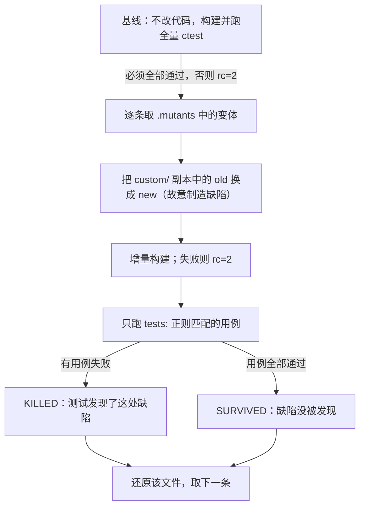
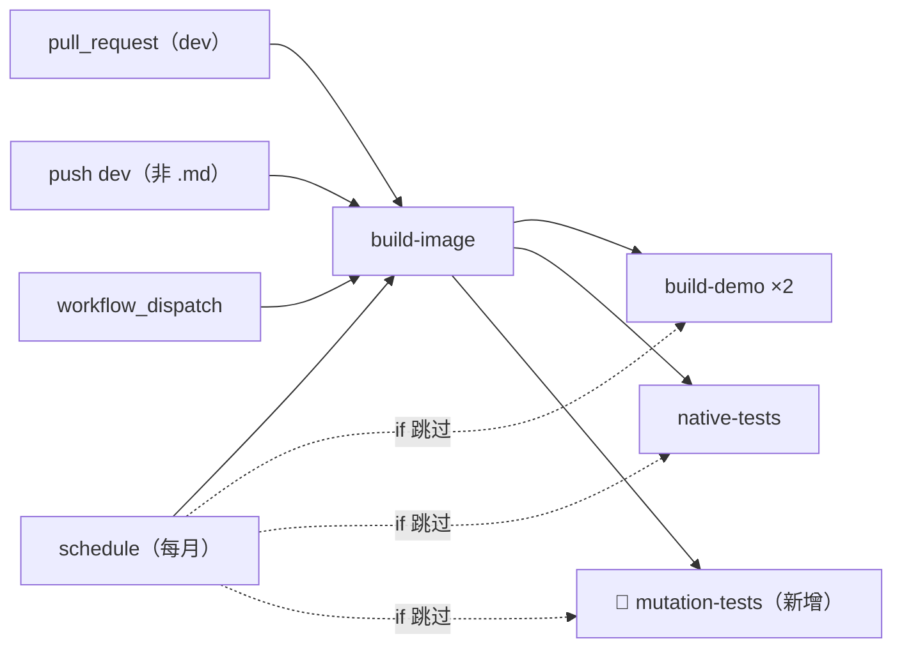

# Luckfox Pico LVGL Example — CI 变体检验设计规格

- **日期**：2026-10-16
- **状态**：已落地；CI 首次运行发现测试依赖目录读取顺序（§2.4），按 Q12、Q13 扩大范围；作者又要求输出显示进度，按 Q14、Q15 改 `mutate.sh`；§7 QA 结论均按推荐执行（Q7 不上传 artifact），验证证据见 plan
- **分支**：`pi/ci-mutation`（起点 `origin/dev` `1615931`，即 PR #11 合入）；PR #12
- **范围来源**：PR #10 plan [`2026-10-10-lvgl-example-board-test-followups.md`](../plans/2026-10-10-lvgl-example-board-test-followups.md) §6.5「CI 增加变体检验」
- **关联计划**：[`../plans/2026-10-16-lvgl-example-ci-mutation.md`](../plans/2026-10-16-lvgl-example-ci-mutation.md)

---

## 1. 概述与目标

`tests/tools/mutate.sh`（改坏检验）逐条应用 `tests/cases/*/*.mutants` 中的变体，确认对应测试失败。它目前只在本地执行：PR #8、PR #10 每个修复 Task 都跑过，但 CI 不跑，测试或清单改坏后要等下一次有人在本地全量运行才会发现。

目标：

1. workflow 新增一个 job，在每次 `pull_request` 推送与 `dev` push 时全量运行 `mutate.sh`，按退出码判定，另把 `SKIPPED` 视为失败（§3.3）；失败时按类型打印相关日志（§3.4）。
2. 音乐页测试读取目录的顺序与文件系统无关（§2.4、§3.10）：CI 首次运行时 `MUSIC-N6-list-unsorted` 在 runner 上存活，本机却被杀死。新增变体 `MUSIC-N6-list-prepend`，共 120 个。
3. `mutate.sh` 只加进度输出（逐条结果行前加 `[序号/总数]`，基线通过后打印一行开始提示，§3.11），判定逻辑与退出码不变；不改 `.cursor/Dockerfile`（§3.6）；测试只改音乐源码的目录读取（`tests/support/fake_fs.[ch]`、`tests/CMakeLists.txt`、`unit_list_alloc.c`）与 `list.mutants`。
4. `AGENTS.md` 与 `tests/README.md` 写明 CI 中的变体检验与目录读取顺序；PR #10 plan §6.5 与 PR #11 已完成的 §6.1 只留状态行与链接，标题不动（§3.8、Q16、Q17）。
5. 在 runner 上实测耗时与稳定性，并用探针确认存活变体、清单错误与 `SKIPPED` 都会让 job 失败（§4）。

**不在本规格范围**：逐提交测试进 CI（Q4）；分片（Q3）；设为必需检查（Q11，仓库设置，由作者决定）；上传 artifact（Q7）。

## 2. 背景

### 2.1 现有 CI

`.github/workflows/build-luckfox-lvgl-demo.yml` 有三个 job：

| job | 作用 | 依赖 | `schedule` 时 |
|---|---|---|---|
| `build-image` | 复用或构建 CI 镜像（标签取 `.cursor/Dockerfile` 内容哈希），`pull_request` 只复用 dev 签名镜像 | — | 强制重建 |
| `build-demo` | glibc、uClibc 两条交叉编译 | `build-image` | 跳过 |
| `native-tests` | 构建 `tests/` 并跑全量 `ctest`，`-DLUCKFOX_TESTS_ARM32=ON` | `build-image` | 跳过 |

触发：`pull_request`（`dev`）、`push`（`dev`，`paths-ignore: '**.md'`）、`schedule`（每月 1 日）、`workflow_dispatch`。并发组含 `github.ref` 与 `github.event_name`，同组新运行取消旧运行。`dev` 的 ruleset 只有 `deletion` 与 `non_fast_forward`，没有必需检查（2026-10-16 用 `gh api repos/…/rules/branches/dev` 查得）。PR #11 最后 6 次 CI 运行每次约 1.5 分钟。

### 2.2 `mutate.sh` 的原理与用法

变体检验检验的是「测试能不能发现缺陷」，不是代码本身对不对：故意把产品代码改坏一处，期望对应测试**失败**。



「成功」与「失败」分两层：

| 层次 | 期望 | 含义 |
|---|---|---|
| 基线 `ctest`（未改代码） | 全部通过 | 不通过时 rc=2：测试本身就坏了，变体结果没有意义 |
| 每个变体对应的 `ctest` | 失败（`KILLED`） | 测试发现了故意制造的缺陷 |
| `mutate.sh` 退出码 | 0 | 全部 `KILLED`；有一个 `SURVIVED` 即 1；工具或清单错误为 2（基线不绿、构建失败、清单不合法、id 不存在、一个变体都没跑等） |
| CI job（§3.3） | rc=0 且 `0 skipped` 时通过 | 否则失败 |

以 `MUSIC-N6-list-unsorted` 为例：它把排序插入中的 `if (strcmp(filename, pos->filename) < 0) break;` 改成 `if (0) break;`，即不再按名字找插入位置。`music.list.*` 应当失败；CI 首次运行时 4 条用例全部通过，所以 `SURVIVED`（原因见 §2.4）。

用法：

```bash
tests/tools/mutate.sh                          # 全量
tests/tools/mutate.sh MUSIC-N6-list-unsorted   # 只跑指定 id，可写多个；用于本地复现
MUTATE_WORK=/tmp/m2 tests/tools/mutate.sh      # 换工作目录（并发运行时必须）
```

输出（§3.11）：

```text
baseline green: 117 tests; running 120 mutants
[  1/120] [EXIT-17a] KILLED by: exit.fb_clear.enospc_silent (Failed)
…
[ 35/120] [MUSIC-N6-list-unsorted] SURVIVED
…
120 run, 0 skipped
```

其他行为：

- 把 `custom/` 复制到 `$MUTATE_WORK/src`（默认 `/tmp/luckfox-mutate`），其余目录链接回仓库，以 `-DLUCKFOX_ROOT` 配置测试工程，不改动工作区。
- 清单每条记录有 `id`、`file`（须在 `custom/` 下）、`old`（须恰好出现一次）、`new`、`tests` 五行，记录间空一行，详见 `tests/README.md`「改坏检验」；用 `python3` 解析，只用 `glob`、`os`、`re`、`sys`。
- `tests:` 正则匹配不到已注册用例时，该变体标为 `SKIPPED`、不应用，不影响退出码，结尾汇总 `N run, M skipped`。
- 配置测试工程时不传 `LUCKFOX_TESTS_ARM32`，取默认 `AUTO`：缺 `qemu-arm` 或 `arm-linux-gnueabihf-gcc` 时不注册 32 位用例。
- 每个变体在 `$MUTATE_WORK` 下留 `<id>.build.log`（增量构建输出）与 `<id>.log`（该变体的 `ctest` 输出）；基线输出在 `baseline.log`，`ctest` 不带 `--output-on-failure`，断言细节只在 `build/Testing/Temporary/LastTest.log` 中，且按完成顺序排列。

读 CI 日志时注意：Actions 会先把 `run:` 脚本原文以青色回显，其中的 `grep -Eq '^[0-9]+ run, 0 skipped$'` 等是代码，不是输出；`mutate.sh` 的输出是开始提示、`[序号/总数] [id] KILLED by: …`、`[序号/总数] [id] SURVIVED` 等逐条结果与末行 `N run, M skipped`，判定结果是 `##[error]` 一行。

### 2.3 实测

命令与脚本见 plan 附录 A。除注明的行外，均为 2026-10-16 在 `origin/dev` `1615931` 上测得。

| 项 | 环境 | 结果 |
|---|---|---|
| 变体数 | — | 119（`grep -h -c '^id:' tests/cases/*/*.mutants` 求和）；本 PR 加 1 条后为 120 |
| CI 镜像中的 Python | dev 签名镜像 `luckfox-lvgl-demo-ci:e8e7beed514d3e974b61dea2c4bcae84`（`sha256:6248164be14053ba34ac4eb83ca01f1d11b6a854fccbf869295d849dfeb31d3b`） | 有 `python3`、`python3.12`，不只是 `python3-minimal`；由 `iotop`（`Depends: python3`）与 `libsdl2-dev` 的依赖链（`libglib2.0-dev`、`libglib2.0-dev-bin` 的 `Depends: python3:any`）带入，Dockerfile 没有显式写（`apt-cache depends`、`dpkg -s`）；`import glob, os, re, sys` 成功 |
| 全量 `mutate.sh`，CI 镜像 | 本机 docker，`--user 0`、`--cpuset-cpus 0-3`（`nproc`=4） | rc=0，`119 run, 0 skipped`，514 s |
| 全量 `mutate.sh`，本机 | 8 核，PR #10 plan 附录 C.2 的命令 | rc=0，`119 run, 0 skipped`，365 s |
| 基线开销，CI 镜像 | 同上 4 核 | 配置与构建 11 s，全量 `ctest` 23 s（117 条） |
| `MUTATE_WORK` 体积 | 本机全量后 | 418 MB，239 个日志 |
| 首次 CI（本 PR 的 workflow 加 `1615931` 的测试，2026-10-17） | runner `ubuntu-24.04`，2 次（第 2 次为 `gh run rerun --job`） | 均为 `[MUSIC-N6-list-unsorted] SURVIVED`、`119 run, 0 skipped`、rc=1；运行步骤 11 分 42 秒、11 分 32 秒，job 12 分 02 秒、12 分 05 秒 |
| 修复后 CI（§3.10，2026-10-17） | 同上，3 次（后 2 次为 `gh run rerun --job`） | 均通过、`120 run, 0 skipped`；运行步骤 10 分 10 秒、11 分 41 秒、9 分 18 秒，job 10 分 42 秒、12 分 12 秒、9 分 52 秒 |
| 最终代码的 CI（含 §3.11 的进度输出，2026-10-17） | 同上，1 次 | 通过、`baseline green: 117 tests; running 120 mutants`、`[  1/120]`–`[120/120]`、`120 run, 0 skipped`；运行步骤 11 分 41 秒，job 12 分 11 秒 |

GitHub 托管 runner 的 `ubuntu-24.04` 对公开仓库为 4 核、16 GB 内存、14 GB SSD（GitHub 文档 *GitHub-hosted runners reference*）。

本机 docker 的存储驱动是 fuse-overlayfs，容器内 `/tmp` 的文件名上限（`getconf NAME_MAX`）为 251：`music.mpv_cmd.escaping_and_length` 用 255 字节的文件名，报 `File name too long`；`music.list.options_over_255` 也失败（12 个 200 字节文件名中有 2 个没进列表，原因未深究）；基线不绿、rc=2。把 `/tmp` 绑定到宿主 ext4（255）后正常。GitHub runner 使用 overlay2（ext4），不受影响；该现象只影响本机复现，`ci-local.sh`（plan 附录 A.2）已绑定 `/tmp`。

### 2.4 目录读取顺序与文件系统哈希种子

`custom_musicplayer.c` 按 `readdir` 返回的顺序，把文件逐个插入按文件名排序的环形链表（PR #10 spec Q33）。`music.list.sorted_by_name` 按 03、01、04、02 的顺序建文件，再检查列表是否为 01–04。N6 的变体破坏排序，能否被杀死，取决于 `readdir` 的顺序本身：读到的若恰是升序，不排序也能得到正确结果。

`readdir` 的顺序由文件系统决定：

- **ext4**（开启 `dir_index`）：按「文件名哈希 + 超级块中的目录哈希种子」排列，单块的小目录也是如此。种子在 `mkfs` 时随机生成（`dumpe2fs -h` 的 `Directory Hash Seed`），所以同一个文件系统上顺序固定，换一个文件系统就可能不同。
- **tmpfs**：与名字无关，随内核版本按创建顺序或其逆序返回。
- **overlayfs、fuse-overlayfs**：新建的目录只在上层，顺序同上层文件系统。

实测（建文件顺序 03、01、04、02，`ls -U`）：

| 环境 | 读取顺序 | 是否升序 |
|---|---|---|
| 本机 `/tmp`（ext4 `/dev/vdc`，`half_md4`，种子 `00000000-0000-0000-0000-000000000004`） | 04、02、01、03 | 否 |
| 本机 docker 容器 `/tmp`（fuse-overlayfs，叠在同一 ext4 上） | 同上 | 否 |
| 64 MiB loop 镜像，`mkfs.ext4 -E hash_seed=<随机>`，第 21 次（`e5bb29e1-580e-4076-be76-fc95834b43b9`） | 01、02、03、04 | 是 |
| 同上，另一组随机种子的第 21 次（`647e99ee-211c-4cd6-bb4a-a5143255677c`） | 04、03、02、01 | 否（降序） |
| 本机 tmpfs `/dev/shm`（内核 6.12.94+） | 02、04、01、03（创建顺序的逆序） | 否 |
| runner | 未直接观测 | `sorted_by_name` 的读取顺序让 `list-unsorted` 碰巧排出升序 |

本机的种子是固定值，像是 VM 镜像自带的，所以 PR #8、#10 在本机每次都是 `KILLED`，靠的是种子碰巧有利。把 `TMPDIR` 指向上面两个 loop 镜像（`fake_fs.c` 的临时目录取 `TMPDIR`），在修复前跑 N6 的 5 个变体（含本 PR 新增的 `list-prepend`）：

| 文件系统 | 存活 |
|---|---|
| 本机默认 | 无 |
| 升序种子 | `list-unsorted`、`head-not-updated`、`stale-id`、`sig-unsorted` |
| 降序种子 | `list-unsorted`、`list-prepend` |

升序种子上全量 119 个变体只有前 4 个存活，其余 115 个 `KILLED`，所以受影响的只有 N6。`custom_main.c`（SDIO 判定）、`custom_brightness.c`（背光目录）也用 `readdir`，它们的变体在这个文件系统上都被杀死；只验证了这一个种子。

`list-unsorted` 在降序时也存活：它把新节点放到末尾，但比头结点小时仍会成为新的头结点，降序输入下每个新节点都比头小，恰好排出升序。`list-prepend` 总是插到开头，降序输入下同样排出升序。所以固定成升序或降序都不够，要用「非单调」的顺序（§3.10）。

## 3. 设计（以 §7 QA 结论为准）

### 3.1 触发与依赖（Q1、Q2、Q10）

新 job `mutation-tests`（显示名 `🧬 变体检验`）与 `native-tests` 相同：`needs: build-image`，`if: github.event_name != 'schedule'`，即 `pull_request`、`push dev`、`workflow_dispatch` 都运行，与 `native-tests`、`build-demo` 并行。只改文档的 PR 也运行，不加路径过滤。



### 3.2 job 定义

- 容器：`needs.build-image.outputs.image`，凭据与 `--user 0` 与 `native-tests` 相同；`permissions` 为 `contents: read`、`packages: read`；`runs-on: ubuntu-24.04`。
- 步骤：检出本仓（`persist-credentials: false`）；运行 `tests/tools/mutate.sh`，输出经 `tee` 存到 `/tmp/mutate.out`，供 §3.3 的判定与 §3.4 识别失败类型；失败时打印日志（§3.4）。
- `MUTATE_WORK`、`MUTATE_OUT` 在 job 级 `env` 写成字面量 `/tmp/luckfox-mutate`、`/tmp/mutate.out`：位于检出目录之外，满足 `mutate.sh` 对工作目录的限制。不用 `${{ runner.temp }}`：容器 job 中该表达式给出的是宿主路径。

### 3.3 判定（Q6）

1. `mutate.sh` 退出码非 0 时，以同一退出码失败，并用 `::error::` 写明含义（1 有变体存活，2 工具或清单错误）。
2. 退出码为 0 时，输出中须有 `^[0-9]+ run, 0 skipped$`，否则失败并列出 `SKIPPED` 行。

第 2 条的依据：CI 镜像有 `qemu-arm` 与 `arm-linux-gnueabihf-gcc`，全部用例都会注册，此时出现 `SKIPPED` 只能是清单的 `tests:` 正则一个用例都没匹配到（写错、用例改名或删除）。这类错误 `mutate.sh` 在本地与 CI 都不报，变体实际没有运行。

32 位工具缺失不靠这条发现：只依赖 32 位用例的变体只有 `M12`（`^main\.brightness_arm32\.`）；`MAIN-13a/b` 的 `^main\.tick\.` 同时匹配主机用例，缺工具时不会 `SKIPPED`，只是少了 32 位覆盖。同一次运行中的 `native-tests` 以 `-DLUCKFOX_TESTS_ARM32=ON` 构建，缺工具时配置即失败，整条 CI 报红。

### 3.4 失败时的日志（Q7、Q13）

`mutate.sh` 每个变体只打印一行，这些行与错误提示本来就进 job 日志；详细输出只在 `$MUTATE_WORK` 的文件里。新增一步 `if: failure()`，按失败类型补打印，每类一个折叠组（`::group::`）：

| 失败类型 | job 日志已有 | 补打印 |
|---|---|---|
| 变体存活（rc=1） | `[n/N] [id] SURVIVED` | 每个存活的 id：清单中的完整记录（含前面的注释，即改了什么）、`<id>.log`（跑了哪些用例、全部通过）与本地复现命令 `tests/tools/mutate.sh <id>`（Q13） |
| 基线不绿（rc=2） | `baseline not green, see …` | `ctest --rerun-failed --output-on-failure` 重跑基线失败的用例，取末尾 200 行 |
| 变体编译失败（rc=2） | `[n/N] [id] BUILD FAILED, see …` | 该 id 的 `<id>.build.log` 末尾 200 行 |
| 清单错误（rc=2）、`SKIPPED` | 错误原因、`SKIPPED` 行 | 一行「没有可补充的日志：错误原因见上一步输出」，避免步骤空白 |

基线失败时不打印 `LastTest.log`：本机探针显示它按完成顺序排列，末尾 200 行落在后完成的通过用例上，看不到失败断言（plan §4）。

不上传 artifact（作者决定）。`tee` 的文件只供本 job 读取，不上传。

### 3.5 超时与分片（Q3）

单个 job，不分片，`timeout-minutes: 30`，与其他 job 相同。runner 上运行步骤 9 分 18 秒至 11 分 42 秒（§2.3，6 次），低于再议分片的 15 分钟，最长约为上限的四成。分片要么在 workflow 中重复解析清单 id，要么给 `mutate.sh` 加分片参数，每片还要重复约 35 s 的基线与镜像拉取。

### 3.6 镜像与 Python（Q5）

不改 `.cursor/Dockerfile`：镜像已有完整 `python3`（§2.3），`mutate.sh` 在镜像内实测 rc=0。改 Dockerfile 会改变镜像标签，本 PR 合并前 `build-image` 必然失败（`AGENTS.md`）。

风险：`python3` 由 `iotop` 与 `libsdl2-dev` 的依赖链间接带入，Dockerfile 没有显式写。两者都去掉时 `python3` 才会消失，届时 `native-tests`（`fake_mpv.py` 以 `/usr/bin/python3` 运行）与 `mutate.sh`（rc=2，`mutants list failed`）都会报错，不会静默；以后改 Dockerfile 时一并显式加上 `python3`。

### 3.7 必需检查（Q11）

本 PR 不设。作者以后要设时：在 `dev` 的 ruleset 加状态检查 `🧬 变体检验`；被 job 级 `if` 跳过的 job 视为成功（GitHub 文档 *Using conditions to control job execution*），被 workflow 级路径过滤跳过时检查一直 Pending（*Troubleshooting required status checks*），这也是 Q10 不在 `pull_request` 上加 `paths-ignore` 的原因之一。

### 3.8 文档

- `AGENTS.md`「GitHub Actions（交叉编译门禁）」：补一条，说明 `mutation-tests` 的触发、判定、失败日志与耗时，逐提交测试仍在本地，不附 spec 链接（Q18）；`--user 0` 一句加上 `mutation-tests`。
- `tests/README.md`：「改坏检验」补一句，CI 每次全量运行，出现 `SKIPPED` 即失败；另补一句输出格式（§3.11）；「注意」补一句音乐源码的目录读取顺序（§3.10）。
- PR #10 plan §6.5：标题不动，正文只留一行状态，链接本 spec 与 PR #10 合并时（`85a6dd48264938b267fc0e4ecd458f6ac14f0530`）的原文：PR #10 正文引用了 §6.5 的锚点（理由同 PR #11 spec §3.7）；原文中的待定问题本 spec 均已回答，「CI 镜像只有 `python3-minimal`」「约 25 行」等说法已不成立，留着容易误读（Q16）。
- PR #10 plan §6.1（PR #11 已完成）：按同样格式精简，状态行指向 PR #11 的 spec 与同一原文；PR #11 spec、plan 中描述 §6.1 原文的地方（56 处统计、两个特例、「Task 1–5」与「附录 A1」的例外）可经原文链接查看；PR #11 的 `restore-check.py` 是在 `85a6dd4` 上做的一次性验证，精简后不再能对以后的 `dev` 复现，当时的结论不变（Q17）。

### 3.9 不做的事

- 逐提交测试进 CI（Q4）：中途提交最终会被 rebase 整理，跑了没有意义；耗时随提交数增长（PR #10 的 19 个提交在 8 核上约 7.6 分钟）。仍按 PR #10 plan 附录 C.3 在本地执行。
- 改 `mutate.sh` 的判定：`SKIPPED` 的判定放在 workflow 中（Q6），本地退出码不变；`mutate.sh` 只加进度输出（§3.11）。
- 修改用例的等待方式：PR #10 已把 `wifi.scan_trigger` 改为按 LVGL tick 等待；其余调用 `tst_run_ms()` 的用例若在 runner 上偶发失败，再按 systematic-debugging 定位后另议（Q8）。
- 产品代码：`custom/` 不改；读取顺序只在测试构建中固定。

### 3.10 固定音乐目录的读取顺序（Q12）

- `tests/CMakeLists.txt` 给 `custom/custom_musicplayer.c` 的源文件 `COMPILE_DEFINITIONS` 加 `readdir=tst_readdir;closedir=tst_closedir`，与 `MUSIC_DIR_PATH` 的覆盖方式相同；`unit_list_alloc.c` 在 `#include "custom_musicplayer.c"` 前用 `#define` 做相同覆盖。只影响音乐源码，`custom_main.c`、`custom_brightness.c` 仍用真实的 `readdir`。
- `tests/support/fake_fs.c` 提供 `tst_readdir()`：某个 `DIR` 第一次调用时用真实 `readdir` 读出全部条目，按文件名排序后以固定顺序逐个返回：「.」「..」在前，其余把后半与前半交错，如 01 02 03 04 → 03 01 04 02（恰为 `sorted_by_name` 的建文件顺序）。`tst_closedir()` 释放后调用真实 `closedir`。同时打开的目录最多 4 个，超出即退出码 2。
- 交错顺序对 3 项及以上非单调：「总是追加」得到 03 01 04 02，「总是插到开头」得到 02 04 01 03，都不是升序。2 项时为 02 01，「总是插到开头」会排出升序；依赖排序的两条用例（`music.list.sorted_by_name`、`music.reenter.sorted_keeps_playlist`）都是 4 项。
- `fake_fs.h` 加 `#include <dirent.h>` 与两个原型；`fake_fs.h` 本来就以 `-include` 进入音乐、WiFi、亮度、清屏源码，多包含一个系统头不改变它们的行为。
- `list.mutants` 新增 `MUSIC-N6-list-prepend`（循环一开始就 `break`、头结点无条件更新，即总是插到开头）：降序读取时存活（§2.4），用来守住「非单调」这一点。
- 测试函数与断言不改；条目内容（含 `d_type`）照抄真实 `readdir`。

### 3.11 输出显示进度（Q14、Q15）

- 基线通过后，先按与主循环相同的筛选数出本次要处理的变体数 N（指定 id 时为指定的个数），打印 `baseline green: <用例数> tests; running <N> mutants`；用例数取自 `baseline.log` 末尾的 `… tests failed out of <数>`。
- 逐条结果行（`KILLED`、`SURVIVED`、`SKIPPED`、`BUILD FAILED`、`cannot apply mutant`、`file must be under custom/`）都以 `[序号/总数] [id]` 开头，序号左侧补空格到总数的位数，如 `[  1/120]`、`[ 37/120]`；末行 `N run, M skipped` 与退出码不变。
- 不打印单条耗时：Actions 日志每行带时间戳，本地需要时可用 `ts` 等工具加。
- workflow 失败步骤识别 `SURVIVED`、`BUILD FAILED` 的正则同步为 `^\[ *[0-9]+/[0-9]+\] \[<id>\] …`；PR #10 plan 附录 C.2 的 `grep -c KILLED`、`grep SURVIVED` 不受影响。

## 4. 验证

1. **语法**：`actionlint`（含 ShellCheck）检查 workflow 为 0 条（按需安装，不入库）。
2. **本地**：全量 `ctest`（含 arm32）通过，在本机默认、升序种子、降序种子三个文件系统上都通过；N6 的 5 个变体在三个文件系统上都 `KILLED`；全量 `mutate.sh` 在本机默认与升序种子文件系统上 rc=0；`screenshots`、`preview` 能构建。
3. **CI 镜像复现**：`ci-local.sh`（plan 附录 A.2）在 CI 镜像中按 workflow 原文运行两个步骤，限 4 核：正常源码 rc=0；五个探针（附录 A.4）的结果与 §3.3、§3.4 一致。
4. **CI 实测**：修复后在 PR 上运行 3 次（首次加 `gh run rerun --job` 2 次），全部通过、`120 run, 0 skipped`，记下每次耗时（Q8）。
5. **失败探针**（Q9）：从 PR 分支建临时分支，各加一个探针提交，用 `gh workflow run --ref` 触发，确认 job 失败且日志符合 §3.4，验证后删除分支：
   - 存活：新增一条只改注释的变体，期望 rc=1、`[id] SURVIVED`，失败步骤打印该记录与复现命令。
   - 清单错误：删掉一条记录的 `tests:` 行，期望 rc=2、`record missing tests`。
   - `SKIPPED`：把一条记录的 `tests:` 改成匹配不到用例的正则，期望 rc=0 但判定失败。
   - 基线不绿、变体编译失败两个探针只在本机用 `ci-local.sh` 验证。
   - 进度输出（Q14、Q15）：本机全量与指定 id 两种运行的序号与总数正确；`ci-local.sh` 的存活、编译失败探针中，失败步骤仍能识别出 id；推送后 CI 再运行一次。
6. **文档**：spec 与 plan 用 PR #11 plan 附录 A.1 的 `check-headings.py` 检查（不入库）；spec 的 Mermaid 图做语法校验；数字与描述改动范围的说法（「只」「不变」「均」）在定稿时统一复核。

## 5. 提交与 PR

- 分支 `pi/ci-mutation`，PR #12 指向 `dev`：开发时为草稿，合并前改为 ready；执行者不合并。
- 先推送 spec 与 plan，实现完成后用 `git rebase` 整理为：
  1. `test(tests): ✅ 固定音乐目录的 readdir 顺序`：`tests/support/fake_fs.[ch]`、`tests/CMakeLists.txt`、`unit_list_alloc.c`、`list.mutants` 与 `tests/README.md`「注意」。放在最前，使后面每个提交在 runner 上都能通过。
  2. `dx(tests): 🧑‍💻 改坏检验输出显示进度`：`tests/tools/mutate.sh` 与 `tests/README.md`「改坏检验」中输出格式一句。放在 workflow 之前，workflow 引入时即为新格式。
  3. `ci(github-actions): 👷 新增变体检验 job`：只改 workflow。
  4. `docs(agents): 📝 写明 CI 的变体检验`：`AGENTS.md` 与 `tests/README.md`「改坏检验」。
  5. `docs(superpowers): 📝 新增 CI 变体检验 spec 与 plan`：本 spec 与 plan，以及 PR #10 plan §6.1、§6.5 的精简。
- PR 标题与第 3 个提交相同：`ci(github-actions): 👷 新增变体检验 job`。提交说明写原因，以「详见 spec §…、Q…」结尾；不带 `Co-authored-by`。

## 6. 风险

- **PR 的 CI 墙钟变长**：由约 1.5 分钟变为变体检验 job 的耗时（runner 上 9 分 52 秒至 12 分 12 秒，§2.3）。新推送会取消旧运行，不会排队。
- **偶发失败**：变体检验把测试重复运行一百多次，按真实时间等待的用例在负载下可能偶发失败。基线偶发失败表现为 rc=2（误报）；变体运行中偶发失败会被误判为 `KILLED`，掩盖存活的变体，CI 不报红。§4 第 4 条用 3 次运行检查前者；后者无法从一次运行中看出，本地开发时仍按 PR #10 的做法逐个确认修复前失败。
- **其他与环境有关的杀死**：§2.4 只查了目录读取顺序，且只用了两个种子；其他环境差异（时区、locale、内核行为）若让某个变体只在部分机器上被杀死，CI 会像这次一样报出，届时按同样方法定位。
- **测试中的读取顺序与真机不同**：`tst_readdir` 只改变顺序，不改变条目；产品代码对任意顺序都应排出升序，这正是 N6 测试要守住的性质。
- **`python3` 间接依赖**：见 §3.6。
- **runner 资源**：`MUTATE_WORK` 约 418 MB，runner SSD 14 GB；内存 16 GB，`ctest -j4` 下 ASan 进程的内存远低于此。

## 7. QA（grilling 记录）

问句与推荐取自问答原文；「答」是作者回答经润色后的版本，意思与原回答一致。收尾前本节有 Q1–Q21：Q1–Q18 与会话中的编号相同，Q19–Q21 是 PR 改为 ready 后的 3 个问题，会话中未编号，由执行者补记。与提交拆分、提交位置有关的 3 条（原 Q10、Q14、Q18）在收尾时删去，内容已在 git 中（Q19），其余按原顺序重新编号：原 Q1–Q9 即本节 Q1–Q9，原 Q11–Q13 为 Q10–Q12，原 Q15–Q17 为 Q13–Q15，原 Q19–Q21 为 Q16–Q18；收尾时会话中的 Q22–Q24 合记为 Q19、Q20。第 1 轮为 Q1–Q9（会话中还有一条提交拆分）。作者先追问 Q6、Q7、Q8 的细节，执行者据此修正了 Q6 的理由与 Q7 的推荐（见各条「补充」），作者随后回答「artifact 暂不上传，其他全部遵循推荐」。第 2 轮为 Q10、Q11，作者回答「全部遵循推荐」。第 3 轮 Q12 由 CI 首次运行的结果引出（§2.4）；作者追问「本机默认文件系统是否有读取顺序的依赖」，又就 CI 日志追问「为什么匹配 0 skipped 时 job 失败、`mutate.sh` 应该全部失败还是成功」与「失败步骤为什么是空的」，前者的解答记入 §2.2，后者引出 Q13；作者回答「全部遵循推荐」，并要求把两处解释写入文档（§2.2、§2.4）。第 4 轮 Q14、Q15 由合并前自查后作者提出的「变体检验的输出加序号显示进度」引出，作者回答「全部遵循推荐」。Q16、Q17 是 PR 改为 ready 后作者的提问，执行者给出建议，作者同意，并要求链接文字用文档名、提交写完整哈希。Q18 为作者要求联网核对 AGENTS.md 的写法后，执行者按结论处理。Q19、Q20 是收尾时作者提出精简 QA 后的确认，作者回答「全部遵循推荐」。

**Q1. 触发时机**

- 问：A 与 `native-tests` 相同，`pull_request` 每次推送与 `push dev` 都运行，`schedule` 跳过；B 只在 `push dev` 运行；C 只由 `workflow_dispatch` 或 label 触发。
- 推荐：A。变体检验的价值在合并前发现测试漏洞（改了 `custom/` 或 `.mutants` 后变体存活），B 等于事后补救，C 要人记得去点。
- 答：按推荐。

**Q2. job 依赖**

- 问：A 只 `needs: build-image`，与 `native-tests` 并行；B `needs: [build-image, native-tests]`，原生测试失败时省下这一轮。
- 推荐：A。`mutate.sh` 的基线本身就跑全量 `ctest`，失败时 rc=2；串行会让墙钟再多约 1.5 分钟；公开仓库托管 runner 不计费。
- 答：按推荐。

**Q3. 分片与超时**

- 问：本机限 4 核实测 514 s，runner 预计 9–13 分钟。是否按变体分片成 matrix？`timeout-minutes` 取多少？
- 推荐：先单个 job、不分片，`timeout-minutes: 30`；runner 实测超过 15 分钟再议分片。分片要重复解析清单或改 `mutate.sh`，每片还要重复约 35 s 的基线与镜像拉取。
- 答：按推荐。runner 实测运行步骤 9–12 分钟（§2.3），不分片。

**Q4. 逐提交测试是否进 CI**

- 问：PR #10 附录 C.3 的 `percommit.sh` 在 19 个提交上约 7.6 分钟（8 核），随提交数增长，4 核预计 15 分钟以上。
- 推荐：不进 CI。中途的提交最终会被 rebase 整理，跑了没有意义；留在本地按附录 C.3 执行。
- 答：按推荐。

**Q5. 是否修改 `.cursor/Dockerfile`**

- 问：镜像的 `python3` 是 `iotop` 间接带入的；显式加上会改变镜像标签，本 PR 合并前 `build-image` 必然失败。
- 推荐：本 PR 不改，在 spec 中记下间接依赖，以后改 Dockerfile 时一并加上。去掉 `iotop` 时 `native-tests` 与 `mutate.sh` 都会报错，不会静默。
- 答：按推荐。
- 补充（收尾核对时）：问句写的「由 `iotop` 带入」不完整，`libsdl2-dev` 的依赖链（`libglib2.0-dev`、`libglib2.0-dev-bin`）同样硬依赖 `python3`，只去掉 `iotop` 时 `python3` 仍在；结论不变（§2.3、§3.6）。

**Q6. 32 位变体被静默跳过的防护**

- 问：`mutate.sh` 配置时不传 `-DLUCKFOX_TESTS_ARM32`，缺工具时 32 位用例不注册，对应变体 `SKIPPED`，退出码仍为 0。A 在 workflow 中断言输出含 `, 0 skipped`；B 给 `mutate.sh` 加 CMake 参数透传；C 不防护。
- 推荐：A，不改 `mutate.sh`。
- 补充（作者追问「断言会不会让变体不被跳过」后）：断言不会让变体运行，只会把静默跳过变成失败。只依赖 32 位用例的变体只有 `M12`；`MAIN-13a/b` 同时匹配主机用例，缺工具时不会 `SKIPPED`，断言查不出。32 位工具缺失由同一次运行中带 `-DLUCKFOX_TESTS_ARM32=ON` 的 `native-tests` 发现。断言的实际作用：CI 镜像工具齐全，出现 `SKIPPED` 只能是 `tests:` 正则写错或用例改名、删除，这类错误目前本地与 CI 都不报。推荐仍为 A，理由改为此。
- 答：按修正后的推荐（§3.3）。

**Q7. 失败时的日志**

- 问：job 日志里只有每个变体一行，详细输出在 `$MUTATE_WORK` 的文件里。
- 推荐：失败时上传 `*.log` 与 `mutants.list` 作为 artifact，保留 7 天。
- 补充（作者追问「不上传时 `tee` 能否看到输出」后）：`tee` 不影响 job 日志，不加也能看到每个变体一行与错误提示；看不到的是基线失败的用例输出与编译错误原文。修正推荐：失败时按类型把相关日志末尾 200 行打印到 job 日志，另上传 artifact 作备份。
- 答：artifact 暂不上传，只打印（§3.4）。存活时打印什么后来由 Q13 改定。
- 执行注记：修正推荐中说「去掉 `tee`」，但 Q6 的判定要读取 `N run, M skipped` 一行，§3.4 也要按输出识别失败类型，所以仍用 `tee` 存一份到 `/tmp/mutate.out`，只供本 job 读取，不上传。

**Q8. runner 上的稳定性**

- 问：怎样确认 runner 上没有偶发失败？
- 推荐：PR 上首次运行后再用 `gh run rerun --job` 重跑 2 次，共 3 次全部 rc=0、`119 run, 0 skipped`；本机 4 核容器再补跑 1 次。
- 补充（作者追问「偶发失败是否由 runner 导致」后）：根源在测试写法。`tst_run_ms()` 按循环次数计时，LVGL tick 取自 `CLOCK_MONOTONIC`，CPU 忙时名义等待短于实际经过的时间，定时器提前到期；PR #10 plan §5 在本机 8 核加 12 个空转进程时复现过（`wifi.scan_trigger` 旧写法 5 轮失败 3 轮），已改为按 tick 等待。runner 核少、与其他租户共享宿主，只是更容易触发。仍调用 `tst_run_ms()` 的还有 9 个测试文件，未逐一确认是否依赖精确时序。
- 答：按推荐。Q12 后变体为 120 个，判据随之为 `120 run, 0 skipped`。

**Q9. 怎样验证 job 确实会失败**

- 问：A 从 PR 分支建临时分支加探针提交，用 `workflow_dispatch --ref` 触发，验证后删除；B 把探针提交推到 PR 分支，验证后 force-push 去掉。
- 推荐：A，PR 历史保持干净；存活与清单错误各一个分支，可并行触发。
- 答：按推荐。
- 执行注记：另加一个 `SKIPPED` 探针，验证 §3.3 第 2 条；Q13 后在本机另加基线不绿、变体编译失败两个探针，只用 `ci-local.sh` 验证（§4）。「删掉一条清单」按删掉记录中的一行（`tests:`）执行：删掉整条记录只会让变体变少，`mutate.sh` 与 CI 都无从发现，属于代码审查的范围。

**Q10. 只改文档的 PR 是否跳过**

- 问：`pull_request` 没有路径过滤，只改文档的 PR 每次推送也要跑变体检验。A 不跳过；B job 级 `if` 加改动文件判断；C `pull_request` 加 `paths-ignore: '**.md'`，整条 workflow 不跑，以后设必需检查时会一直 Pending。
- 推荐：A，与 `build-demo`、`native-tests` 一致；只改文档的 PR 不多，代价只是多等几分钟；B 要新增 job，复杂度明显上升。
- 答：按推荐。

**Q11. 是否设为必需检查**

- 问：`dev` 的 ruleset 没有必需检查，合并门槛由作者人工确认 CI 通过；必需检查是仓库设置，不在 PR 的改动内。
- 推荐：本 PR 不设，在 spec 中写明设置方法与注意事项（§3.7）。
- 答：按推荐。

**Q12. 怎样消除对目录读取顺序的依赖**

- 问：CI 首次运行 `MUSIC-N6-list-unsorted` 存活、本机被杀死，根因是 ext4 的读取顺序取决于哈希种子（§2.4）。A 测试中固定 `readdir` 顺序：音乐源码以 `readdir=tst_readdir` 编译，`tst_readdir()` 读出真实条目后按固定的非单调顺序返回，在任何文件系统上结果都相同，但要改测试；B CI 设 `TMPDIR=/dev/shm`，只改 workflow，本地与其他 ext4 仍依赖种子；C 用例建完文件后检查读取顺序，已是升序就换名重建或判失败，断言中的文件名要跟着变；D 不修，CI 一直报红，不可行。
- 推荐：A；另加变体 `MUSIC-N6-list-prepend`（总是插到开头），确认所选顺序对「总是追加」与「总是插到开头」都有效；在本机默认与升序种子两个文件系统上全量 `mutate.sh` 都要 rc=0。
- 补充（作者追问「本机默认文件系统是否有读取顺序的依赖」后）：有。依赖在测试写法里，本机碰巧有利：本机 ext4 的种子是固定值 `…0004`，读取顺序 04、02、01、03 不是升序，「总是插到开头」得到 03、01、02、04 也不是升序，所以一直 `KILLED`；换一台机器、一个 runner 镜像或作者自己的电脑，结果都可能不同。另更正 B 的说法：本机内核 6.12 的 tmpfs 按创建顺序的**逆序**返回，不是按创建顺序，tmpfs 的顺序随内核版本变化，B 同样依赖环境。推荐仍为 A。
- 答：按推荐（§3.10）。执行中又找到一个降序种子，`list-unsorted` 与 `list-prepend` 在其上都存活（§2.4），说明固定成降序也不够，交错顺序是必要的。

**Q13. 变体存活时，失败步骤打印什么**

- 问：首次 CI 失败时「📄 失败时打印相关日志」一步为空：按原 §3.4，存活时不补打印，读者看不出发生了什么，要弄清改了什么还得去翻 `.mutants`。A 维持现状；B 对每个存活的 id 打印清单中的完整记录、`<id>.log` 与本地复现命令 `tests/tools/mutate.sh <id>`，三类都没有可补充的日志时打印一行说明。
- 推荐：B，约 10 行，用 `awk -v RS=` 按段落取出记录；spec §3.4 同步；用 `ci-local.sh` 与存活探针在本机验证。
- 答：按推荐（§3.4）。
- 执行注记：本机基线探针显示原设计打印的 `LastTest.log` 末尾 200 行落在后完成的通过用例上，看不到失败断言；基线失败改为 `ctest --rerun-failed --output-on-failure`（plan §4）。

**Q14. 进度加在哪里**

- 问：作者希望变体检验的输出显示进度，现在每行只有 `[WIFI-22c] KILLED by: …`。A 改 `mutate.sh`：先数出本次要处理的变体数 N，逐条结果行加序号，本地与 CI 都能看到；workflow 失败步骤的正则与文档同步。B 只改 workflow：`tee` 前加 `awk` 按清单 `id:` 的条数加序号，`mutate.sh` 不动，本地看不到，且 workflow 重复了一份清单统计。
- 推荐：A。本地全量也要 6–9 分钟，同样需要进度；进度应由运行变体的一方给出。
- 答：按推荐（§3.11）。

**Q15. 输出格式**

- 问：序号放在行首（`[ 37/120] [WIFI-22c] KILLED by: …`）还是行尾（`… (37/120)`）？行首便于扫读，但按行首匹配的地方要改（只有本 PR 的 workflow）；行尾兼容旧格式，但 `KILLED` 行很长。是否在基线通过后打印一行开始提示，避免基线阶段 35 秒到 1 分钟没有输出？
- 推荐：行首、左侧补空格对齐，`SKIPPED` 也编号，加开始提示 `baseline green: 117 tests; running 120 mutants`，汇总行不变；不打印单条耗时，Actions 日志自带时间戳。
- 答：按推荐（§3.11）。

**Q16. PR #10 plan §6.5 是否只留状态行**

- 问：§6.5 加了状态行，但 PR #10 时的详细描述还在，是否只保留状态行，主要给出文档链接，细节到本 spec 查看？
- 推荐：是。原文的四个待定问题本 spec 均已回答（Q1–Q4、Q8），「CI 镜像只有 `python3-minimal`」（实为完整 `python3`，§3.6）、「约 25 行」（workflow 新增 83 行，另改测试与 `mutate.sh`）、「`AGENTS.md`、`tests/README.md` 各补一句」（`tests/README.md` 补了 3 处）已不准确，留着容易被当成现状。标题与锚点不动；状态行附 PR #10 合并时的原文链接，需要时可查。
- 答：同意；链接文字用文档名，提交写完整哈希（§3.8）。

**Q17. PR #10 plan §6.1 是否同样处理**

- 问：PR #11 完成的 §6.1 是否也精简为状态行与链接？
- 推荐：是。PR #11 的决定（其 spec §3.7、Q6）是「不删除、不改标题」以保留锚点，精简正文不影响锚点；PR #11 spec、plan 中描述 §6.1 原文的 5 处可经原文链接查看；状态行中「特例 1 最终改为……」等与原文的对比一并删去，这些在 PR #11 spec §3.4–§3.6。
- 答：同意（§3.8）。

**Q18. `AGENTS.md` 是否需要写 spec 或 plan 的链接**

- 问：作者要求联网查 AGENTS.md 的官方文档与最佳实践，判断 `AGENTS.md` 中是否有必要写 spec 或 plan 的链接，不需要就移除。
- 结论（执行者）：agents.md 官网把它定位为「给 agent 的 README」，写构建、测试命令与约定，没有关于外链的规定；Claude Code 文档建议「每一行都问：删掉它会不会让 agent 出错，不会就删」，细节文档「链接过去而不是抄进来」；Cursor 文档建议「引用文件而不是复制内容」，被引用的文件不会自动进入上下文，要告诉 agent 去那里找什么。本 PR 在 `mutation-tests` 一条末尾加的「设计见 spec」只是设计背景，这一条本身已写明触发、判定与失败日志，agent 改 workflow 时不需要先读 spec，删掉不会导致出错，所以移除。`AGENTS.md` 中此前 PR 留下的 3 处 spec 链接（native 渲染编译单元的来历、板型判据背景、标题编号的特例）属于「复杂约束的出处，需要时去查」，符合上述做法，不在本 PR 范围内改动。
- 答：作者要求「不需要就移除」，已移除（§3.8）。

**Q19. 删除与提交有关的 QA，重新编号**

- 问：QA 中关于 git 提交的条目（提交拆分与 PR 标题、`test(tests)` 与 `dx(tests)` 的位置）在 git 中已有，是否删去？删去后编号是否补齐？
- 推荐：删去这 3 条，其中与提交无关的结论（job 名与 id、范围扩大到测试、进度输出的验证）正文 §3.1、§3.10、§4 已有；§5「提交与 PR」保留，plan 与 PR 正文的提交表都对照它。删去后重新连续编号，正文、plan、PR 正文、提交说明与两处代码注释中的编号一并改，并用脚本核对每个编号都指向存在的条目。
- 答：按推荐。

**Q20. 补实测命令的附录**

- 问：spec 中的部分数字（如 514 s、11 s 与 23 s、`NAME_MAX` 251、418 MB、PR #11 的 1.5 分钟、tmpfs 的读取顺序）在 plan 中找不到对应命令；整理提交的脚本是否也要补？
- 推荐：plan 新增附录 A.7「实测与核对命令」，按「数字 → 命令」列出并注明提交；整理提交的 `rebase` 脚本与提交说明的格式检查不补，内容在 git 中。
- 答：按推荐。
