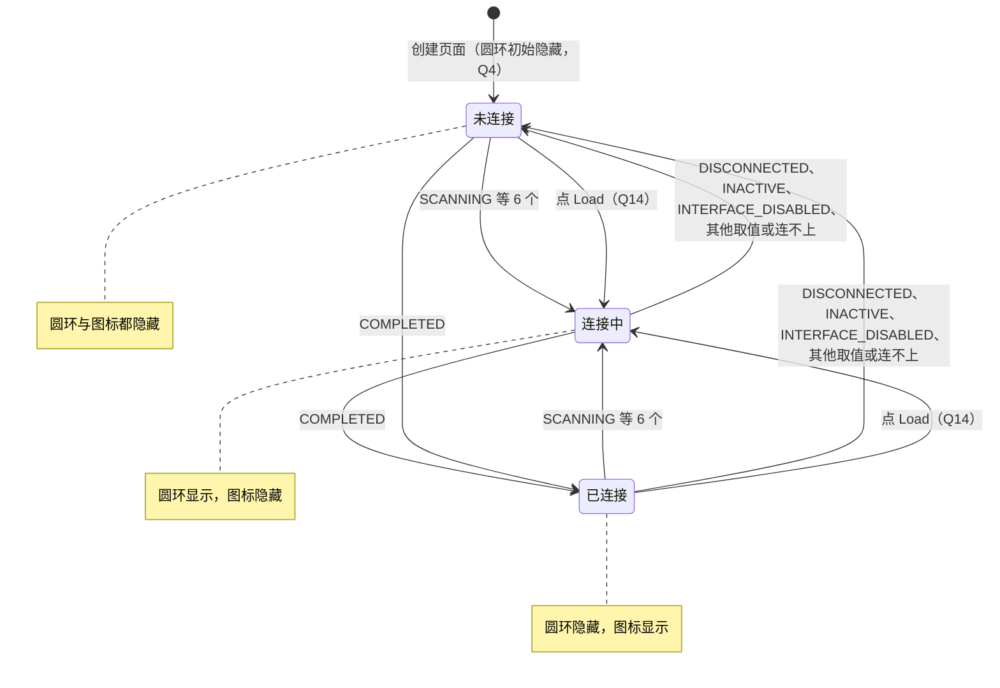

# Luckfox Pico LVGL Example — WiFi 页圆环启停设计规格

- **日期**：2026-10-18
- **状态**：已落地；合并前按 Codex 审查增加 WiFi [3/3]（Q14）；真机复测 W1–W6 与 Scan 补测通过（§5.2）；§9 QA 结论均按推荐执行，验证证据见 plan
- **分支**：`pi/wifi-spinner`（起点 `origin/dev` `1272564`，即 PR #12 合入）；PR #13
- **范围来源**：PR #10 plan [`2026-10-10-lvgl-example-board-test-followups.md`](../plans/2026-10-10-lvgl-example-board-test-followups.md) §6.3「WiFi 页在 `wpa_supplicant not reachable` 时圆环一直转（N7）」；N7 的发现见 PR #10 spec [`2026-10-10-lvgl-example-board-test-followups-design.md`](2026-10-10-lvgl-example-board-test-followups-design.md) §3.5.1，当时只记录不修（其 Q2）
- **关联计划**：[`../plans/2026-10-18-lvgl-example-wifi-spinner.md`](../plans/2026-10-18-lvgl-example-wifi-spinner.md)

---

## 1. 概述与目标

WiFi 页左上角的圆环（`WIFI_loading_spinner`）表示「正在连接」，右上角的 WiFi 图标与 SSID 标签表示「已连接」。PR #10 真机复测 N1 时（两份 `wpa_supplicant.conf` 为空，wpa_supplicant 没有运行），红色提示 `wpa_supplicant not reachable` 出现后，圆环仍一直转（N7）。

目标：

1. 按 `wpa_cli status` 的 `wpa_state` 把显示分为「已连接」「连接中」「未连接」三组（§3.1），连不上 wpa_supplicant 时归入「未连接」，圆环停止。
2. 圆环初始隐藏；每次进入 WiFi 页立即查询一次状态，不再等 5 s 轮询（§3.2）。
3. 点 Load 发起重连后立即显示连接中（§3.3，Q14）。
4. 代码改动只在 `custom/custom_wifi.c`，不改 `generated/`；每处改动都有修复前失败的测试与 `mutate.sh` 变体（§4）。另按 Q12 去掉 `AGENTS.md` 中变体检验的具体耗时。
5. 作者真机复测（§5.2）。

**不在本规格范围**：状态查询连不上时自动显示红色提示（Q2）；`popen` 移出 UI 线程（Q5）；状态命令加 `-i wlan0`（Q6）；用 `status` 的 `ssid=` 更新 SSID 标签；Scan 期间显示圆环。

## 2. 背景

### 2.1 N7 的记录

PR #10 spec §3.5.1（2026-10-11，`pr10-7fc0af3`）N1 一行：「文字：wpa_supplicant not reachable；红色；下拉框里是空白的，没有显示 scanning」；左上角圆环一直转（N7）。PR #10 认为它不影响 N1 的判据，只记录（其 Q2），留作 plan §6.3：「以后追查圆环的启停条件，连不上 `wpa_supplicant` 时应停止」。

### 2.2 现有代码

- 圆环在 `generated/setup_scr_WIFI.c` 中以 `lv_spinner_create(ui->WIFI, 1000, 50)` 创建，位置 (29, 24)，创建时可见；图标 `WIFI_wifi_log_img`（375, 15）与 SSID 标签 `WIFI_loaded_wifi_label`（300, 80）也在生成代码中创建为可见。生成代码只给键盘 `g_kb_WIFI` 加了 `LV_OBJ_FLAG_HIDDEN`。
- `setup_scr_WIFI()` 末尾依次调用 `wifi_backend_init()`、`wifi_app_init()`（`custom/custom_wifi.c`）：前者创建 5000 ms 的重复定时器 `wifi_update_timer`，后者回填 SSID、隐藏图标与 SSID 标签、创建红色提示标签。
- 定时器回调 `wifi_update_timer_cb()` 在当前屏不是 WiFi 页时直接返回（PR #8 D16），否则调用 `_wifi_status_update()`：`popen("wpa_cli status")` 逐行读，含 `wpa_state=COMPLETED` 时隐藏圆环、显示图标与标签，含 `wpa_state=SCANNING` 时反之，两者都不含时不改动；`popen` 失败时直接返回，保持原有显示（PR #8 D18，`wifi.popen.failure` 守护）。
- WiFi 页只在第一次进入时创建：`ui_load_scr_animation()` 的 `auto_del` 为 false，离开后不删除，再次进入不重建（`generated/gui_guider.c`、`events_init.c`）。

`_wifi_status_update()` 的两分支写法来自上游首个提交 `00974b5`（first），此后只有 PR #8 D18 删掉了 `popen` 失败时的 `pclose(NULL)`；`wifi_app_init()` 中隐藏图标与 SSID 标签的两行同样来自 `00974b5`（`git blame`）。N7 是历史问题。

### 2.3 `wpa_state` 的取值与 `wpa_cli` 的输出

hostap 的 `wpa_supplicant_state_txt()`（`wpa_supplicant/wpa_supplicant.c`）共 11 个取值：`DISCONNECTED`、`INACTIVE`、`INTERFACE_DISABLED`、`SCANNING`、`AUTHENTICATING`、`ASSOCIATING`、`ASSOCIATED`、`4WAY_HANDSHAKE`、`GROUP_HANDSHAKE`、`COMPLETED`，其他为 `UNKNOWN`。

按 hostap `scan.c`、`events.c` 源码推断（未在板上观测）：

- 没有启用的网络时，`wpa_supplicant_scan()` 打印「No enabled networks - do not scan」并置 `INACTIVE`（PR #10 F1 的三行配置即如此）；手动 `wpa_cli scan` 开始时由 `DISCONNECTED` 或 `INACTIVE` 置为 `SCANNING`，扫完由 `scan_only_handler()` 恢复原状态。
- 启用的网络不在范围内时，扫描结果处理（「No suitable network found」）不改状态、只安排下一轮扫描，状态停在 `SCANNING`（README 官方模板的占位网络即如此）。

`wpa_cli` 连不上守护进程时只往 stderr 写错误（hostap `wpa_cli.c`：`fprintf(stderr, "Failed to connect to non-global ctrl_ifname: …")`，`return -1`）。本机临时安装的 `wpa_cli` v2.10 实测（plan 附录 A.2 ①）：

| 命令 | 退出码 | stdout | stderr |
|---|---|---|---|
| `wpa_cli status` | 255 | 空 | `Failed to connect to non-global ctrl_ifname: (nil)  error: No such file or directory` |
| `wpa_cli -i wlan0 status` | 255 | 空 | 同上，`ctrl_ifname: wlan0` |
| `wpa_cli -i wlan0 scan` | 255 | 空 | 同上 |

`popen(…, "r")` 只读 stdout，所以连不上时读不到任何行。不带 `-i` 时，`wpa_cli` 取控制目录中第一个套接字作接口，跳过 `p2p-dev-` 开头的接口，并往 stdout 打印 `Selected interface '…'`。

### 2.4 探针实测

在 `1272564` 的临时工作树中（plan 附录 A.2 ②，不入库），经 `unit_wifi.c` 的 `tst_wifi_status_update()` 依次喂入状态（假 `wpa_cli` 对 `status` 输出 `status.txt`）：

| 输入 | 圆环 | 图标与标签 | 说明 |
|---|---|---|---|
| 页面创建后、未查询 | 显示 | 隐藏 | 生成代码与 `wifi_app_init()` 的初始值 |
| 无输出（连不上） | 显示 | 隐藏 | 不改动，一直转（N7） |
| `COMPLETED` → `DISCONNECTED` | 隐藏 | 显示 | 断开后仍显示「已连接」 |
| `SCANNING` → `INACTIVE` | 显示 | 隐藏 | 没有启用的网络仍在转 |
| `COMPLETED` → `INTERFACE_DISABLED` | 隐藏 | 显示 | 接口关闭后仍显示「已连接」 |
| `SCANNING` → `ASSOCIATING` | 显示 | 隐藏 | 碰巧正确（沿用上一次） |
| `COMPLETED` → `4WAY_HANDSHAKE` | 隐藏 | 显示 | 握手中仍显示「已连接」 |
| `COMPLETED` → 无输出 | 隐藏 | 显示 | 守护进程退出后仍显示「已连接」 |

即：除 `COMPLETED`、`SCANNING` 外，其他状态与连不上都沿用上一次的显示。

### 2.5 进入页面的时序

- 首次进入：定时器在页面创建时启动，首次查询在 5 s 后；这 5 s 内显示初始值（圆环转、图标隐藏），与实际状态无关。
- 再次进入：页面不重建；离开期间定时器回调直接返回，回来时显示离开前的状态，最多 5 s 后才更新。
- 首次查询 `popen` 失败：按 D18 保持原有显示，而原有显示就是初始的转圈，圆环一直转。

LVGL 8.3 的切屏（`lib/lvgl/src/core/lv_disp.c`）：带动画的 `lv_scr_load_anim()` 在动画开始时（`scr_load_anim_start()`）先把 `act_scr` 设为新屏幕，再向新屏幕发送 `LV_EVENT_SCREEN_LOAD_START`，动画结束时发送 `LV_EVENT_SCREEN_LOADED`；不带动画的 `lv_scr_load()`（`scr_load_internal()`）先发送 `LV_EVENT_SCREEN_LOAD_START`，再设置 `act_scr`。主屏 WiFi 按钮用 `LV_SCR_LOAD_ANIM_FADE_ON`、时长 100 ms、延时 100 ms，点击时 `lv_scr_act()` 仍是主屏。

`lv_timer_ready(t)`（`lv_timer.c`）只把 `last_run` 设为 `lv_tick_get() - period - 1`，定时器在下一次 `lv_timer_handler()` 中执行。

### 2.6 `generated/` 的修改历史与约定

`00974b5` 之后共 10 个提交改过 `generated/`（plan 附录 A.2 ③）：

| 来源 | 提交 | 改动 |
|---|---|---|
| 上游 Luckfox（2024-11-28） | `b3c99aa` | `setup_scr_Main.c` 加隐藏音乐按钮，+11 行 |
| PR #8 | `6b890ce`、`d133e55`、`fcc843a`、`f9bdc3f` | 日历数组、WiFi 密码框长度 32→63、画布缓冲区、音乐选项串 |
| PR #10 | `0107875`、`88f1d96`、`9aeb9ce` | 音乐页属性或调用，每处 1–3 行 |
| PR #10 | `0704213` | 主屏 MUSIC 按钮回调加一行 `music_recheck_enable()` |
| PR #10 | `cfcedeb` | 列表按钮与背景回调改为调用 `music_list_toggle()`、`music_list_close()` |

约定（PR #7 spec §10.3、PR #8 D2）：新增的逻辑放进 `custom/`，`generated/` 只改调用处；一两行能修好的可直接改 `generated/`。`tests/tools/mutate.sh` 只复制 `custom/`，`generated/` 中的改动只能手动检验（PR #10 Task 13、17：改回原样后测试失败，还原后通过）。

WiFi 页三个状态控件中，图标与 SSID 标签的初始隐藏不在 `generated/`，而在 `custom/` 的 `wifi_app_init()`：

```bash
$ git show 00974b5:custom/custom_wifi.c | sed -n '/^void wifi_app_init/,/^}/p' | tail -3
    lv_obj_add_flag(guider_ui.WIFI_wifi_log_img,LV_OBJ_FLAG_HIDDEN);
    lv_obj_add_flag(guider_ui.WIFI_loaded_wifi_label,LV_OBJ_FLAG_HIDDEN); 
}
$ git show 00974b5:generated/setup_scr_WIFI.c | grep -c HIDDEN
1
```

生成代码中唯一的 `HIDDEN` 是键盘。PR #8 的 `d133e55` 沿用同一做法，在 `wifi_app_init()` 中创建红色提示标签并先设为 `HIDDEN`。

## 3. 设计（以 §9 QA 结论为准）

### 3.1 状态分组（Q1、Q6）

| 组 | `wpa_state` | 圆环 | 图标与 SSID 标签 |
|---|---|---|---|
| 已连接 | `COMPLETED` | 隐藏 | 显示 |
| 连接中 | `SCANNING`、`AUTHENTICATING`、`ASSOCIATING`、`ASSOCIATED`、`4WAY_HANDSHAKE`、`GROUP_HANDSHAKE` | 显示 | 隐藏 |
| 未连接 | `DISCONNECTED`、`INACTIVE`、`INTERFACE_DISABLED`、`UNKNOWN`、其他取值、没有 `wpa_state=` 行（连不上） | 隐藏 | 隐藏 |
| 不改动 | `popen` 失败（Q3，D18） | 保持 | 保持 |



- 只认行首的 `wpa_state=`，取等号后去掉行尾 `\r\n` 的值整串比较；不再对每行 `strstr`。`status` 输出中 `ssid=` 在 `wpa_state=` 之前，SSID 本身可以含 `wpa_state=COMPLETED` 这样的文字。
- 命令保持 `wpa_cli status`，不加 `-i wlan0`（Q6）。
- 停止后只隐藏圆环与图标，不显示其他文字；红色 `wpa_supplicant not reachable` 仍只在点 Scan 时出现（Q2）。
- 已知代价（Q1）：密码错误时状态在 `DISCONNECTED` 与「连接中」之间来回，5 s 轮询可能让圆环时转时停；官方模板的占位网络不在范围内时状态一直是 `SCANNING`，圆环一直转，这反映 wpa_supplicant 确实在找网络，不属于 N7。

### 3.2 初始状态与进入页面时立即查询（Q4）

改法 1：`wifi_app_init()` 中与隐藏图标、标签的两行一起隐藏圆环，初始显示归入「未连接」组，与「没有 `wpa_state=` 行算未连接」一致；首次查询 `popen` 失败时也不再一直转。

改法 2：`wifi_app_init()` 给 `guider_ui.WIFI` 注册 `LV_EVENT_SCREEN_LOAD_START` 回调，回调只调用 `lv_timer_ready(wifi_update_timer)`。查询仍在定时器回调中执行，此时两种切屏方式的 `act_scr` 都已是 WiFi 页（§2.5），页面判断成立；回调中不同步 `popen`，阻塞情况与每 5 s 一次的查询相同。首次进入与再次进入都触发，误差缩短到一次 `lv_timer_handler()` 与一次 `popen`。

被否决的替代（Q4 的补充）：

| 方案 | 改动位置 | 变体检验 | 问题 |
|---|---|---|---|
| 不改，等首次查询纠正 | 无 | — | 首次进入最多 5 s 显示「连接中」，再次进入最多 5 s 显示离开前的状态，首次查询 `popen` 失败时一直转 |
| 只做改法 1 | `custom/` | 自动 | 首次与再次进入最多 5 s 不显示真实状态 |
| 页面创建时同步查询一次 | `custom/` | 自动 | 多一个阻塞点；只覆盖首次进入 |
| G1：`setup_scr_WIFI.c` 创建圆环后加一行隐藏，加改法 2 | `generated/` 1 行 + `custom/` | 初始隐藏只能手动检验 | 与改法 1 效果相同；图标与标签的初始隐藏在 `wifi_app_init()`（§2.6），分在两处 |
| G2：主屏 WiFi 按钮回调加一行刷新调用（仿 `0704213`） | `generated/events_init.c` 1 行 + `custom/` | 调用处只能手动检验 | 点击时 `lv_scr_act()` 仍是主屏（§2.5），用 `lv_timer_ready()` 时定时器回调因页面判断直接返回，要么在点击回调中同步 `popen`，要么绕过页面判断；只覆盖一条进入路径 |
| G3：把事件注册写进 `events_init_WIFI()` | `generated/` + `custom/` | 注册处只能手动检验 | 与改法 2 等价，没有收益 |

### 3.3 点 Load 后显示连接中（Q14）

Codex 审查（PR #13，P2）指出：进入页面时为未连接、随后点 Load 时，`_wifi_conf_load()` 只隐藏连接图标，既不显示圆环也不触发查询，下一次 5 s 轮询前没有任何进行中提示；连接在轮询前完成时，圆环一次都不出现。临时工作树中的探针（plan 附录 A.7）：进入时 `DISCONNECTED`，点 Load 后把状态改为 `COMPLETED`：

| 阶段 | WiFi [2/3] 之后 | `origin/dev` |
|---|---|---|
| 进入页面后 | 圆环隐藏、图标隐藏 | 圆环转（N7 遗留的初始值） |
| 点 Load 后立即 | 圆环隐藏、图标隐藏 | 圆环转 |
| 下一次轮询（`COMPLETED`） | 显示图标 | 显示图标 |
| Load 之后圆环出现过 | 否 | 是 |

`origin/dev` 在这个场景有圆环，只是因为 N7 让它一直转；所以这是 WiFi [2/3] 让初始与未连接时不再转圈后才暴露的倒退。Load 前已连接（`COMPLETED`）时，两版在下一次轮询前都什么也不显示，是上游即有的空档。

设计：`_wifi_conf_load()` 执行到 `wpa_cli reconfigure &` 后调用 `wifi_status_connecting()`：按「连接中」显示（圆环显示、图标隐藏），并对 `wifi_update_timer` 调用 `lv_timer_reset()`，下一次查询推到一个周期（5 s）之后，此后按真实状态显示。输入校验失败、没有 `network={}` 块、`popen` 失败、写配置失败等提前返回的路径不调用，显示不变。上述「已连接时点 Load」的空档也一并消除。

被否决的替代：

- Load 后调用 `lv_timer_ready()` 立即查询（Codex 的第一个建议）：`reconfigure` 在后台执行，立即查询多半读到旧的未连接状态，圆环仍不出现。
- 不推迟下一次轮询：原本快到期的轮询读到旧状态，圆环刚出现又被隐藏。
- 不修，记为已知限制：倒退由本 PR 引入。

### 3.4 不做的事

- 状态查询连不上时自动显示红色提示（Q2）：提示标签与输入校验共用，每 5 s 会覆盖校验错误，编辑文本框时又会被隐藏。
- `popen` 移出 UI 线程（Q5）：要改跨线程更新控件的方式，属于 PR #8 暂缓的另一项；与 PR #10 plan §6.7 的 `SYN_DROPPED` 风险有关，留待以后。
- 状态命令加 `-i wlan0`（Q6）：会改变上游在多接口板子上的行为。
- `generated/` 不改（Q4）。

## 4. 测试（Q7）

新文件 `tests/cases/wifi/test_status.c`（`UNIT unit_wifi.c`）与 `status.mutants`，测试名 `wifi.status.<用例>`，变体 id 前缀 `WIFI-N7-`。等待一律按 LVGL tick（与 `test_scan_trigger.c` 的 `run_until()` 相同），不用 `tst_run_ms()`。

假 `wpa_cli`（`tests/cases/wifi/wifi_env.h`）新增 `status` 分支：有 `status.txt` 时输出其内容，没有时像 v2.10 一样把错误写到 stderr、以 255 退出（§2.3）。其他分支不变。

| 提交 | 用例 | 内容 | 修复前 |
|---|---|---|---|
| WiFi [1/3] | `unreachable_stops` | `SCANNING` 后连不上：圆环、图标都隐藏 | 失败（圆环仍显示） |
| WiFi [1/3] | `idle_states_stop` | `DISCONNECTED`、`INACTIVE`、`INTERFACE_DISABLED`、`UNKNOWN` 与一个未知取值，分别从 `SCANNING` 与 `COMPLETED` 切过去：圆环、图标都隐藏 | 失败 |
| WiFi [1/3] | `connecting_states_spin` | 6 个「连接中」状态分别从 `COMPLETED` 切过去：圆环显示、图标隐藏 | 失败（`SCANNING` 以外） |
| WiFi [1/3] | `completed_shows_icon` | `SCANNING` 后 `COMPLETED`：圆环隐藏，图标与标签显示 | 通过（守护现有行为） |
| WiFi [1/3] | `state_line_only` | 状态为 `ASSOCIATING`，`ssid=` 行为 `ssid=wpa_state=COMPLETED`：按连接中显示 | 失败（`strstr` 先命中 `ssid=` 行） |
| WiFi [1/3] | `timer_unreachable_stops` | 走真实定时器：直接查询一次得到 `SCANNING`，改为连不上后只等一次轮询（5.1 s 内），圆环停止 | 失败 |
| WiFi [2/3] | `initial_hidden` | 创建页面后、查询前：圆环隐藏 | 失败 |
| WiFi [2/3] | `enter_queries_now` | 首次进入与离开后再次进入，各在 300 ms 内查询（`cmd.log` 有 `wpa_cli status`）并显示对应状态 | 失败 |
| WiFi [3/3] | `load_shows_spinner` | 进入时 `DISCONNECTED`，约 4.5 s 后（原本的下一次轮询约 0.5 s 后到期）点 Load：立即显示圆环、隐藏图标，之后 1 s 内不查询、圆环不消失 | 失败（圆环不显示，1 s 内查询了一次） |

变体覆盖：未连接时保持原样、未知取值归入连接中、连不上归入连接中、连接中只认 `SCANNING`、漏掉最后一个连接中状态、在任意位置找 `wpa_state=`、不去掉行尾换行、已连接时也显示圆环、连接中也显示图标、`popen` 失败时改为未连接（由 `wifi.popen.failure` 杀死，守护 Q3）、删掉初始隐藏、删掉进入页面的事件注册、进入页面时重置定时器而不是立即触发、Load 后不显示连接中、Load 后不推迟下一次轮询、Load 后改为立即查询。具体 id 与 `old`/`new` 以 `status.mutants` 为准，结果记入 plan。

## 5. 验证

### 5.1 本地与 CI

1. 每个 `fix` 提交先只加测试与变体，修复前运行确认失败，失败输出记入 plan；加修复后同一测试通过，`tests/tools/mutate.sh <id>...` 全部 `KILLED`。
2. 全量 `ctest`（`-DLUCKFOX_TESTS_ARM32=ON`）与全量 `mutate.sh` 通过。
3. glibc、uClibc 两条交叉编译，告警数与 `AGENTS.md` 基线（glibc 121、uClibc 120）对比；uClibc 产物用 `qemu-arm` 冒烟。
4. 不单独做逐提交测试（Q9）：每个 `fix` 提交创建前各跑一次全量 `ctest`，两个文档提交只改 `docs/` 与 `AGENTS.md`，测试工程不读；若以后改动了 `fix` 提交中的代码或测试，再对改动后的提交跑全量 `ctest`。
5. 推送后 CI 全部通过，`🧬 变体检验` 为 `0 skipped`。
6. spec 与 plan 用 PR #11 plan 附录 A.1 的 `check-headings.py` 检查、附录 A.5 的 `check-samples.sh` 回归；Mermaid 图用 PR #9 plan 附录 A.3 的 `check.mjs` 校验；QA 编号与引用、排版用 plan 附录 A.2 ⑦ 与 A.8 的脚本核对。
7. 合并前由执行者按作者的审查模板自查（A 代码与构建、B 事实与复现、C 规范与表述），只查不改；提交说明对照 cz-conventional-emoji 1.1.8、gitmojis 3.15.0、Conventional Commits 1.0.0 与 PR #10–#12 的提交核对（plan Task 10、附录 A.6）。

### 5.2 真机复测（Q8）

W1–W4 的二进制为 uClibc 产物 `luckfox_lvgl_demo-pr13-fc4c066`（当时的 WiFi [2/2]；同目录的 `-pr13-d46d953`、`-pr13-8838e2e` 是提交哈希因改写测试与提交说明而变化后复制的同一份产物，SHA256 相同）；W5、W6 的二进制为含 WiFi [3/3] 的 `luckfox_lvgl_demo-pr13-a329c22`（SHA256 `3e1440c3…`，见 plan §4）。均在 `/cursor/stores/self/board-retest-20261018/`，同目录 `SHA256SUMS`（PR #10 plan 附录 C.4 的 `cross.sh`）。照 PR #10 spec §3.1 准备（`RkLunch-stop.sh`、备份两份 WiFi 配置），每项写时间标记、记录原话、拍照。

| 项 | 步骤 | 判据 |
|---|---|---|
| W1 | 两份配置为空、wpa_supplicant 没有运行，进 WIFI，等 10 s；再点一次 Scan | 进入后圆环不转，10 s 内也不转；点 Scan 后出现红色 `wpa_supplicant not reachable` |
| W2 | 按 README 写入官方完整模板，复制到 `/data` 并重启 wpa_supplicant（PR #10 spec §3.5 F1 的方式）；在 WIFI 页填测试热点并点 Load，等 10 s | 连上后右上角显示 WiFi 图标与 SSID，圆环不转 |
| W3 | 保持连接，关掉热点，等 15 s | 图标与 SSID 消失；圆环随 wpa_supplicant 重新扫描而转动 |
| W4 | 返回主屏，打开热点，等 `wpa_cli -i wlan0 status` 为 `wpa_state=COMPLETED` 后立即进 WIFI | 进入后立即显示图标与 SSID，不再先转圈约 5 s |
| W5（Q15） | 已连接时执行 `wpa_cli -i wlan0 disconnect`，确认状态为 `DISCONNECTED`；进 WIFI（圆环与图标都没有），不改输入点 Load，观察 10 s；结束后 `wpa_cli -i wlan0 reconnect` | 点 Load 后立即出现圆环，约 5 s 内不消失；之后按真实状态显示。按 hostap 源码推断（W5 板上证实），`disconnect` 设置的标志不会被 `reconfigure` 清除，状态仍为 `DISCONNECTED`，圆环随后消失属正常；`reconnect` 后连上即显示图标 |
| W6（Q15） | 已连接时在 WIFI 页不改输入直接点 Load，观察 10 s | 点 Load 后立即出现圆环、图标与 SSID 消失；约 5 s 后圆环消失，图标与 SSID 重新出现 |

结束后两份配置的去留由作者决定（PR #10 spec Q4 建议不留空文件）。结果 zip 存入项目存储，同目录 `SHA256SUMS` 记录其哈希（做法同 PR #10 plan 附录 C.6），不进仓库。

#### 5.2.1 复测结果（2026-10-18）

作者用本地 pi 执行，二进制为 `luckfox_lvgl_demo-pr13-fc4c066`（与 `-pr13-8838e2e` 为同一份产物，SHA256 `b9a822ec…`，板上 `sha256sum -c` 通过）。作者决定只在需要图片辅助判断时拍照，本轮没有需要，0 张照片，判定依据作者的现场观察与板上日志。原始记录 `RESULTS.md` 与 17 个日志文件在项目存储 `board-retest-results-20261018/pr13-fc4c066/` 的 zip 中（SHA256 `899928a8…`，含测试热点的 SSID 与密码原文，不进仓库）。板上时钟在收尾前从 2021 年跳到 2026 年，跳变前后的时间标记不相减。结束时两份 WiFi 配置恢复为测试前的官方占位模板，哈希与测试前一致。

| 项 | 结果 | 依据（作者原话或记录摘要） |
|---|---|---|
| W1 | 通过 | 进入后「始终不转」；点 Scan 后「圆环仍不转, wpa_supplicant not reachable 红色」，作者确认是没有圆环，而非圆环静止；应用日志中 `wpa_cli` 只往 stderr 写 `Failed to connect to non-global ctrl_ifname: (nil)  error: No such file or directory` |
| W2 | 通过 | Load 后 10 s 状态为 `COMPLETED`；「右上角是显示 WiFi 图标和 <测试热点>，圆环是已消失、不再转动」 |
| W3 | 通过 | 关热点 15 s 后状态为 `SCANNING`（`ip_address` 仍为旧值）；「页面上的 WiFi 图标和 SSID 是已消失，圆环是正在转动」 |
| W4 | 通过 | 主屏等到状态为 `COMPLETED` 后进入：「是直接显示 WiFi 图标和 SSID，没有转圈」 |
| Scan 补测 | 通过 | 作者追加：重启应用进入 WiFi 页，下拉框为空；点 Scan 后「是先显示 scanning，随后出现热点名称」 |

复测中的其他观察：

- **W2 Load 前圆环在转**：写入官方占位模板并启动 wpa_supplicant 后，状态为 `SCANNING`，圆环转动。这是 §3.1 列出的已知代价（占位网络不在范围内时一直 `SCANNING`），不属于 N7。
- **下拉框为空**：W2 填 SSID 时下拉框里没有任何热点。下拉框的初始选项在生成代码中为 `""`（`setup_scr_WIFI.c` 第 301 行），只有点 Scan 时才由 `_wifi_scan_request()` 与读结果的定时器填入；W1 时 Scan 因连不上而只显示红色提示，下拉框不变，W2 启动守护进程后没有再点 Scan。补测中点一次 Scan 即列出热点。这是上游即有的行为，与本 PR 改动无关；「守护进程从未运行变为运行、应用不重启」时再点 Scan 的场景未单独复测。
- 板上 `wpa_cli` 为 v2.6（应用日志），连不上时的行为与本机 v2.10（§2.3）相同。

#### 5.2.2 W5、W6 补测结果（`pr13-a329c22`，2026-10-18）

作者用本地 pi 执行，二进制 `luckfox_lvgl_demo-pr13-a329c22`（SHA256 `3e1440c3…`，板上 `sha256sum -c` 通过），不重测 W1–W4，0 张照片，判定依据作者的现场观察与板上日志。准备时写入含测试热点的官方模板并重启 wpa_supplicant，确认 `COMPLETED` 后才启动应用。原始记录与 12 个日志文件（`out-a329c22/`）与 W1–W4 的记录合并在项目存储 `board-retest-results-20261018/pr13-a329c22/` 的 zip 中（SHA256 `2daf986a…`，同目录 `SHA256SUMS`，含测试热点的 SSID 与密码原文，不进仓库）。板上时钟在准备阶段又跳变一次，时间标记不跨跳变相减。

| 项 | 结果 | 依据（作者原话或记录摘要） |
|---|---|---|
| W5 | 通过 | `disconnect` 后状态为 `DISCONNECTED`；进入 WIFI 时「圆环和 WiFi 图标是都没有」；点 Load 后「圆环是立即出现、前约 5 秒是一直显示，以及之后是消失」，Load 后状态仍为 `DISCONNECTED`；`reconnect` 后为 `COMPLETED`，「页面是已显示 WiFi 图标与 <测试热点>，且没有圆环」 |
| W6 | 通过 | 已连接时点 Load：立即出现圆环、隐藏图标与 SSID，约 5 s 后圆环消失、图标与 SSID 重新出现，作者确认两个阶段都符合（原话「是」）；Load 后状态为 `COMPLETED` |

复测中的其他观察：

- **W5 证实了 §5.2 的推断**：Load 触发的 `reconfigure` 没有让 `disconnect` 之后的连接恢复，要 `reconnect` 才恢复。这是 wpa_supplicant 的行为，Load 的写法沿用上游。
- **两份配置的格式不同**：结束时作者选择保留含测试热点的配置。两份配置的 `ssid`、`psk` 相同，但 `/data/wpa_supplicant.conf` 少一行 `ap_scan=1`，`network` 块用 Tab 缩进，`/etc/wpa_supplicant.conf` 用 8 个空格，所以哈希不同。原因：wpa_supplicant 以 `-c /data/wpa_supplicant.conf` 运行，Load 中的 `save_config` 由它重写该文件，hostap `config_file.c` 只在 `ap_scan` 不等于默认值（`config.h` 中 `DEFAULT_AP_SCAN` 为 1）时写出这一行，块内各行以 `\t` 开头；`/etc` 则由应用按行替换 `ssid=`、`psk=`，保留模板格式。上游即如此，本 PR 未改 Load 写配置的逻辑。

## 6. 提交与 PR

- 分支 `pi/wifi-spinner`，PR #13 指向 `dev`，开发时为草稿，合并前改为 ready；执行者不合并。
- 先推送 spec 与 plan，实现完成后用 `git rebase` 整理为（`docs(agents)` 按 Q12、WiFi [3/3] 按 Q14 加入；加入 [3/3] 时前两个 `fix` 由 [1/2]、[2/2] 改为 [1/3]、[2/3]）：
  1. `fix(wifi): 🐛 WiFi [1/3] 圆环按 wpa_state 启停，连不上 wpa_supplicant 时停止`：`custom/custom_wifi.c` 的状态解析与分组，`test_status.c` 的前 6 条用例、`status.mutants`、`wifi_env.h` 的 `status` 分支、`CMakeLists.txt`。
  2. `fix(wifi): 🐛 WiFi [2/3] 圆环初始隐藏，进入 WiFi 页立即查询状态`：`wifi_app_init()` 的两处改动与 `initial_hidden`、`enter_queries_now` 两条用例、变体。
  3. `fix(wifi): 🐛 WiFi [3/3] 点 Load 后立即显示圆环`：`wifi_status_connecting()` 与 `load_shows_spinner`、3 个变体（Q14）。
  4. `docs(agents): 📝 变体检验不再写具体耗时`：`AGENTS.md` 去掉变体检验的分钟数（Q12）。
  5. `docs(superpowers): 📝 新增 WiFi 页圆环启停 spec 与 plan`：本 spec 与 plan，以及 PR #10 plan §6.3 的状态行。
- PR 标题：`fix(wifi): 🐛 修复 WiFi 页连不上 wpa_supplicant 时圆环一直转`。提交说明按 cz-conventional-emoji 1.1.8 的格式，正文为要点、写原因，`fix` 提交注明历史问题，最后一个要点为 `- 详见 spec §…、Q…`（与 PR #10–#12 相同）；不带 `Co-authored-by`。

## 7. 风险

- **定时器回调中的同步 `popen`**：改法 2 每次进入 WiFi 页多一次查询，阻塞时间与轮询相同；`popen` 仍在 UI 线程（Q5）。
- **测试与真机输出的差异**：假 `wpa_cli` 按 v2.10 源码与本机实测模拟；板上为 v2.6，连不上时同样只写 stderr（§5.2.1），判定只读 stdout。
- **Load 后的显示**：Load 后固定显示一个周期的连接中（§3.3）；`reconfigure` 失败或不会重连（如 `disconnect` 之后）时，圆环约 5 s 后才消失（W5 板上即如此，§5.2.2）。
- **状态来回切换**：密码错误等情况下圆环可能时转时停（§3.1），由真机复测观察，不作为判据。
- **依赖 LVGL 事件顺序**：改法 2 依赖 `LV_EVENT_SCREEN_LOAD_START` 在两种切屏方式下都会发送（§2.5）；`enter_queries_now` 用 `lv_scr_load()` 覆盖不带动画的路径，带动画的路径由真机 W4 覆盖（§5.2.1 通过）。

## 8. 后续事项

### 8.1 整理 `preview` 的启动与操作方法（Q10）

**状态**：待办，另开会话与 PR；完成后改为状态行，链接新 PR 的文档。

本 PR 在 Cloud Agent 桌面上用 `preview` 查看 WiFi 页时，启动与操作方法分散在多处。`origin/dev` `1272564` 上提到 `preview` 的文档（`git grep -c preview`，plan 附录 A.2 ⑤）：

| 位置 | 次数 | 内容 |
|---|---|---|
| `AGENTS.md` | 1 | 一句构建与运行命令 |
| `tests/README.md`「手动目标」 | 1 | 环境变量与限制 |
| PR #7、#9、#10、#12 的 spec | 共 22 | 设计背景（编译单元、Mesa 等） |
| PR #6、#7、#9、#10、#12 的 plan | 共 52 | 其中 PR #10 plan 附录 C.5 有 4 个桌面脚本（`pv-start.sh`、`pv-songs.sh`、`pv-check.sh`、`preview_run.sh`） |

此外，本 PR plan 附录 A.4 新增了一个假 `wpa_cli`，用来在 WiFi 页切换状态。`tests/tools/` 只有 `preview.c` 本身，没有启动或操作脚本；要用 `preview`，得先知道去 PR #10 plan 附录 C.5，再从 Markdown 中提取脚本。

| 方案 | 做法 | 优点 | 缺点 |
|---|---|---|---|
| A：只合并文档 | 扩写 `tests/README.md`「手动目标」，汇总启动、操作与核对方法，脚本仍留在各 plan 附录 | 不改「辅助脚本不入库」的现有做法 | 脚本仍要从 plan 中提取；plan 是历史记录，脚本以后改动无处落地 |
| B：脚本入库 | 新建目录（如 `tests/tools/preview/`）存放上述 4 个脚本与假 `wpa_cli`；用法写进 `tests/README.md`，`AGENTS.md` 只留一句指引 | 一处可找；脚本能做 ShellCheck；新会话可直接运行 | 要维护窗口坐标等硬编码；改变了 PR #10、#12 把辅助脚本写在 plan 附录的做法 |
| C：新建单独文档 | 如 `docs/preview.md` | 篇幅不受 `tests/README.md` 限制 | 与 `tests/README.md` 重复，又多一个入口 |

建议 B：`preview` 脚本是反复使用的开发工具，与一次性的核对脚本（`percommit.sh`、`probe.sh` 等）不同，适合入库；一次性脚本仍留在 plan 附录。历史 plan 不改正文，只在 PR #10 plan 附录 C.5 开头加一行状态，指向新目录（同 PR #12 对 §6.5 的处理）。本 PR plan 附录 A.4 保持原样，作为本 PR 的记录。

在新会话、新 PR 中执行：

- 范围：开发工具与文档的整理，与 N7 的修复无关，并入本 PR 会扩大 spec、QA 与验证的范围。
- 时机：整理与本 PR 互不依赖，不必等本 PR 合并，可从最新的 `dev` 另开分支进行。
- 上下文：本会话已经很长，新会话读 `AGENTS.md` 与 PR #10 plan 附录 C.5 即可起步。

新会话待定：目录名；是否加 ShellCheck 检查（本机或 CI）；480、720 两种屏幕的坐标是否参数化；Xvfb 与云端桌面两种运行方式是否合并为一个脚本。

## 9. QA（grilling 记录）

问句与推荐取自问答原文；「答」是作者回答经润色后的版本。第 1 轮为 Q1–Q8，作者先就 Q4 追问三次（见 Q4 的补充），随后回答「遵从推荐」，Q4 采用改法 1 + 改法 2，并要求把会话中的证据写入文档。Q9、Q10、Q12 是实施中作者的提问，Q11 是首次 CI 后、Q13 是真机复测后执行者的提问；Q14、Q15 由 Codex 审查引出，会话中同一轮还有一问是新提交的位置，属于提交拆分，不记入。WiFi [1/2]、[2/2] 在 Q14 后改为 [1/3]、[2/3]，问句与推荐保留原文。

**Q1. 各状态的圆环与连接图标**

- 问：按 `wpa_state` 分三组：已连接（`COMPLETED`）；连接中（`SCANNING`、`AUTHENTICATING`、`ASSOCIATING`、`ASSOCIATED`、`4WAY_HANDSHAKE`、`GROUP_HANDSHAKE`）显示圆环；未连接（`DISCONNECTED`、`INACTIVE`、`INTERFACE_DISABLED`、`UNKNOWN`、未知取值、没有 `wpa_state` 行）圆环与图标都隐藏。代价：密码错误时圆环可能时转时停；官方模板的占位网络不在范围内时一直 `SCANNING`、圆环一直转。
- 推荐：按上述分组，未知取值归入未连接，与连不上同样处理。
- 答：按推荐（§3.1）。

**Q2. 停止后显示什么，与 N1 红色提示如何配合**

- 问：A 只隐藏圆环和图标，红色提示仍只在点 Scan 时出现；B 状态查询连不上时也自动显示红色提示，但提示标签与输入校验共用，会互相覆盖；C 右上角标签显示 `Not connected` 等新文案。
- 推荐：A。
- 答：按推荐（§3.1、§3.4）。

**Q3. `popen` 失败时**

- 问：PR #8 D18 定为保持原有连接指示（`wifi.popen.failure` 守护）；若在首次查询前失败，圆环仍会一直转，但 `popen` 失败极少见。
- 推荐：保持 D18，不改。
- 答：按推荐。Q4 的改法 1 让初始显示归入未连接，首次查询失败时也不再一直转。

**Q4. 进入页面时的初始状态，以及是否改 `generated/`**

- 问：A 不改，生成代码中圆环一开始可见，视为「状态未知、查询中」，最迟 5 s 后由首次查询纠正；B 在 `wifi_app_init()` 中先隐藏圆环；C 页面创建时立即同步查询一次。
- 推荐：A。
- 补充 1（作者问「初始状态是否满足 Q1 的组，是否有冲突」后）：有冲突。初始显示外观上等于「连接中」，但实际状态未知；首次进入最多 5 s 显示错误、再次进入最多 5 s 显示离开前的状态、首次查询 `popen` 失败时一直转（§2.5）。推荐改为改法 1（`wifi_app_init()` 中隐藏圆环）加改法 2（注册 `LV_EVENT_SCREEN_LOAD_START`，回调只调用 `lv_timer_ready()`），只改 `custom/`（§3.2）。
- 补充 2（作者问「允许改 `generated/` 时是否有其他改法，历史上是否改过」后）：`00974b5` 之后有 10 个提交改过 `generated/`（§2.6）；可选 G1、G2、G3，比较见 §3.2 的表，没有比改法 1 + 改法 2 更好的。
- 补充 3（作者问「`wifi_app_init()` 中隐藏图标与标签的先例是否改过 `generated/`」后）：没有。那两行是上游 `00974b5` 写在 `custom/` 中的，生成代码只隐藏了键盘（§2.6 的 `git show`）；所以 G1「读生成代码就能看到初始属性」的好处并不成立。
- 答：采用改法 1 + 改法 2，不改 `generated/`。

**Q5. 是否顺带把同步 `popen` 移出 UI 线程**

- 问：同一函数同步执行 `popen`，会阻塞 UI 线程，与 PR #10 plan §6.7 的 `SYN_DROPPED` 风险有关。
- 推荐：不顺带。`wpa_cli status` 是本地套接字请求，通常很快返回；移入线程要改跨线程更新控件的方式，属于 PR #8 暂缓的另一项。
- 答：按推荐（§3.4）。

**Q6. 解析方式与命令**

- 问：现在对每一行 `strstr(…, "wpa_state=COMPLETED")`；命令是 `wpa_cli status`，不带 `-i wlan0`。
- 推荐：只认行首的 `wpa_state=`，取值后分组；命令不变。不带 `-i` 时 `wpa_cli` 取控制目录中第一个接口并跳过 `p2p-dev-`，加 `-i wlan0` 会改变上游在多接口板子上的行为，不在 N7 范围内。
- 答：按推荐（§3.1）。

**Q7. 测试、变体命名与等待方式**

- 问：测试名、变体 id 前缀与等待方式。
- 推荐：新文件 `test_status.c` 与 `status.mutants`，测试名 `wifi.status.<用例>`，变体前缀 `WIFI-N7-`；大部分用例经 `tst_wifi_status_update()` 直接调用，走真实定时器的用例按 `run_until()`（LVGL tick）等待，不用 `tst_run_ms()`；假 `wpa_cli` 新增 `status` 分支，`status.txt` 不存在时像真机一样写 stderr、以 255 退出。Q4 改为改法 1 + 改法 2 后，加 `initial_hidden`、`enter_queries_now` 两条用例与对应变体。
- 答：按推荐（§4）。

**Q8. 真机复测与补测二进制交付**

- 问：是否需要真机复测，二进制如何交付。
- 推荐：需要。按 PR #10 plan 附录 C.4 编 uClibc 产物，交付到 `/cursor/stores/self/board-retest-20261018/`，同目录 `SHA256SUMS`；复测连不上、连上、断开三项，Q4 改为改法 1 + 改法 2 后加「离开后再进入立即显示当前状态」一项；结果 zip 按附录 C.6 归档。
- 答：按推荐（§5.2）。

**Q9. 是否再做逐提交测试**

- 问：PR #10 plan 附录 C.3 的 `percommit.sh` 在本 PR 中有没有必要再执行？没有必要就不执行。
- 推荐：不执行。逐提交测试防的是中间提交单独构建或测试失败；PR #10 有 19 个提交且多次用 fixup 改动早先提交的代码，本 PR 只有 WiFi [1/2]、WiFi [2/2]、`docs(superpowers)` 三个提交。两个 `fix` 提交创建前各跑一次全量 `ctest`（含 arm32），提交的树即测过的树；整理提交只把 `docs(superpowers)` 移到最后，它只改 `docs/`，测试工程不读该目录，`fix` 提交中的代码与测试不变；最终树另有全量 `ctest`、全量 `mutate.sh` 与 CI。例外：以后若用 fixup 或 rebase 改动了 `fix` 提交中的代码或测试，对改动后的提交单独跑全量 `ctest`。
- 答：作者提出「没有必要则不执行」，按推荐（§5.1）。
- 补充（Q12 后）：新增的 `docs(agents)` 只改 `AGENTS.md`，测试工程同样不读，结论不变。
- 补充（Q14 后）：新增的 WiFi [3/3] 创建前同样跑了全量 `ctest`；插入时只调整提交顺序与前两个 `fix` 的标题，各提交的树不变，结论不变。

**Q10. 是否整理 `preview` 的启动与操作方法**

- 问：在 Cloud Agent 桌面上运行 `preview` 的方法分散在多个文档中，是否整理？合并到单个文档，还是新建脚本目录专门存放？在新会话还是当前会话中执行？
- 推荐：整理，采用「脚本入库 + 一处说明」（§8.1 的方案 B）；在新会话、新 PR 中执行，不并入本 PR。
- 答：同意；建议写入本 spec（§8.1），新 PR 完成后由作者改为状态行；另在本 PR 发一条评论。

**Q11. 变体检验变长怎么处理**

- 问：首次 CI 的变体检验 job 为 15 分 15 秒（`AGENTS.md` 写约 10–12 分钟）；13 个 `WIFI-N7-*` 共 175 s，每个约 13.5 s，主要是 `timer_unreachable_stops` 的两次 5 s 等待。A 维持现状；B 该用例改为只等一次轮询：先直接查询一次得到 `SCANNING`，再改为连不上，等定时器轮询一次后确认圆环停止，WiFi [1/2]、[2/2] 下都单独验证 5 s 轮询，CI 约省 1 分钟，要改 WiFi [1/2] 中的测试；C 在 A 或 B 之外把 `AGENTS.md` 的耗时改为实测值。
- 推荐：B + C。
- 答：按推荐。B 按 Q9 的例外，对改动后的 WiFi [1/2]（现为 [1/3]）单独跑全量 `ctest`；CI 中 13 个 `WIFI-N7-*` 合计由 175 s 降到 104 s、115 s（两次），job 总时长另受 runner 波动影响（plan §4）。C 由 Q12 改为去掉具体分钟数。

**Q12. `AGENTS.md` 是否还写变体检验的耗时**

- 问：为了避免反复修改，`AGENTS.md` 是否移除具体时间？
- 推荐：`AGENTS.md` 去掉「runner 上 job 约 10–12 分钟」，改为「它是 CI 中耗时最长的 job，同一 PR 的新推送会取消正在运行的 CI（`cancel-in-progress`），只改文档的修订尽量攒到一起推送」。耗时随变体数量与 runner 负载变化（PR #12 的 6 次实测 job 为 9 分 52 秒至 12 分 12 秒，本 PR 首次为 15 分 15 秒），写具体值就要随测试反复改；agent 需要的是「最慢」与「推送会取消」，实测值按日期与提交记在各 PR 的 spec、plan 中。workflow 中 `timeout-minutes: 30` 的注释（「runner 上运行步骤 9–12 分钟（spec §2.3），按约 2.5 倍留余量」）是当时定值的依据，有出处，本 PR 首次的 15 分钟仍有约 2 倍余量，本 PR 不改，实测接近 20 分钟时再与超时、分片一起评估。
- 答：按推荐（§1 目标 4）。

**Q13. 下拉框在点 Scan 之前为空，是否记为后续事项**

- 问：真机复测 W2 时下拉框没有热点（§5.2.1）：下拉框只在点 Scan 时填入，W1 的 Scan 因连不上而没有填入，之后没有再点 Scan；补测中点 Scan 即列出热点，是上游即有的行为。A 只在 §5.2.1 记录观察；B 另在 §8 加一项「进入 WiFi 页时自动列出已有的扫描结果」（进入页面时读一次 `scan_results` 缓存，会在 UI 线程多一次同步 `popen`，与 Q5 相关）；C 在本 PR 中实现。
- 推荐：A。这是新功能而不是缺陷，现有的「点 Scan 刷新」在真机上正常。
- 答：按推荐。

**Q14. Codex 指出的「未连接时点 Load 不显示圆环」是否修复**

- 问：Codex 审查（P2）：进入页面时为未连接，点 Load 后圆环不出现，下一次 5 s 轮询前没有进行中提示，连接很快完成时圆环一次都不出现（§3.3 的探针）。A Load 后 `lv_timer_ready()` 立即查询；B Load 发起重连后显式切到连接中，并把下一次轮询推到一个周期之后；C 不修，记为已知限制。
- 推荐：B。A 在 `reconfigure` 后台执行时多半读到旧状态；C 的倒退由本 PR 引入。B 约 3 行与一个前置声明，都在 `custom/`，按 TDD 新增 `load_shows_spinner` 与 3 个变体。
- 答：按推荐（§3.3）。

**Q15. 是否真机补测 Load 后的圆环**

- 问：主机测试覆盖逻辑，板上的观感以真机为准；是否补测「先 `disconnect` 使状态为 `DISCONNECTED`，再点 Load，看圆环是否立即出现」？
- 推荐：补测。
- 答：按推荐。执行者按 hostap 源码推断 `disconnect` 后 `reconfigure` 不会重连（`reconfigure` 不清除 `disconnect` 设置的标志），另加「已连接时点 Load」一项，覆盖完整的重连过程（§5.2 的 W5、W6）；W5 在板上证实了这一推断，W5、W6 均通过（§5.2.2）。
