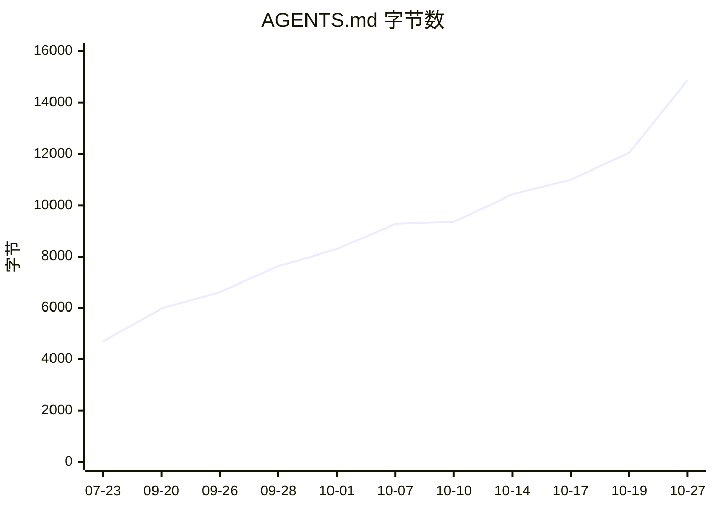
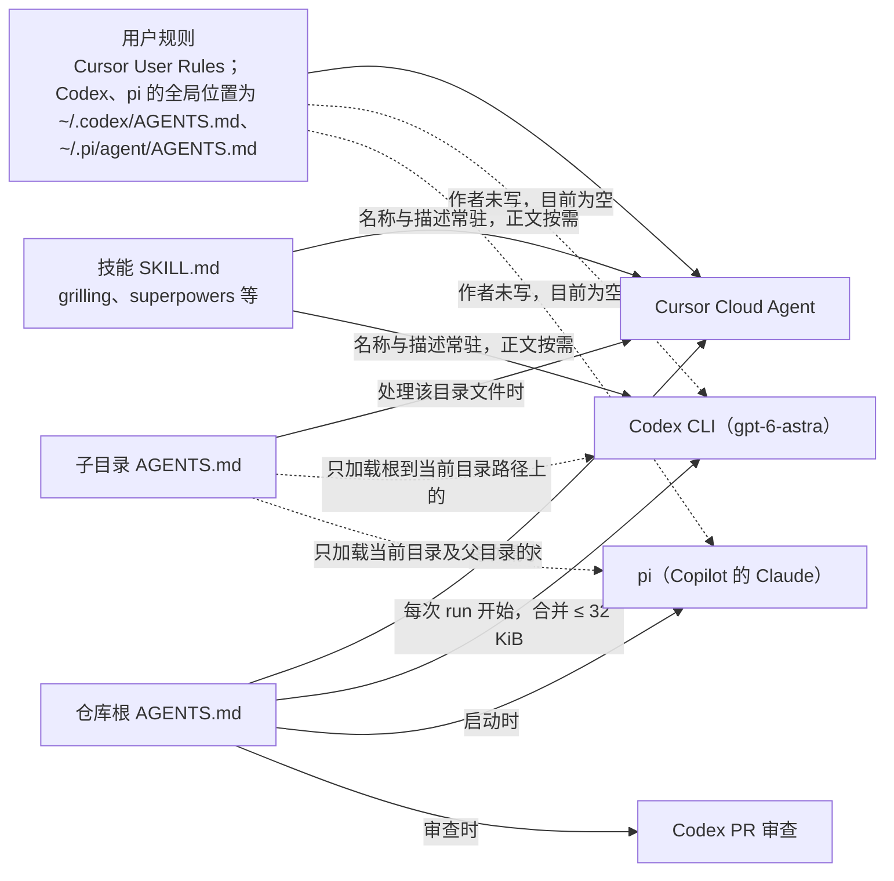
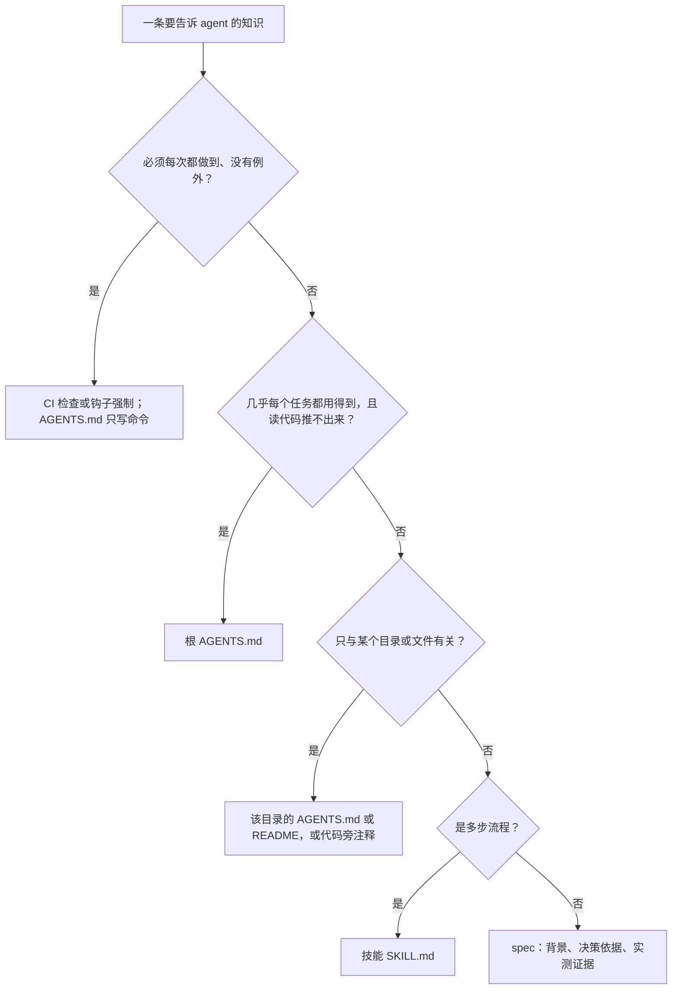
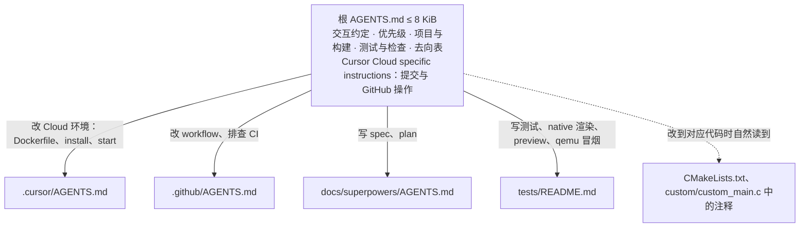
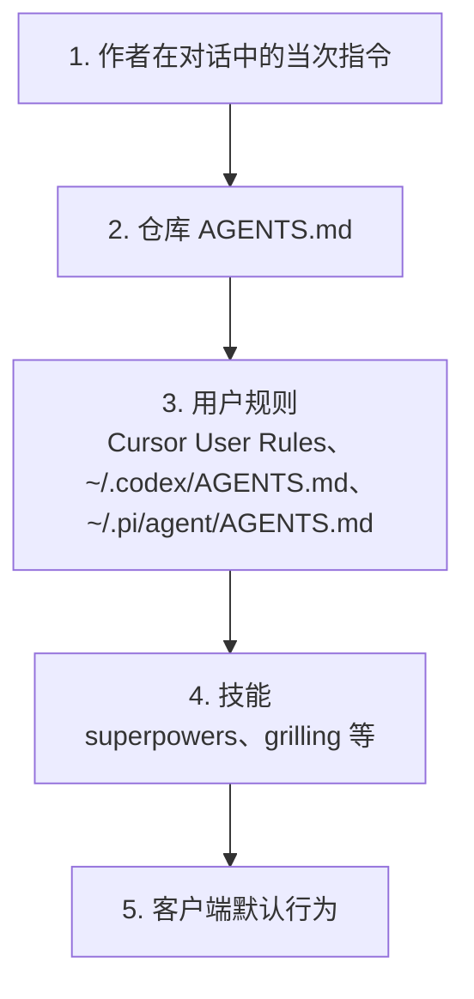

# Luckfox Pico LVGL Example — AGENTS.md 精简与 harness 审视设计规格

- **日期**：2026-11-01
- **状态**：已实施，两路冷启动问答复测通过，验证证据见 plan；用户规则的修改（§3.6.1）待作者处理，后续事项见 §9
- **分支**：`cursor/agents-md-slim-d7ec`（起点 `origin/dev` `de8dddb`，即 PR #16 合入）
- **范围来源**：作者 2026-11-01 提出：GPT-6 Astra 对 `AGENTS.md` 等文件中的指令更敏感，而本仓库 `AGENTS.md` 几乎每个 PR 都改、越来越长；精简它，并检查 `AGENTS.md` 之外还有哪些 harness 内容需要改
- **关联计划**：[`../plans/2026-11-01-lvgl-example-agents-md-slim.md`](../plans/2026-11-01-lvgl-example-agents-md-slim.md)

---

## 1. 概述与目标

`AGENTS.md` 是每个会话开始时自动注入上下文的文件：Cursor 每次请求都带着它，Codex 与 pi 在每次 run 开始时读入并在整个会话中保留（§2.2）。它从 2026-07-23 的 4,694 字节涨到 14,883 字节，21 个提交、16 个已合并 PR 中的 14 个改过它（§2.1），内容里混着只适用 Cursor Cloud VM 的环境细节、CI 内部实现、会过时的数字和只与个别文件有关的背景（§2.6）。作者写代码用 Codex 的 `gpt-6-astra`，OpenAI 的 GPT-6 文档指出它更容易被 `AGENTS.md` 与技能中的指令影响，指令不清或互相冲突时会提前停下（§2.3）。

目标：

1. 根 `AGENTS.md` 只保留几乎每个任务都用得到、又不能从代码推出来的内容，体积降到预算以内（§3.2，Q1）。
2. 移出的内容按「离用到它的地方最近」放置，根文件用一张去向表指过去，不删信息（§3.1、§3.3，Q2、Q3）。
3. 写明用户指令、`AGENTS.md` 与技能之间的优先级，去掉可能让模型无谓停下的措辞（§3.4，Q4、Q5）。
4. 用 CI 检查守住体积预算，避免以后每个 PR 又把它写长（§3.5，Q6）。
5. 仓库外同样会影响模型行为的 harness 内容按需修改：执行者能改的直接改，不能改的写明改法交作者，两者都在 §3.6 留痕（Q7、Q11）。

**不在本规格范围**：superpowers 插件文件本身（Cursor 插件缓存，执行者与作者都不改，用优先级声明约束，Q11）；作者 macmini 上的文件（执行者访问不到，§3.6 给出改法）；新增 `CLAUDE.md`、`GEMINI.md`（Q8）；C 代码与测试用例的行为改动。

### 1.1 为什么值得改

本节同时用作 PR 描述的开头。

- **体量**：`AGENTS.md` 从 4,694 字节涨到 14,883 字节，已合并的 16 个 PR 中有 14 个改过它，字节数从未下降。现在 74 行，看似远低于用户规则 4 的约 150 行，但不硬折行时每行平均约 200 字节，行数反映不出体量（§2.1）。
- **内容错位**：除交互约定外，所有内容都放在 `Cursor Cloud specific instructions` 之下。Cursor 官方说这一节只用来放 Cloud 专属说明，在 macmini 上用 Codex、pi 时，模型分不清哪些只适用 Cloud VM（§2.4、§2.6）。
- **占篇幅的内容**：「GitHub Actions」一节 3,202 字节，是最大的一节，大半是 CI 内部实现；还有告警 121、120 条这类会过时的数字，是几乎每个 PR 都要回来改它的主因（§2.6）。
- **Astra 的敏感点**：OpenAI 文档说 GPT-6 Astra 对 `AGENTS.md` 和技能中的指令更敏感，指令不清或冲突时会提前停下。现在全文没写用户指令、`AGENTS.md`、技能三者谁优先，「不确定时用 grilling 询问」也可能成为无意的停顿点（§2.3、§2.6）。

## 2. 背景

### 2.1 `AGENTS.md` 的现状

`origin/dev` `de8dddb` 上共 74 行、14,883 字节、9,800 个字符。作者的用户规则 4 把每轮自动加载文件的目标定为约 150 行，并要求因不硬折行同时看字节数；74 行看似远低于目标，实际每行平均约 200 字节，行数反映不出体量。

| 节 | 字节 | 适用范围 |
|---|---|---|
| 交互约定 | 111 | 通用 |
| `Cursor Cloud specific instructions` 标题与说明 | 133 | — |
| 项目简介 | 510 | 通用 |
| Cloud Agent 环境（Dockerfile 模式 / 配置即代码） | 1,703 | 只适用 Cursor Cloud VM；改环境时才需要 |
| 提交与 GitHub 操作 | 1,586 | 只适用 Cursor Cloud VM；每次提交都需要 |
| 构建（标准开发流程） | 1,494 | 通用 |
| GitHub Actions（交叉编译门禁） | 3,202 | 通用；大部分只在改 workflow 或排查 CI 时需要 |
| Lint（代码检查） | 836 | 通用；大部分只在改 `CMakeLists.txt` 告警段时需要 |
| 测试 | 813 | 通用 |
| 运行 / 验证 GUI（重要陷阱） | 2,760 | 通用；其中 WiFi 判据只在改板型判断时需要 |
| 文档（spec 与 plan） | 1,725 | 通用；只在写 spec、plan 时需要 |

除「交互约定」外，所有内容都在 `## Cursor Cloud specific instructions` 之下。

增长过程（每个日期取当天最后一个提交）：

已合并的 16 个 PR 中有 14 个改了它，只有 #2、#15 没改。每次的改动都是「把本 PR 新发现的事实追加进去」，字节数从未下降。

### 2.2 谁在什么时候加载 `AGENTS.md`

作者实际使用的客户端（Project Context 中的工作流文档与 harness 清单）：Cursor Cloud Agent 负责协调、spec 与文字类工作；Codex CLI（`gpt-6-astra`）按 plan 写代码；pi 经 GitHub Copilot 订阅调用 Claude 做只读复核；PR 上另有 Codex 的自动审查。

| 客户端 | 何时加载 | 加载哪些文件 | 依据 |
|---|---|---|---|
| Cursor（含 Cloud Agent） | 每次请求都在上下文中（作为 always-applied 规则） | 根 `AGENTS.md`；子目录的 `AGENTS.md` 在处理该目录文件时自动加入 | Cursor Rules 文档；本会话上下文中 `/workspace/AGENTS.md` 即以 always-applied 规则出现 |
| Codex CLI | 每次 run 开始时构建一次指令链，整个会话保留 | `~/.codex/AGENTS.md`，再从仓库根逐层到当前目录，每层一个文件；合并后上限 `project_doc_max_bytes`，默认 32 KiB，超出截断 | Codex AGENTS.md 文档 |
| pi | 启动时 | `~/.pi/agent/AGENTS.md`，以及当前目录与各级父目录的 `AGENTS.md` / `CLAUDE.md`；`-nc` 关闭 | harness 清单 Rules 一节 |
| Codex 的 GitHub 代码审查 | 审查 PR 时 | 离被审代码最近的 `AGENTS.md`，其中 `## Code Review Rules` 一节作为审查规则 | Codex AGENTS.md 文档 |
| Claude Code（作者目前不直接使用） | 每个会话开始时 | 没有 `CLAUDE.md` 时读 `AGENTS.md`（v2.1.277 起）；子目录的按需加载 | Claude Code memory 文档 |
| Gemini CLI（作者目前不使用） | 每次提示 | 默认只读 `GEMINI.md`，要在 `settings.json` 的 `context.fileName` 加上 `AGENTS.md` | Gemini CLI GEMINI.md 文档 |

两个结论：

- 「模型每次都会读取」成立：三个客户端都在会话开始时整份注入，之后每次模型调用都带着它（多数按缓存读计费）。文件越长，每次调用的固定成本越高，与任务无关的指令也越多。
- 子目录 `AGENTS.md` 只有 Cursor 会按需自动加载；Codex 与 pi 从仓库根启动时看不到根以下的文件，所以根文件里必须写明「做什么事之前读哪个文件」，不能只靠自动加载。
- Cursor 在 Agent Run 启动时缓存规则：本 PR 改完根文件后起的子代理报告，自动附带的仍是精简前的版本（plan §5）。所以改动在新的 Agent Run 中才生效，同一 Run 中的验证要另起不带缓存的客户端（本 PR 用 Codex）。

### 2.3 GPT-6 Astra 的行为变化

OpenAI「Using GPT-6」文档的「GPT-6 Astra behavior」一节与本 PR 相关的几点：

- **指令遵循**：比以往模型更严格地遵循指令，也对技能和 `AGENTS.md` 等文件中的指令更敏感；官方强烈建议审查模型能读到的技能与文件中会影响其行为的指令。
- **停下询问**：更倾向于在补充信息可能改变结果时向用户提问，用户期望它自行假设并继续时也可能停下；技能文件中不清楚或互相冲突的指导会让它提前停下、阻塞工作。官方建议写明用户指令与技能的优先级，并让模型在因技能停下或偏离时指出是哪个文件的哪句话。
- **测试与验证**：编码任务中倾向于充分测试，小任务上可能做超出需要的测试。

作者的用户规则 2（发现改进点必须 STOP 汇报）与 7（开 PR 前用 grilling 询问）是有意设置的停止点；本 PR 要去掉的是仓库文件中「无意的」停止点和互相冲突的说法，不改这两条用户规则。

### 2.4 各家官方建议

| 来源 | 体积 | 放什么 | 放不下时 |
|---|---|---|---|
| OpenAI Codex（Customization、AGENTS.md、Best practices） | 合并预算默认 32 KiB；「Keep it small」，短而准确胜过长而含糊 | 构建、测试、lint 命令，评审期望，仓库约定，目录级说明，「完成」的含义；同一错误出现两次再加规则 | 主文件保持简洁，引用按任务拆分的 Markdown；目录级规则放到最近的子目录；用 pre-commit、linter 等基础设施强制执行 |
| Anthropic Claude Code（Memory、Best practices） | 每个文件目标 200 行以内，越长越占上下文、遵循度越低；`@` 导入不减少成本 | 只放读代码推不出来的：确认工作的命令、误导性的代码、仓库外的决策、纠正过两次的事 | 只与部分代码有关的放 path-scoped 规则；多步流程放技能；必须每次都做到的放 hook；反复加 IMPORTANT 不如缩短文件 |
| Google Gemini CLI（GEMINI.md） | 未给数字 | 项目说明、风格 | 用 `@file.md` 拆分；子目录文件在工具访问该目录时按需加载 |
| Cursor（Rules、Cloud Agent setup） | 单条规则 500 行以内 | 具体、可执行、有范围的规则；引用文件而不是复制内容 | Cloud 专属的环境与测试说明设专用小节，可命名为 `Cursor Cloud specific instructions`，该节变大时引用其他文件；子目录 `AGENTS.md` 自动按目录生效 |
| agents.md | 无必填字段 | 给新同事会讲的内容 | 大型仓库用嵌套文件，离被改文件最近的优先，用户在对话中的指令覆盖一切 |

共识：根文件短；只写推不出来的内容；按位置拆分并在根文件引用；能用工具强制的交给工具；用户当次指令优先。

### 2.5 仓库内外的其他 harness 内容

| 内容 | 位置 | 何时进入上下文 | 在仓库内 | 与本 PR 的关系 |
|---|---|---|---|---|
| 根 `AGENTS.md` | `/workspace/AGENTS.md` | 每个会话（§2.2） | 是 | 本 PR 主要改动 |
| grilling 技能 | `.cursor/install.sh` 下载到 `~/.cursor/skills/grilling/SKILL.md`（固定提交 `85f83d3`） | Cursor：名称与描述常驻，作者要求时读正文 | 安装脚本在 | 只在作者要求时使用，正文的「确认前不行动」是该技能的本意；不改。`AGENTS.md` 中「不确定时用 grilling 询问」会把它变成隐式停止点（Q5） |
| `tests/README.md` | 仓库 | 按需（`AGENTS.md` 引用） | 是 | 接收测试相关内容（§3.3） |
| `tests/tools/docs/` 两个脚本的注释 | 仓库 | 按需 | 是 | 注释引用「`AGENTS.md`『文档（spec 与 plan）』一节」，规则移走后同步改（§3.3） |
| 历史 spec 与 plan | `docs/superpowers/` | 按需；单份 30–60 KB | 是 | `AGENTS.md` 现链接其中 3 份；只在确有需要时引用，避免引导模型读整份长文档 |
| `.github/workflows/build-luckfox-lvgl-demo.yml` | 仓库 | 不自动加载 | 是 | 规则的强制执行层：`🐚 ShellCheck`、`📝 文档检查` 已强制的规则，`AGENTS.md` 只需写命令（§3.5） |
| 用户规则 | Cursor User Rules，原文存于 Project Context `internal/user-rules.md`；作者 macmini 上的 `~/.codex/AGENTS.md`、`~/.pi/agent/AGENTS.md` 没有写内容 | Cursor：每个会话；Codex、pi：没有 | 否 | Cursor 中与 `AGENTS.md` 叠加；Codex 与 pi 读不到用户规则，只有仓库 `AGENTS.md` 与派工提示词，所以优先级等约束必须写进仓库文件（§3.4.1、§3.6） |
| superpowers 插件技能 | Cursor 插件缓存；Codex `/plugins`、pi `pi install` 安装 | 名称与描述常驻 | 否 | `using-superpowers` 写有「哪怕只有 1% 可能适用也 ABSOLUTELY MUST 调用」，正是 §2.3、§2.4 所说会被过度执行的强调写法；建议见 §3.6 |
| Codex 公共指令 | Project Context `workflows/codex-dev.md` 所述 `/tmp/codex-run/common.md` | 每个 Codex Task | 否 | 建议见 §3.6 |

### 2.6 现有内容的问题

1. **通用内容放在 Cloud 专属标题下**：Cursor 建议的 `Cursor Cloud specific instructions` 是给 Cloud 专属说明用的（§2.4），本仓库把构建、测试、文档规则都放在它下面。在 macmini 上用 Codex、pi 时，模型分不清哪些只适用 Cloud VM。真正只适用 Cloud VM 的是「Cloud Agent 环境」与「提交与 GitHub 操作」两节（共 3,289 字节）。
2. **CI 内部实现占比最大**：「GitHub Actions」一节 3,202 字节，多数是 job 的实现细节（`mutate.sh` 的退出码含义、artifact 保留天数、`--user 0` 的原因、镜像 attest 方式），只在改 workflow 或排查 CI 时需要，workflow 文件本身就能读到。所有任务都用得到的只有两条：改 `.cursor/Dockerfile` 的 PR 在合并前 `build-image` 必然失败；新推送会取消正在运行的 CI，文档修订要攒到一起推。
3. **会过时的数字与细节**：告警基线 121、120 条，工具链约 233 MB，artifact 保留 7 天，QA 豁免 6 份，Dockerfile 的 apt 包清单。这些数字在后续 PR 中会变，每次都要回来改，是 `AGENTS.md` 每个 PR 都被修改的主要原因之一。
4. **与其他文件重复**：测试命令与 `tests/README.md` 重复；构建命令与 `README.md` 重复；文档标题规则已由 `check-headings.py` 在 CI 中强制执行。
5. **只与个别文件有关的背景**：WiFi 判据（`custom/custom_main.c`）、告警段与 `add_compile_options()` 的位置（`CMakeLists.txt`）、`tests/support/app_env.c` 的来历。离代码最近的位置是代码旁的注释或该目录的说明文件。
6. **可能造成无谓停顿的措辞**：「文档」一节中「执行中途插入 Task 时……不确定时用 grilling 询问」；全文也没有写明用户指令、`AGENTS.md`、技能三者冲突时以谁为准（§2.3）。
7. **过时的说明**：「保留该英文章节标题作为工具约定锚点」源自 PR #1 时对 Cursor 文档的理解，现行文档只把该标题作为示例（§2.4），没有逐字匹配的要求。

### 2.7 Cloud Agent 中提交与 PR 的实测

现有 `AGENTS.md`「提交与 GitHub 操作」一节有两处与 2026-11-01 的实测不符，精简时按实测改写：

- **创建 PR**：Cloud Agent 自带的 PR 管理工具可以创建 PR，本 PR #17 即由它创建（草稿）；在 Cloud Agent 环境中用 `gh`（`cursor` 账户登录）创建 PR、改 PR 正文、发评论仍然失败（作者确认）。现有说法只写了后者。
- **co-author 钩子**：
  - `~/.cursor/agent-hooks/<id>/` 中的 `commit-msg.cursor.co-author`、`prepare-commit-msg.cursor.co-author` 标有 `@cursor-managed`，修改时间就是本次 Agent Run 的启动时间；追加的是发起本次 Run 的 Cursor 账户，本次是一个工作邮箱，而不是现有文字写的 GitHub noreply 地址。
  - 现行脚本只在说明中没有「完全相同」的那一行时追加，说明里已有别的 `Co-authored-by` 也照样追加；`prepare-commit-msg` 那份在 `--no-verify` 时也会运行（cherry-pick、rebase、am 除外）。
  - 直接修改这两个文件立即生效（在临时仓库中提交验证，只追加了 noreply 地址），但新的 Agent Run 会重新生成；Cursor 论坛的官方答复是托管 Cloud Agent 目前没有关闭或更改该 co-author 的设置。
  - 全部分支的提交历史中，作者、提交者与说明都没有这个工作邮箱；历史中的 63 行 `Co-authored-by` 都是 noreply 地址（PR #7–#9）。

所以本仓「提交不带尾注、改说明时用 `git -c core.hooksPath=/dev/null`」的做法仍然必要，而且要写清钩子追加的是发起人的账户、每次 Run 重新生成。

### 2.8 SDK 仓库 `AGENTS.md` 的借鉴

作者给出的链接指向本仓库 `dev` 的 `AGENTS.md`；`dev` 在 `de8dddb` 之后没有新提交，内容就是本 PR 精简前的原文，每一句的去向见 plan 附录 B。名字相近的 SDK 仓库 `yuangezhizao/luckfox-pico@dev` 有一份 7,523 字节的 `AGENTS.md`（最后修改于 `e9ed0e7f`，2026-10-05），按 Q12 的推荐对照如下：

| SDK 仓库的内容 | 本仓库的情况 | 处理 |
|---|---|---|
| 「成功判据」：`./build.sh` 退出码 0 且 `IMAGE/` 下出现新存档 | 没有写「完成」的判据，也没有按改动范围选检查的说明 | 根文件「测试与检查」加「按改动范围选检查」（Q13） |
| 编译会原地改写被跟踪的预编译件，提交前 `git status` 检查并恢复 | 构建只写 `build/`、`build-tests/`、`install/` 与 `/tmp`，都不被跟踪；原文「`.gitignore` 只忽略 `build/`、`install/`」漏了 `build-tests/` | 不借鉴；根文件中这一句按 `.gitignore` 更正 |
| 编译时不要滥用 `sudo` | 没有出现过因 `sudo` 导致的问题 | 不加：出现重复错误再加（§2.4） |
| README 的选板菜单过时，以 `AGENTS.md` 为准 | 本仓 README 的构建命令与 `CMakeLists.txt` 一致 | 不适用 |
| 选板、Buildroot 下载包、桌面与 VNC、与 ESP-IDF 项目的区别 | 本仓库不涉及 | 不适用 |

SDK 仓库的 `AGENTS.md` 也有 §2.6 第 1、7 条的问题：全部内容都在 `Cursor Cloud specific instructions` 之下，并保留了「锚点」说明，另开该仓库的 PR 处理（§9，Q14）。

## 3. 设计（以 §8 QA 结论为准）

### 3.1 放置原则

一条新知识按下图决定放哪里，本 PR 移出的内容和以后各 PR 新增的内容都按此判断：

### 3.2 根 `AGENTS.md` 的目标结构（Q1、Q3、Q4）

预算：8 KiB（8,192 字节）以内（Q1）。各节：

1. `## 交互约定`：中文回复（不变）。
2. `## 优先级`：作者当次指令优先于本文件，本文件优先于技能中的流程要求；superpowers 等技能的流程在本仓库只作可选参考，作者已明确同意不必为满足技能流程而停下或补做步骤，spec 与 plan 仍按 `docs/superpowers/AGENTS.md` 的格式写；因本文件或技能而停下、请求确认或偏离任务时，说明是哪个文件的哪一句（Q4、Q11）。
3. `## 项目与构建`：项目一句话；只能交叉编译、未设 `GLIBC_COMPILER` 或 `LUCKFOX_SDK_PATH` 时 `CMakeLists.txt` 提前 `return()`；glibc、uClibc 两条构建命令；板上跑的是 uClibc 产物；产物不能在 VM 上运行，权威验证是真机。
4. `## 测试与检查`：`ctest` 一行命令；ShellCheck 与文档检查各一行命令；按改动范围选检查（§2.8、Q13）；其余指向 `tests/README.md`。
5. `## 去向表`：做什么事之前读哪个文件（§3.3）；最后一行是「新增给 agent 的约定前，按本 spec §3.1 判断放哪」（§3.5）。
6. `## Cursor Cloud specific instructions`：只放 Cloud VM 专属内容，即「提交与 GitHub 操作」的全部要点（每次提交都要用，不能放进只在改 `.cursor/` 时才加载的文件），以及一句「改 Cloud 环境前读 `.cursor/AGENTS.md`」（Q3）。

### 3.3 移出内容的去向（Q2）

| 现节 | 留在根文件 | 移到 |
|---|---|---|
| 项目简介 | 一句话 | vendored 库、Dockerfile 模式的说明并入 `.cursor/AGENTS.md` |
| Cloud Agent 环境 | 一句指向 | `.cursor/AGENTS.md`（新建） |
| 提交与 GitHub 操作 | 全部要点，压缩措辞，并按 §2.7 的实测更新 | — |
| 构建 | 坑与两条命令 | uClibc 工具链稀疏检出的完整命令保留在根文件（CI 对齐时常用）；`make install` 产物布局并入 `README.md` 已有说明或保留一句 |
| GitHub Actions | 两条（§2.6 第 2 条） | `.github/AGENTS.md`（新建）：各 job 的触发、镜像、失败输出与限制 |
| Lint | 一句：无 C linter、无 `-Werror`，告警只记录不作门禁 | `-std=gnu99`、`add_compile_options()` 位置与 `-O0` 现状写成 `CMakeLists.txt` 告警段旁的注释；121、120 条基线不再写进常驻文件，需要时由命令现场统计（命令放 `.github/AGENTS.md`） |
| 测试 | 一行命令 | `tests/README.md`：32 位测试条件、不调用 `custom_init()` 的原因（已部分存在，补齐） |
| 运行 / 验证 GUI | 产物不能在 VM 上运行、权威验证是真机 | qemu 冒烟命令与 preview、`app_env.c` 的来历并入 `tests/README.md`；WiFi 判据并入 `custom/custom_main.c` 判定函数旁的注释 |
| 文档 | 一句：写 spec、plan 前读 `docs/superpowers/AGENTS.md`，检查命令一行 | `docs/superpowers/AGENTS.md`（新建）：标题、Task、附录、QA 编号规则与检查器用法；`tests/tools/docs/` 两个脚本注释中的引用同步改 |

目标形态：

逐句的去向在 plan 中列成对照表：根文件现有的每一句，要么留在根文件，要么能在新位置找到，要么属于 §2.6 第 3 条中由命令现场得出的数字；不允许无去向的删除（用户规则 4）。

#### 3.3.1 子目录 `AGENTS.md` 的生效方式与维护（Q2）

子目录 `AGENTS.md` 是放在子目录中、文件名为 `AGENTS.md` 的普通 Markdown 文件，只讲该目录的事。各客户端的读取方式不同：

| 客户端 | 是否自动读取子目录的 `AGENTS.md` | 依据 |
|---|---|---|
| Cursor | 会：处理该目录或其子目录的文件时自动加入，与上级文件合并，越具体越优先 | Cursor Rules 文档「Nested AGENTS.md support」 |
| Claude Code | 会：用读取工具打开该目录的文件时加载（该目录没有 `CLAUDE.md` 时） | Claude Code memory 文档 |
| Gemini CLI | 会：工具访问该目录时按需加载（需把 `AGENTS.md` 配进 `context.fileName`） | GEMINI.md 文档 |
| Codex | 不会：只读仓库根到当前工作目录路径上的文件，从仓库根启动时只有根文件 | Codex AGENTS.md 文档 |
| pi | 不会：只读当前目录与各级父目录 | harness 清单 |

- **靠去向表兜底**：作者主要用 Codex 与 pi，真正起作用的是根文件的去向表（「做什么事之前先读哪个文件」），模型读到后主动去读。冷启动复测中 Codex 第一条命令就读了根文件与三个子目录 `AGENTS.md`，10 题全对（plan §5）。Cursor 的自动加载即使不生效，去向表同样适用。
- **Cursor 的自动加载未在本 Run 验证**：本 Run 中读取 `.github/` 下的文件时，上下文没有出现 `.github/AGENTS.md`；这些文件在本 Run 中途才创建，而 Cursor 在 Run 启动时缓存规则（§2.2），所以不能据此下结论，合并后在新会话中确认（§9）。
- **这是常见做法**：agents.md 官网举例 OpenAI 主仓库有 88 个 `AGENTS.md`；OpenAI、Anthropic、Cursor 的文档都建议主文件保持简短、按目录拆分、离代码最近的优先（§2.4）。
- **维护成本**：文件由 1 个变为 4 个，每个只讲一个目录；改 CI 只改 `.github/AGENTS.md`，改环境只改 `.cursor/AGENTS.md`，根文件不再每个 PR 都改，膨胀时 CI 失败（§3.5）。主要风险是重复内容漂移：同一事实写在几处，改一处忘了其他处。维护规则是每条事实只在一处写完整说明，其他位置只写一句结论并指向它；现有的重复见 §6。
- **备选**：若要更少的文件，可把三个子目录文件改为 `docs/agents/` 下的普通文档，只靠去向表；代价是 Cursor 失去按目录自动加载，Codex 与 pi 不受影响。
- **`Cursor Cloud specific instructions` 仍在根文件**：该节位于根文件末尾，放 Cloud VM 专属的提交与 GitHub 操作；移到 `.cursor/AGENTS.md` 的只是环境配置细节，该节开头指向它。Cursor 把整份根文件作为常驻规则注入，不按标题查找内容（§2.4、Q3）。

### 3.4 优先级与停顿（Q4、Q5）

- 根文件新增「优先级」一节（§3.2 第 2 条），措辞取 GPT-6 文档建议的意思，写成一两句中文。
- 「文档」规则中插入 Task 的一句改为「按位置插入，后面的 Task 顺延并同步引用」，去掉「不确定时用 grilling 询问」（Q5）。用户规则 2 对 plan 偏离要求 STOP 汇报，仍照常适用。
- 不加「不要停下」「一直做到完成」之类的鼓动语：Anthropic 文档指出这类话更容易导致过度工作，作者的停止点由用户规则决定。

#### 3.4.1 各层指令的优先级（Q11）

superpowers 是 Cursor 插件，文件在插件缓存中，改了也会在更新时被覆盖，所以不改插件，而是在更高优先级的指令里约束它。各层的先后：

- **对话指令最高**：agents.md 的 FAQ 写明对话中的明确指令覆盖一切；`using-superpowers` 自己也写「User instructions (CLAUDE.md, AGENTS.md, GEMINI.md, etc, direct requests) take precedence over skills」。
- **仓库 `AGENTS.md` 高于用户规则**：Cursor Rules 文档写明冲突时 Team Rules、Project Rules、User Rules 依次优先，`AGENTS.md` 是项目级规则的简化形式（文档没有单独写它在顺序中的位置）；Codex 先读 `~/.codex/AGENTS.md` 再读仓库文件，后出现的覆盖先出现的；pi 同样先全局后项目（harness 清单）。
- **用户规则与 `AGENTS.md` 都高于技能**：`using-superpowers` 把两者都列为「User instructions」，并写「Only skip skill workflows or instructions when your human partner has explicitly told you to」。所以约束要写成作者明确同意跳过的形式（§3.2 第 2 条），只写「技能可选」可能不够。
- **放在哪一层**：本仓库的约束写进 `AGENTS.md`，Cursor、Codex、pi 都读；作者 macmini 上的 `~/.codex/AGENTS.md`、`~/.pi/agent/AGENTS.md` 没有写内容，Codex 与 pi 读不到用户规则，仓库 `AGENTS.md` 是它们唯一的一层。其他仓库也想同样处理时，Cursor 写进用户规则，Codex、pi 写进这两个全局文件（§3.6）。

### 3.5 体积检查（Q6）

- CI 的 `📝 文档检查` job 增加一步：根 `AGENTS.md` 超过 8,192 字节时失败，并打印当前字节数与 §3.1 放置原则的位置。
- 根文件不写维护说明全文，只在去向表中用一行指向本 spec §3.1：放置原则本身会占常驻上下文，只有新增约定时才需要读；`.github/AGENTS.md` 写明这一步的含义。

### 3.6 仓库外的 harness（Q7）

执行者能改的直接改，不能改的写明改法；实际改动与验证记在 plan。

| 内容 | 执行者能否改 | 处理 |
|---|---|---|
| Cursor User Rules | 不能：在作者的 Cursor 设置中 | 作者按 §3.6.1 的文本修改；改后由协调者同步 Project Context 中的原文副本 `internal/user-rules.md` |
| macmini 上的 `~/.codex/AGENTS.md`、`~/.pi/agent/AGENTS.md` | 不能：执行者访问不到 | 作者目前没有写这两个文件，Codex 与 pi 读不到用户规则（harness 清单的复刻步骤 6 是计划，没有执行）。是否写入由作者决定；写的话可复制 §3.6.1 修改后的用户规则，其中规则 1 的开场声明等只与 Cursor 有关的条目按需删去 |
| superpowers 插件 | 不改：插件缓存，更新时被覆盖 | 用仓库 `AGENTS.md` 的优先级一节约束（§3.4.1） |
| Codex 公共指令要点（Project Context `workflows/codex-dev.md`） | 能 | 加一条：因 `AGENTS.md`、用户规则或技能而停下、请求确认或偏离任务时，在汇报中指出文件与原句，便于发现剩余的冲突指令（§2.3） |
| 本 VM 的 Codex | 能 | 为冷启动问答安装 Codex CLI 0.166.0，作者设备码登录；问答时不放 `~/.codex/AGENTS.md`，与作者 macmini 的现状一致（Q9） |
| Cloud Agent 的 co-author 钩子 | 能，只对本次 Agent Run 有效 | 作者要求不把工作邮箱写进 git：本 VM 的 `commit-msg.cursor.co-author`、`prepare-commit-msg.cursor.co-author` 改为 GitHub noreply 地址；新的 Agent Run 会重新生成，长期做法仍是本仓提交不带尾注（§2.7） |
| Codex 子代理与测试强度 | — | 不改：GPT-6 文档指出 Astra 委派偏少、测试偏多，本项目的 plan 已规定每个 Task 的红绿与回归范围，观察到问题再加 |

#### 3.6.1 用户规则的修改文本

1. 规则 4 中「AGENTS.md 等每轮自动加载的文件目标 ~150 行，且因不硬折行需同时看字节数（Claude 官方 <200 行、Codex 合并预算 32 KiB）」改为：

   > AGENTS.md 等每轮自动加载的文件按字节计（不硬折行时行数反映不出体量）：仓库 CI 有预算的以仓库为准（本仓根 `AGENTS.md` ≤ 8 KiB），没有的以约 8 KiB 为目标（Claude 官方 <200 行、Codex 合并预算 32 KiB）

2. 新增规则 9：

   > 9. 指令优先级：我在对话中的当次指令优先于一切；本规则与仓库 AGENTS.md 都优先于技能。superpowers 等技能的流程只作可选参考，我已明确同意不必为满足技能流程而停下或补做步骤。规则 2、7 之外，可逆操作、只读调查和我已授权的工作直接做，不先问；因规则、AGENTS.md 或技能而停下、请求确认或偏离任务时，说明是哪个文件的哪一句。

   第二句用「我已明确同意」的写法，是因为 `using-superpowers` 只在用户明确说过时才允许跳过技能流程（§3.4.1）；第三句对应 GPT-6 文档关于 Astra 倾向停下询问的建议（§2.3），规则 2、7 的停止点不变。

### 3.7 不做的事

- 不新增 `CLAUDE.md`、`GEMINI.md`，不在 `AGENTS.md` 中加 `## Code Review Rules`（Q8）。
- 不用 `.cursor/rules/*.mdc`：只有 Cursor 读取，Codex 与 pi 看不到。
- 不改历史 spec 与 plan 中「`AGENTS.md` 某某一节」的叙述：它们描述的是当时的情况。

## 4. 验证（Q9）

1. **去向对照**：plan 中的逐句对照表覆盖根文件现有每一句（§3.3）。
2. **体积**：根 `AGENTS.md` ≤ 8,192 字节；新增的子目录文件各自记录字节数。
3. **文档检查**：`check-headings.py` 对全部 spec 与 plan 为 0 处问题，`check-samples.sh` 不符合 0 个；体积检查在超出时失败（临时提交验证，不进最终历史）。
4. **ShellCheck**：如新增 shell 步骤，`shellcheck` 0 条。
5. **冷启动问答**：用固定的一组问题（plan 附录，涵盖构建、能否在 VM 上运行、提交前注意事项、改 Dockerfile 的 PR 为什么 CI 失败、Task 编号规则、WiFi 判据、新约定写在哪、技能与作者指令冲突时怎么做），分别在 `origin/dev` 与本分支上问两个客户端：不带本会话上下文的 Cursor 子代理，以及 Codex CLI（`gpt-6-astra`，`--yolo`，问答限定只读）。比较答案的正确性与读了哪些文件，答案不应变差（Q9）。
6. **CI**：PR 上全部 job 通过。本 PR 不改 C 代码与用例（只加注释），本地不运行 `ctest` 与变体检验，由 CI 运行。

## 5. 提交与 PR（Q10）

- 分支 `cursor/agents-md-slim-d7ec`，PR 指向 `dev`，开发时为草稿，执行者不合并；PR 描述的开头使用 §1.1。
- 提交按主题拆分（拟）：`CMakeLists.txt`、`custom/custom_main.c` 注释；子目录说明文件与 `tests/README.md`；根 `AGENTS.md`；CI 体积检查；spec 与 plan 放在最后一个提交（用户规则 6）。具体拆分在 plan 中定。
- 改动入库后精简 plan，只保留未入库的部分（验证命令、对照表等）。

## 6. 风险

- **Codex 与 pi 不自动加载子目录文件**（§2.2）：依赖根文件的去向表；去向表写成「做 X 之前读 Y」，冷启动问答（§4 第 5 条）检验模型是否会照做。
- **体积检查阻塞正常 PR**：新增内容时根文件超预算，必须先按 §3.1 移出别的内容；这是有意的约束，预算本身可以在后续 PR 中调整。
- **Cursor 子目录 `AGENTS.md` 的加载时机**：文档说「处理该目录或其子目录的文件时」自动生效，具体触发条件（读取、编辑还是被引用）未实测；根文件的去向表不依赖它。
- **Cursor 中改动不立即生效**：同一 Agent Run 及其子代理沿用启动时缓存的根文件（§2.2）；本 PR 合并后，新的 Cursor 会话才以精简后的根文件为常驻规则。
- **子目录说明中的重复**：「改 `.cursor/Dockerfile` 的 PR 上 `build-image` 必然失败」同时写在根文件、`.github/AGENTS.md`、`.cursor/AGENTS.md`；按 §3.3.1 的维护规则，完整说明应只留在 `.github/AGENTS.md`，另两处只写结论与指向（§9）。
- **信息看似丢失**：从常驻文件移出的内容只在需要时读到；对照表保证可找回，但模型可能不去读。冷启动问答覆盖最常见的几类问题。

## 7. 参考资料

作者提供：

- OpenAI，[Using GPT-6](https://developers.openai.com/api/docs/guides/latest-model#gpt-6-astra-behavior)：GPT-6 Astra behavior、Instruction following、Initiative and follow-through、Testing and verification 各节（§2.3）。
- OpenAI，[Customization](https://learn.chatgpt.com/docs/customization/overview)：`AGENTS.md`、Skills、MCP、Subagents 的分工，「Keep it small」，何时更新 `AGENTS.md`（§2.4）。
- OpenAI，[Custom instructions with AGENTS.md](https://learn.chatgpt.com/docs/agent-configuration/agents-md)：发现顺序、合并方式、32 KiB 预算、`## Code Review Rules`（§2.2）。
- OpenAI，[Best practices](https://learn.chatgpt.com/guides/best-practices)：好的 `AGENTS.md` 包含什么、过大时引用任务专用文件、同一错误出现两次再加规则（§2.4）。

补充查阅（2026-11-01）：

- Anthropic，[How Claude remembers your project](https://code.claude.com/docs/en/memory)：200 行目标、path-scoped 规则、读取 `AGENTS.md` 的条件（§2.2、§2.4）。
- Anthropic，[Best practices for Claude Code](https://code.claude.com/docs/en/best-practices)：只写推不出来的内容、强调写法导致过度执行、规则与 hook 的分工（§2.4、§3.4）。
- Google，[Provide context with GEMINI.md files](https://geminicli.com/docs/cli/gemini-md/)：层级加载、按需加载、`context.fileName`（§2.2）。
- Cursor，[Rules](https://cursor.com/docs/context/rules) 与 [Cloud Agent setup](https://cursor.com/docs/cloud-agent/setup)：always-applied、子目录 `AGENTS.md`、Cloud 专属小节（§2.2、§2.4）。
- [agents.md](https://agents.md/)：开放格式、嵌套文件、冲突时的优先级（§2.4）。

## 8. QA（grilling 记录）

问句与推荐取自问答原文，「答」是作者回答经润色后的版本。第 1 轮 10 问（Q1–Q10）；作者回答时另提一问，记为 Q11。实施后作者要求对照另一份 `AGENTS.md`，第 2 轮 3 问（Q12–Q14）。

**Q1. 根 `AGENTS.md` 的体积预算**

- 问：A ≤ 8 KiB（约为现在的一半）；B ≤ 5 KiB（只留交互约定、优先级、构建命令、提交要点与去向表，其他全部移出）；C 不设字节预算，仍按用户规则 4 的约 150 行。
- 推荐：A。§3.2 列出的必留内容估计约 6–7 KB，8 KiB 留有余量；B 要把每次提交都用到的 Cloud 提交要点也移出，Cursor 上反而更容易出错；C 在不硬折行的约定下约束不了体量（§2.1）。
- 答：按推荐 A（§3.2）。

**Q2. 移出内容放在哪里**

- 问：A 子目录 `AGENTS.md`（`.cursor/`、`.github/`、`docs/superpowers/`），测试相关并入已有的 `tests/README.md`，只与单个文件有关的写成代码旁注释，根文件用去向表指过去；B 全部写成普通文档（如 `docs/agents/*.md`），根文件引用；C 用 `.cursor/rules/*.mdc` 按 glob 生效。
- 推荐：A。Cursor 处理这些目录时会自动加载子目录文件，Codex 与 pi 通过去向表读取，两边都能用；B 失去 Cursor 的自动加载；C 只有 Cursor 读取（§3.7）。
- 答：按推荐 A（§3.3）。作者追问「子目录 AGENTS.md」是不是名为 `AGENTS.md` 的文件夹：不是，是放在子目录里、文件名为 `AGENTS.md` 的普通 Markdown 文件，如 `.github/AGENTS.md`，内容只讲该目录的事；Cursor 处理该目录的文件时自动加载，Codex 与 pi 从仓库根启动时不加载，靠根文件的去向表读到（§2.2）。作者另问各客户端如何读取子目录文件、是否难以维护：见 §3.3.1。

**Q3. `Cursor Cloud specific instructions` 一节放什么**

- 问：A 按 Cursor 文档本意只放 Cloud VM 专属内容：「提交与 GitHub 操作」的全部要点，加一句改环境前读 `.cursor/AGENTS.md`；通用内容提到它前面的中文章节；英文标题保留，删掉「保留锚点」的说明。B 维持现有结构，只在各节内删减。
- 推荐：A。在 macmini 上用 Codex、pi 时能分清哪些只适用 Cloud VM（§2.6 第 1 条）；提交要点每次提交都用到，留在根文件，不放进只在改 `.cursor/` 时才自动加载的文件。
- 答：按推荐 A（§3.2）。

**Q4. 是否写明优先级**

- 问：根文件是否新增「优先级」一节：作者当次指令优先于 `AGENTS.md`，`AGENTS.md` 优先于技能（superpowers、grilling 等）的流程要求；因本文件或技能而停下、请求确认或偏离任务时，说明是哪个文件的哪一句。
- 推荐：加。这是 GPT-6 文档针对 Astra 的直接建议（§2.3），约 200 字节；作者本次「不想 superpowers 技能限制发挥」的意图也由它表达。
- 答：按推荐，加（§3.2、§3.4）。措辞按 Q11 的结论写成作者明确同意跳过技能流程的形式。

**Q5. 「不确定时用 grilling 询问」是否删除**

- 问：「文档」规则中插入 Task 一句的「不确定时用 grilling 询问」，A 删除，改为「按位置插入，后面的 Task 顺延并同步引用」；B 保留。
- 推荐：A。重新编号是可逆的机械操作，不值得停下；真正改变 plan 范围的偏离仍由用户规则 2 要求 STOP 汇报。
- 答：按推荐 A（§3.4）。

**Q6. 如何防止再次膨胀**

- 问：A 在 `📝 文档检查` 中加一步，根 `AGENTS.md` 超过预算时 CI 失败；B 只在根文件写一句维护说明；C 两者都不做，靠评审。
- 推荐：A。Anthropic 与 OpenAI 都建议把必须每次做到的规则交给工具（§2.4）；B 的维护说明本身也会常驻上下文，且模型同样可能忽略。
- 答：按推荐 A（§3.5）。

**Q7. 仓库外的 harness 内容**

- 问：用户规则、superpowers 插件、Codex 公共指令也会影响模型行为（§2.5）。A 本 PR 只改仓库内，仓库外的修改建议写进 spec（§3.6），由作者自行决定；B 本 PR 同时修改 Project Context 中的工作流文档与用户规则副本。
- 推荐：A。用户规则是作者的个人设置，Project Context 中的文件由协调者维护；建议写清楚后作者一次改完即可。
- 答：作者希望仓库外的内容也按需修改以适应新模型：执行者能改的直接改并在文档中留痕，不能改的写明怎么改（§3.6）。作者补充：macmini 上的 `~/.codex/AGENTS.md`、`~/.pi/agent/AGENTS.md` 没有写内容。

**Q8. 是否为其他客户端添加入口文件**

- 问：是否新增 `CLAUDE.md`（内容为 `@AGENTS.md`）、`.gemini/settings.json`，或在 `AGENTS.md` 中加 `## Code Review Rules` 供 Codex PR 审查使用。
- 推荐：都不加。pi 与新版 Claude Code 直接读 `AGENTS.md`，作者不用 Gemini CLI；PR 审查目前没有反复出现、需要写成规则的问题。以后出现再加。
- 答：按推荐，都不加（§3.7）。

**Q9. 验证方式**

- 问：A 逐句去向对照表、体积与文档检查，加一轮 Cursor 子代理的冷启动问答（§4）；B 在 A 之外再用 Codex（`gpt-6-astra`）做同一组冷启动问答，需要作者在本 VM 上完成 Codex 设备码登录。
- 推荐：A。对照表保证不丢信息，冷启动问答检验去向表是否有效；B 更贴近作者的主力环境，可在作者方便登录时补做。
- 答：B，作者要求在本 VM 安装 Codex，需要登录时通知作者，可以用 `codex --yolo`（§3.6、§4）。思考等级用 `medium`：与作者在本项目用 Codex 写代码时的等级一致，基线与复测用同一等级。

**Q10. PR 的时机与形式**

- 问：作者本次已要求开新 PR。按 PR #16 的做法，本轮 QA 答完、写好 plan 后推送 spec 与 plan 并开草稿 PR；还是现在就推送本 spec 草稿并开 PR。
- 推荐：答完本轮、写好 plan 后再推送并开草稿 PR。同一 PR 的每次推送都会触发 CI（其中变体检验耗时最长），spec 在本轮之后还会改写，一起推送更省。
- 答：按推荐（§5）。

**Q11. 无法修改 `using-superpowers` 时能否用用户规则或 `AGENTS.md` 约束，优先级如何**

- 问：作者无法修改 Cursor 插件中的 superpowers，能否用用户规则或 `AGENTS.md` 限制它，各层优先级是什么。
- 推荐：能。对话指令最高，其次仓库 `AGENTS.md`，再次用户规则，然后才是技能；`using-superpowers` 自己写明用户指令（含 `AGENTS.md`）优先于技能，但只在用户明确说过时才跳过技能流程，所以约束要写成作者明确同意的形式。本仓库写进 `AGENTS.md`，其他仓库写进用户规则。
- 答：按推荐（§3.4.1、§3.6.1）。

**Q12. 作者给出的链接指的是哪份 `AGENTS.md`**

- 问：链接指向本仓库 `dev` 的 `AGENTS.md`，内容与本 PR 起点相同，已由 plan 附录 B 逐句处理（§2.8）。本意是否为名字相近的 SDK 仓库 `yuangezhizao/luckfox-pico` 的 `AGENTS.md`，还是另有所指。
- 推荐：按 SDK 仓库理解，§2.8 的对照据此写出；另有所指时给出链接，重新对照。
- 答：按推荐，对照 SDK 仓库（§2.8）。

**Q13. 是否在根文件加「按改动范围选检查」**

- 问：A 在根文件「测试与检查」加一条：只改文档跑 `check-headings.py`；改 shell 脚本跑 ShellCheck；改 `custom/`、`generated/` 或用例跑 ctest，改界面时再跑 `tests/README.md` §7.1 的核对脚本；改 `CMakeLists.txt` 或 `lib/` 跑两条交叉编译；plan 另有要求时以 plan 为准，CI 每次推送都会运行全部检查与变体检验（约 380 字节）。B 不加，由各 PR 的 plan 规定。C 只写一句完成判据：CI 全部通过，界面改动由作者真机确认。
- 推荐：A。OpenAI 的最佳实践建议写明「完成的含义与验证方法」（§2.4），GPT-6 文档指出 Astra 在小任务上也倾向于做超出需要的测试（§2.3）；「plan 另有要求时以 plan 为准」保留现有做法，如 Codex 收尾时本地跑全量 `mutate.sh`。
- 答：按推荐 A（§3.2）。CI 的触发范围按 workflow 写明：指向 `dev` 的 PR 每次推送，以及 `dev` 上不只改 `.md` 的推送；没开 PR 的分支推送不触发。

**Q14. SDK 仓库的 `AGENTS.md` 是否也按本 PR 的方法处理**

- 问：以 Q12 按推荐为前提。A 本 PR 合并后，在 SDK 仓库另开 PR，沿用 §3.1 的放置原则与体积检查；B 不处理。
- 推荐：A，记为后续事项，不在本 PR 中改动其他仓库。该文件 7,523 字节，问题与本仓库相同（§2.8）。
- 答：按推荐 A，记为后续事项（§9）。

## 9. 后续事项

1. **用户规则**：作者按 §3.6.1 修改 Cursor User Rules；协调者随后同步 Project Context 中的原文副本 `internal/user-rules.md`。是否在 macmini 上写 `~/.codex/AGENTS.md`、`~/.pi/agent/AGENTS.md` 由作者决定（§3.6）。
2. **SDK 仓库的 `AGENTS.md`**：本 PR 合并后，在 `yuangezhizao/luckfox-pico` 另开 PR，沿用 §3.1 的放置原则与体积检查；该文件 7,523 字节，问题同 §2.6 第 1、7 条（§2.8、Q14）。
3. **Cursor 中的效果**：确认 Cursor 是否按目录自动加载子目录 `AGENTS.md`（§3.3.1）；本 PR 合并后在新的 Cursor 会话中重做 plan 附录 A.1 的问答，确认常驻规则为精简后的根文件（§2.2）。
4. **收紧重复项**：按 §3.3.1 的维护规则逐项检查根文件与三个子目录 `AGENTS.md` 的重复说明，只保留一处完整说明（§6），是否在本 PR 中处理由作者决定。
