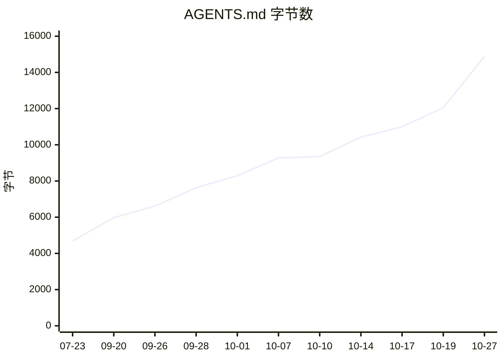
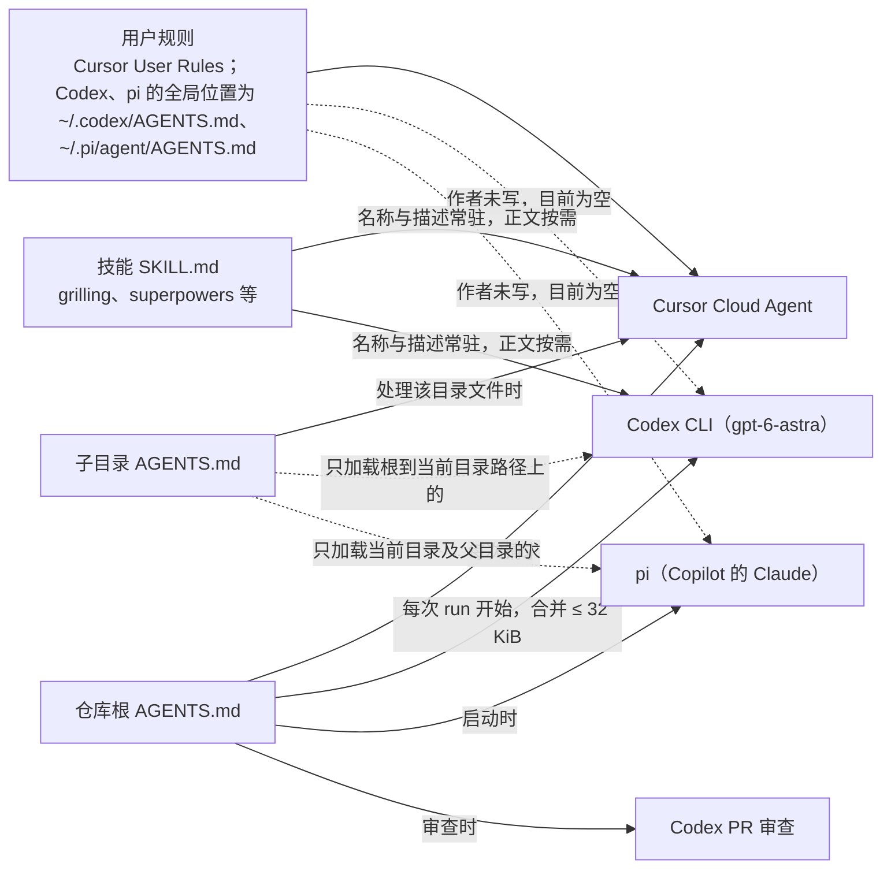
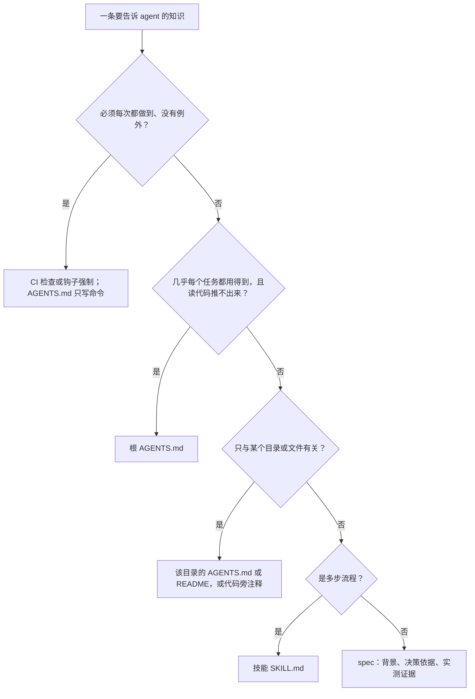
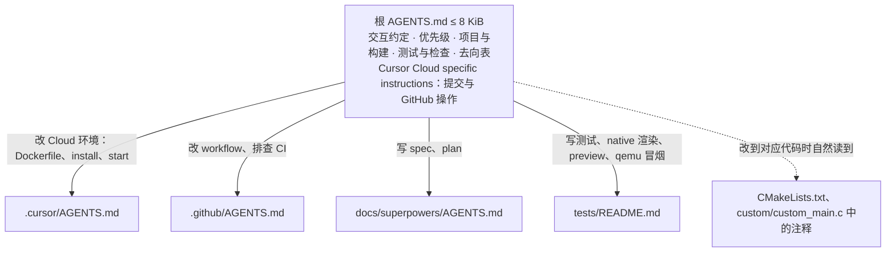
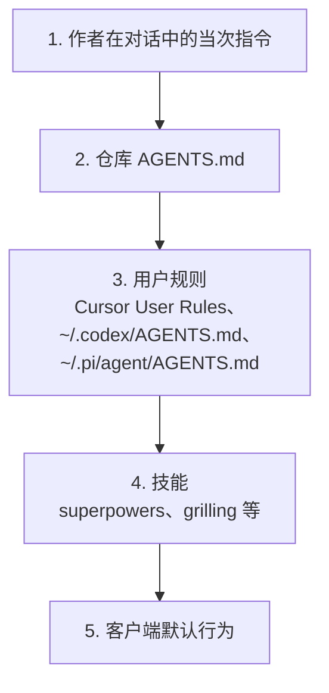

# Luckfox Pico LVGL Example — AGENTS.md 精简与 harness 审视设计规格

- **日期**：2026-11-01
- **状态**：已落地，Codex、pi、Cursor 的问答与行为测试通过，验证证据见 plan
- **分支**：`cursor/agents-md-slim-d7ec`（起点 `origin/dev` `de8dddb`，即 PR #16 合入）
- **范围来源**：作者 2026-11-01 提出：GPT-6 Astra 对 `AGENTS.md` 等文件中的指令更敏感，而本仓库 `AGENTS.md` 几乎每个 PR 都改、越来越长；精简它，并检查 `AGENTS.md` 之外还有哪些 harness 内容需要改
- **关联计划**：[`../plans/2026-11-01-lvgl-example-agents-md-slim.md`](../plans/2026-11-01-lvgl-example-agents-md-slim.md)

---

## 1. 概述与目标

`AGENTS.md` 是每个会话开始时自动注入上下文的文件：Cursor 每次请求都带着它，Codex 与 pi 在每次 run 开始时读入并在整个会话中保留（§2.2）。它从 2026-07-23 的 4,694 字节涨到 14,883 字节，21 个提交、16 个已合并 PR 中的 14 个改过它（§2.1），内容里混着只适用 Cursor Cloud VM 的环境细节、CI 内部实现、会过时的数字和只与个别文件有关的背景（§2.6）。作者写代码用 Codex 的 `gpt-6-astra`，OpenAI 的 GPT-6 文档指出它更容易被 `AGENTS.md` 与技能中的指令影响，指令不清或互相冲突时会提前停下（§2.3）。

目标：

1. 根 `AGENTS.md` 只保留几乎每个任务都用得到、又不能从代码推出来的内容，体积降到预算以内（§3.2，Q1）。
2. 移出的内容按「离用到它的地方最近」放置，根文件用一张去向表指过去，不删信息（§3.1、§3.3，Q2、Q3）。
3. 写明用户指令、`AGENTS.md` 与技能之间的优先级，去掉可能让模型无谓停下的措辞（§3.4，Q4、Q5）。
4. 用 CI 检查守住体积预算，避免以后每个 PR 又把它写长（§3.5，Q6）。
5. 仓库外同样会影响模型行为的 harness 内容按需修改：执行者能改的直接改，不能改的写明改法交作者，两者都在 §3.6 留痕（Q7、Q11）。

**不在本规格范围**：superpowers 插件文件本身（Cursor 插件缓存，执行者与作者都不改，用优先级声明约束，Q11）；作者 macmini 上的文件（执行者访问不到，§3.6 给出改法）；新增 `CLAUDE.md`、`GEMINI.md`（Q8）；C 代码与测试用例的行为改动。

### 1.1 为什么值得改

本节同时用作 PR 描述的开头。

- **体量**：`AGENTS.md` 从 4,694 字节涨到 14,883 字节，已合并的 16 个 PR 中有 14 个改过它，字节数从未下降。现在 74 行，看似远低于用户规则 4 的约 150 行，但不硬折行时每行平均约 200 字节，行数反映不出体量（§2.1）。
- **内容错位**：除交互约定外，所有内容都放在 `Cursor Cloud specific instructions` 之下。Cursor 官方说这一节只用来放 Cloud 专属说明，在 macmini 上用 Codex、pi 时，模型分不清哪些只适用 Cloud VM（§2.4、§2.6）。
- **占篇幅的内容**：「GitHub Actions」一节 3,202 字节，是最大的一节，大半是 CI 内部实现；还有告警 121、120 条这类会过时的数字，是几乎每个 PR 都要回来改它的主因（§2.6）。
- **Astra 的敏感点**：OpenAI 文档说 GPT-6 Astra 对 `AGENTS.md` 和技能中的指令更敏感，指令不清或冲突时会提前停下。现在全文没写用户指令、`AGENTS.md`、技能三者谁优先，「不确定时用 grilling 询问」也可能成为无意的停顿点（§2.3、§2.6）。

## 2. 背景

### 2.1 `AGENTS.md` 的现状

`origin/dev` `de8dddb` 上共 74 行、14,883 字节、9,800 个字符。作者的用户规则 4 把每轮自动加载文件的目标定为约 150 行，并要求因不硬折行同时看字节数；74 行看似远低于目标，实际每行平均约 200 字节，行数反映不出体量。

| 节 | 字节 | 适用范围 |
|---|---|---|
| 交互约定 | 111 | 通用 |
| `Cursor Cloud specific instructions` 标题与说明 | 133 | — |
| 项目简介 | 510 | 通用 |
| Cloud Agent 环境（Dockerfile 模式 / 配置即代码） | 1,703 | 只适用 Cursor Cloud VM；改环境时才需要 |
| 提交与 GitHub 操作 | 1,586 | 只适用 Cursor Cloud VM；每次提交都需要 |
| 构建（标准开发流程） | 1,494 | 通用 |
| GitHub Actions（交叉编译门禁） | 3,202 | 通用；大部分只在改 workflow 或排查 CI 时需要 |
| Lint（代码检查） | 836 | 通用；大部分只在改 `CMakeLists.txt` 告警段时需要 |
| 测试 | 813 | 通用 |
| 运行 / 验证 GUI（重要陷阱） | 2,760 | 通用；其中 WiFi 判据只在改板型判断时需要 |
| 文档（spec 与 plan） | 1,725 | 通用；只在写 spec、plan 时需要 |

除「交互约定」外，所有内容都在 `## Cursor Cloud specific instructions` 之下。

增长过程（每个日期取当天最后一个提交）：

已合并的 16 个 PR 中有 14 个改了它，只有 #2、#15 没改。每次的改动都是「把本 PR 新发现的事实追加进去」，字节数从未下降。

### 2.2 谁在什么时候加载 `AGENTS.md`

作者实际使用的客户端（Project Context 中的工作流文档与 harness 清单）：Cursor Cloud Agent 负责协调、spec 与文字类工作；Codex CLI（`gpt-6-astra`）按 plan 写代码；pi 经 GitHub Copilot 订阅调用 Claude 做只读复核；PR 上另有 Codex 的自动审查。

| 客户端 | 何时加载 | 加载哪些文件 | 依据 |
|---|---|---|---|
| Cursor（含 Cloud Agent） | 根文件每次请求都在上下文中（作为 always-applied 规则）；子目录文件在读取该目录的文件时附在读取结果末尾 | Cloud Agent 中规则取自 Environment Build 时的缓存，各层 `AGENTS.md` 都在缓存里，只有根文件常驻（§2.2、§3.3.1） | Cursor Rules 文档；本 PR 的云端实测（plan §5） |
| Codex CLI | 每次 run 开始时构建一次指令链，整个会话保留 | `~/.codex/AGENTS.md`，再从仓库根逐层到当前目录，每层一个文件；合并后上限 `project_doc_max_bytes`，默认 32 KiB，超出截断 | Codex AGENTS.md 文档 |
| pi | 启动时 | `~/.pi/agent/AGENTS.md`，以及当前目录与各级父目录的 `AGENTS.md` / `CLAUDE.md`；`-nc` 关闭 | harness 清单 Rules 一节 |
| Codex 的 GitHub 代码审查 | 审查 PR 时 | 离被审代码最近的 `AGENTS.md`，其中 `## Code Review Rules` 一节作为审查规则 | Codex AGENTS.md 文档 |
| Claude Code（作者目前不直接使用） | 每个会话开始时 | 没有 `CLAUDE.md` 时读 `AGENTS.md`（v2.1.277 起）；子目录的按需加载 | Claude Code memory 文档 |
| Gemini CLI（作者目前不使用） | 每次提示 | 默认只读 `GEMINI.md`，要在 `settings.json` 的 `context.fileName` 加上 `AGENTS.md` | Gemini CLI GEMINI.md 文档 |

两个结论：

- 「模型每次都会读取」成立：三个客户端都在会话开始时整份注入，之后每次模型调用都带着它（多数按缓存读计费）。文件越长，每次调用的固定成本越高，与任务无关的指令也越多。
- 子目录 `AGENTS.md` 只有 Cursor 会按需自动加载；Codex 与 pi 从仓库根启动时看不到根以下的文件，所以根文件里必须写明「做什么事之前读哪个文件」，不能只靠自动加载。
- Cursor Cloud 注入的规则取自 Environment Build 时的缓存：`/opt/cursor/.exec-daemon/request-context-cache.json` 的 `requestContext.rules` 只有根文件一条，内容与构建时检出的 `dev`（`de8dddb`）逐字相同，写入时间（2026-10-31 20:16:24，与 `builtAtMs` 一致）早于本 VM 启动；在本分支上新开的云端 Run 中同样如此，其 git reflog 显示 Run 启动后才从 `dev` 切到本分支（plan §5）。所以改 `AGENTS.md` 之后，要有新的 Environment Build 把它写进缓存，Cursor Cloud 才会注入新版；同一 Run 中或从旧 Build 启动的 Run 中的验证要另起不受此影响的客户端（本 PR 用 Codex、pi），或从本分支做草稿 Build 后在其上新开 Run（§4.1.3）。
- 缓存的生成：exec-daemon 的子命令 `prebuild-request-context-cache`（说明为「Compute the request context and write it to disk for snapshot reuse」）在 Environment Build 中计算请求上下文（规则、技能等）并写入该文件；之后请求标记为使用缓存时，直接返回缓存内容，只合并插件规则，缓存缺失时才现场计算。本环境每天由系统自动构建一次（`list-environment-builds` 中 `source: SYSTEM`、`triggerType: RECURRING`，约 4 分钟），所以合并到 `dev` 后，当天的定时构建会把新版写入缓存；也可手动触发。在检出目录中运行 `prebuild-request-context-cache --cloud-rules-enabled` 可在本地生成同样的缓存（§2.9）：本分支的结果是 `requestContext.rules` 4 条、`cloudRule` 只含根文件，与云端一致。从本分支构建的草稿 Build 中，缓存的 `requestContext.rules` 有 4 条，即根文件与三个子目录 `AGENTS.md`，类型都是 `global`，但只有根文件作为常驻规则注入（§3.3.1、plan §5）。

### 2.3 GPT-6 Astra 的行为变化

OpenAI「Using GPT-6」文档的「GPT-6 Astra behavior」一节与本 PR 相关的几点：

- **指令遵循**：比以往模型更严格地遵循指令，也对技能和 `AGENTS.md` 等文件中的指令更敏感；官方强烈建议审查模型能读到的技能与文件中会影响其行为的指令。
- **停下询问**：更倾向于在补充信息可能改变结果时向用户提问，用户期望它自行假设并继续时也可能停下；技能文件中不清楚或互相冲突的指导会让它提前停下、阻塞工作。官方建议写明用户指令与技能的优先级，并让模型在因技能停下或偏离时指出是哪个文件的哪句话。
- **测试与验证**：编码任务中倾向于充分测试，小任务上可能做超出需要的测试。

作者的用户规则 2（发现改进点必须 STOP 汇报）与 7（开 PR 前用 grilling 询问）是有意设置的停止点；本 PR 要去掉的是仓库文件中「无意的」停止点和互相冲突的说法，不改这两条用户规则。

### 2.4 各家官方建议

| 来源 | 体积 | 放什么 | 放不下时 |
|---|---|---|---|
| OpenAI Codex（Customization、AGENTS.md、Best practices） | 合并预算默认 32 KiB；「Keep it small」，短而准确胜过长而含糊 | 构建、测试、lint 命令，评审期望，仓库约定，目录级说明，「完成」的含义；同一错误出现两次再加规则 | 主文件保持简洁，引用按任务拆分的 Markdown；目录级规则放到最近的子目录；用 pre-commit、linter 等基础设施强制执行 |
| Anthropic Claude Code（Memory、Best practices） | 每个文件目标 200 行以内，越长越占上下文、遵循度越低；`@` 导入不减少成本 | 只放读代码推不出来的：确认工作的命令、误导性的代码、仓库外的决策、纠正过两次的事 | 只与部分代码有关的放 path-scoped 规则；多步流程放技能；必须每次都做到的放 hook；反复加 IMPORTANT 不如缩短文件 |
| Google Gemini CLI（GEMINI.md） | 未给数字 | 项目说明、风格 | 用 `@file.md` 拆分；子目录文件在工具访问该目录时按需加载 |
| Cursor（Rules、Cloud Agent setup） | 单条规则 500 行以内 | 具体、可执行、有范围的规则；引用文件而不是复制内容 | Cloud 专属的环境与测试说明设专用小节，可命名为 `Cursor Cloud specific instructions`，该节变大时引用其他文件；子目录 `AGENTS.md` 自动按目录生效 |
| agents.md | 无必填字段 | 给新同事会讲的内容 | 大型仓库用嵌套文件，离被改文件最近的优先，用户在对话中的指令覆盖一切 |

共识：根文件短；只写推不出来的内容；按位置拆分并在根文件引用；能用工具强制的交给工具；用户当次指令优先。

### 2.5 仓库内外的其他 harness 内容

| 内容 | 位置 | 何时进入上下文 | 在仓库内 | 与本 PR 的关系 |
|---|---|---|---|---|
| 根 `AGENTS.md` | `/workspace/AGENTS.md` | 每个会话（§2.2） | 是 | 本 PR 主要改动 |
| grilling 技能 | `.cursor/install.sh` 下载到 `~/.cursor/skills/grilling/SKILL.md`（固定提交 `85f83d3`） | Cursor：名称与描述常驻，作者要求时读正文 | 安装脚本在 | 只在作者要求时使用，正文的「确认前不行动」是该技能的本意；不改。`AGENTS.md` 中「不确定时用 grilling 询问」会把它变成隐式停止点（Q5） |
| `tests/README.md` | 仓库 | 按需（`AGENTS.md` 引用） | 是 | 接收测试相关内容（§3.3） |
| `tests/tools/docs/` 两个脚本的注释 | 仓库 | 按需 | 是 | 注释引用「`AGENTS.md`『文档（spec 与 plan）』一节」，规则移走后同步改（§3.3） |
| 历史 spec 与 plan | `docs/superpowers/` | 按需；单份 30–60 KB | 是 | `AGENTS.md` 现链接其中 3 份；只在确有需要时引用，避免引导模型读整份长文档 |
| `.github/workflows/` | 仓库 | 不自动加载 | 是 | 规则的强制执行层：`🐚 ShellCheck`、`📝 文档检查` 与本 PR 新增的体积检查 workflow 已强制的规则，`AGENTS.md` 只需写命令（§3.5） |
| 用户规则 | Cursor User Rules，原文存于 Project Context `internal/user-rules.md`；作者 macmini 上的 `~/.codex/AGENTS.md`、`~/.pi/agent/AGENTS.md` 没有写内容 | Cursor：每个会话；Codex、pi：没有 | 否 | Cursor 中与 `AGENTS.md` 叠加；Codex 与 pi 读不到用户规则，只有仓库 `AGENTS.md` 与派工提示词，所以优先级等约束必须写进仓库文件（§3.4.1、§3.6） |
| superpowers 插件技能 | Cursor 插件缓存；Codex `/plugins`、pi `pi install` 安装 | 名称与描述常驻 | 否 | `using-superpowers` 写有「哪怕只有 1% 可能适用也 ABSOLUTELY MUST 调用」，正是 §2.3、§2.4 所说会被过度执行的强调写法；建议见 §3.6 |
| Codex 公共指令 | Project Context `workflows/codex-dev.md` 所述 `/tmp/codex-run/common.md` | 每个 Codex Task | 否 | 建议见 §3.6 |

### 2.6 现有内容的问题

1. **通用内容放在 Cloud 专属标题下**：Cursor 建议的 `Cursor Cloud specific instructions` 是给 Cloud 专属说明用的（§2.4），本仓库把构建、测试、文档规则都放在它下面。在 macmini 上用 Codex、pi 时，模型分不清哪些只适用 Cloud VM。真正只适用 Cloud VM 的是「Cloud Agent 环境」与「提交与 GitHub 操作」两节（共 3,289 字节）。
2. **CI 内部实现占比最大**：「GitHub Actions」一节 3,202 字节，多数是 job 的实现细节（`mutate.sh` 的退出码含义、artifact 保留天数、`--user 0` 的原因、镜像 attest 方式），只在改 workflow 或排查 CI 时需要，workflow 文件本身就能读到。所有任务都用得到的只有两条：改 `.cursor/Dockerfile` 的 PR 在合并前 `build-image` 必然失败；新推送会取消正在运行的 CI，文档修订要攒到一起推。
3. **会过时的数字与细节**：告警基线 121、120 条，工具链约 233 MB，artifact 保留 7 天，QA 豁免 6 份，Dockerfile 的 apt 包清单。这些数字在后续 PR 中会变，每次都要回来改，是 `AGENTS.md` 每个 PR 都被修改的主要原因之一。
4. **与其他文件重复**：测试命令与 `tests/README.md` 重复；构建命令与 `README.md` 重复；文档标题规则已由 `check-headings.py` 在 CI 中强制执行。
5. **只与个别文件有关的背景**：WiFi 判据（`custom/custom_main.c`）、告警段与 `add_compile_options()` 的位置（`CMakeLists.txt`）、`tests/support/app_env.c` 的来历。离代码最近的位置是代码旁的注释或该目录的说明文件。
6. **可能造成无谓停顿的措辞**：「文档」一节中「执行中途插入 Task 时……不确定时用 grilling 询问」；全文也没有写明用户指令、`AGENTS.md`、技能三者冲突时以谁为准（§2.3）。
7. **过时的说明**：「保留该英文章节标题作为工具约定锚点」源自 PR #1 时对 Cursor 文档的理解，现行文档只把该标题作为示例（§2.4），没有逐字匹配的要求。

### 2.7 Cloud Agent 中提交与 PR 的实测

现有 `AGENTS.md`「提交与 GitHub 操作」一节有两处与 2026-11-01 的实测不符，精简时按实测改写：

- **创建 PR**：Cloud Agent 自带的 PR 管理工具可以创建 PR，本 PR #17 即由它创建（草稿）；在 Cloud Agent 环境中用 `gh`（`cursor` 账户登录）创建 PR、改 PR 正文、发评论仍然失败（作者确认）。现有说法只写了后者。
- **co-author 钩子**：
  - `~/.cursor/agent-hooks/<id>/` 中的 `commit-msg.cursor.co-author`、`prepare-commit-msg.cursor.co-author` 标有 `@cursor-managed`，修改时间就是本次 Agent Run 的启动时间；追加的是发起本次 Run 的 Cursor 账户，本次是一个工作邮箱，而不是现有文字写的 GitHub noreply 地址。
  - 现行脚本只在说明中没有「完全相同」的那一行时追加，说明里已有别的 `Co-authored-by` 也照样追加；`prepare-commit-msg` 那份在 `--no-verify` 时也会运行（cherry-pick、rebase、am 除外）。
  - 直接修改这两个文件立即生效（在临时仓库中提交验证，只追加了 noreply 地址），但新的 Agent Run 会重新生成；Cursor 论坛的官方答复是托管 Cloud Agent 目前没有关闭或更改该 co-author 的设置。
  - 全部分支的提交历史中，作者、提交者与说明都没有这个工作邮箱；历史中的 63 行 `Co-authored-by` 都是 noreply 地址（PR #7–#9）。

所以根文件要写清钩子追加的是发起本次 Run 的账户、每次 Run 重新生成。作者随后决定允许带该尾注，但地址只能是 GitHub noreply 地址（Q20）：每次 Run 第一次提交前检查两个钩子中的地址，不对就改；不再需要用 `git -c core.hooksPath=/dev/null` 绕过钩子去掉尾注。

### 2.8 SDK 仓库 `AGENTS.md` 的借鉴

作者给出的链接指向本仓库 `dev` 的 `AGENTS.md`；`dev` 在 `de8dddb` 之后没有新提交，内容就是本 PR 精简前的原文，每一句的去向见 plan 附录 B。名字相近的 SDK 仓库 `yuangezhizao/luckfox-pico@dev` 有一份 7,523 字节的 `AGENTS.md`（最后修改于 `e9ed0e7f`，2026-10-05），按 Q12 的推荐对照如下：

| SDK 仓库的内容 | 本仓库的情况 | 处理 |
|---|---|---|
| 「成功判据」：`./build.sh` 退出码 0 且 `IMAGE/` 下出现新存档 | 没有写「完成」的判据，也没有按改动范围选检查的说明 | 根文件「测试与检查」加「按改动范围选检查」（Q13） |
| 编译会原地改写被跟踪的预编译件，提交前 `git status` 检查并恢复 | 构建只写 `build/`、`build-tests/`、`install/` 与 `/tmp`，都不被跟踪；原文「`.gitignore` 只忽略 `build/`、`install/`」漏了 `build-tests/` | 不借鉴；根文件中这一句按 `.gitignore` 更正 |
| 编译时不要滥用 `sudo` | 没有出现过因 `sudo` 导致的问题 | 不加：出现重复错误再加（§2.4） |
| README 的选板菜单过时，以 `AGENTS.md` 为准 | 本仓 README 的构建命令与 `CMakeLists.txt` 一致 | 不适用 |
| 选板、Buildroot 下载包、桌面与 VNC、与 ESP-IDF 项目的区别 | 本仓库不涉及 | 不适用 |

SDK 仓库的 `AGENTS.md` 也有 §2.6 第 1、7 条的问题：全部内容都在 `Cursor Cloud specific instructions` 之下，并保留了「锚点」说明，另开该仓库的 PR 处理（§9，Q14）。

### 2.9 exec-daemon 的子命令

Cursor Cloud Agent 的 VM 中，`/exec-daemon/index.js` 是 agent 工具调用的执行端（Node 程序，由 `/exec-daemon/node` 运行）。`/exec-daemon/node /exec-daemon/index.js --help` 列出 4 个子命令（另有 `help`），以下选项取自各子命令的 `--help`（2026-11-01 本 VM）；只读帮助文本，没有运行前三个子命令。

#### 2.9.1 `refresh-git-token`

刷新 git 配置中的 GitHub 访问令牌后退出。选项：

| 选项 | 说明 |
|---|---|
| `--token <token>` | GitHub 访问令牌 |
| `--hostname <hostname>` | git 主机名，如 `github.com`、`gitlab.com` |
| `--repo-url <repoUrl>` | 按仓库限定的 git 认证所用的仓库地址 |
| `--exact-repo-path` | 需配合 `--repo-url`：只认证该仓库（带或不带 `.git`）及其下路径，不认证同级的其他仓库 |
| `--clone-username <cloneUsername>` | 与令牌配对的克隆用户名 |
| `--rewrite-from-url <rewriteFromUrl>` | 需配合 `--repo-url`：把这个 https 克隆地址改写到已认证的仓库地址，并让从该地址克隆的远端指向它 |
| `--verbose` | 输出不含令牌的分步耗时日志 |

对本仓库的意义：`~/.gitconfig` 中 `url.<带令牌的地址>.insteadOf` 与凭据助手由它维护，令牌会被环境定期刷新；手工 `gh auth login` 的状态因此随时可能被覆盖（§2.7），需要 `gh` 写操作时要尽快完成，输出中带令牌的地址要打码。

#### 2.9.2 `refresh-git-tokens`

一次刷新多个按仓库限定的 git 访问令牌后退出；`--token`、`--hostname`、`--repo-url` 每个仓库各给一次。用于多仓库工作区，本仓库只有一个仓库，不涉及。

#### 2.9.3 `prebuild-request-context-cache`

计算请求上下文并写盘，供快照复用；写入固定路径 `/opt/cursor/.exec-daemon/request-context-cache.json`，没有指定输出路径的选项。选项：

| 选项 | 说明 | 对本仓库的意义 |
|---|---|---|
| `--cloud-rules-enabled` | 生成 `cloudRule` | 实测 `cloudRule` 只含根 `AGENTS.md`，即常驻的一份（§3.3.1） |
| `--multi-root-cloud-rule-omits-agents-md` | 多个工作区根时，不把各根的 `AGENTS.md` 放进 `cloudRule` | 单仓库，不涉及 |
| `--hook-repo-path <path>` | 当前目录之下、其项目钩子在该仓库内运行的仓库（可重复） | 与 `core.hooksPath` 指向的 Cursor 钩子相关（§2.7） |
| `--mcp-meta-tool-enabled`、`--mcp-meta-tool-slim-descriptors`、`--mcp-input-schema-json` | MCP 工具的发现方式与烘焙时的精简 | Cursor 自己也只让 MCP 工具的名称常驻、详情按需读取 |
| `--strip-agent-skill-content` | 不烘焙非插件技能的正文 | 技能同样只有名称与描述常驻，与本 PR「根文件常驻、细节按需」一致 |
| `--claude-md-enabled` / `--no-claude-md-enabled` | 是否加载 `CLAUDE.md`（默认开启） | 新增 `CLAUDE.md` 会在 Cursor 中重复注入，Q8 不加 |
| `--project-dir <path>` | 覆盖项目目录 | 实测要在被预览的检出目录中运行才得到正确结果 |
| `--rg-path <path>`、`--log-level <level>` | ripgrep 路径与日志级别 | — |

对本仓库的意义：它是 Cursor Cloud 常驻规则的来源（§2.2）。在检出目录中运行 `prebuild-request-context-cache --cloud-rules-enabled`，可以在本地看到 Cursor 会缓存哪些规则，验证 `AGENTS.md` 的改动不必跑云端构建；它会覆盖本机正在使用的缓存，运行前备份、看完还原（plan 附录 A.6）。

#### 2.9.4 `serve`

启动 exec daemon 服务，即本 VM 上执行 agent 工具调用的常驻进程（本 VM 中为 PID 63）。`--help` 列出 61 个选项（含 `-h`），按用途分组：

| 分组 | 选项 |
|---|---|
| 端口与认证 | `--port`（默认 8080）、`--pty-websocket-port`（默认 8081）、`--auth-token`（必填）、`--pty-auth-token` |
| 规则与项目 | `--cloud-rules-enabled`、`--multi-root-cloud-rule-omits-agents-md`、`--hook-repo-path`、`--project-dir`、`--claude-md-enabled` / `--no-claude-md-enabled` |
| 技能 | `--strip-agent-skill-content`、`--filter-model-disabled-skills`（不放入 `disable-model-invocation` 的技能）、`--agent-store-skills-dir`（Agent Store 中的技能目录，可重复） |
| MCP | `--mcp-config`、`--mcp-config-file`、`--mcp-oauth-server-urls`、`--http-mcp-tools-file`、`--mcp-meta-tool-enabled`、`--mcp-meta-tool-slim-descriptors`、`--mcp-input-schema-json`、`--session-mcp-enabled` |
| 钩子 | `--nested-claude-hook-output-normalization-enabled`、`--command-hook-stdin-transport-enabled`（命令钩子经 stdin 而不是 argv 传参） |
| 计算机操作与浏览器 | `--browser-enabled`、`--chrome-executable-path`、`--computer-use-enabled`、`--computer-use-lazy-init`、`--computer-use-api-width`、`--computer-use-api-height`、`--desktop-lease-enforce`、`--record-screen-enabled`、`--generate-image-enabled` |
| 沙箱与只读模式 | `--sandbox-enabled`、`--sandbox-helper-path`、`--sandbox-policy`、`--read-only-bare-mode`、`--read-only-bare-repo-path` |
| Agent Store（FUSE） | `--agent-store-fuse-liveness-kill` 及 `-hung-only`、`-relaunch-grace`、`-kill-chain-cap`，`--fuse-dispatch-stats`、`--fuse-dispatch-stats-interval-ms`、`--agent-store-conflict-notices`、`--agent-store-quota-notices` |
| 追踪 | `--trace-endpoint`、`--trace-auth-token`、`--ghost-mode`（默认 true，关闭追踪）、`--trace-insecure`、`--trace-attributes` |
| 其他 | `--tmux-service-enabled`、`--tmux-path`、`--tmux-conf-path`、`--machine-resources-enabled`、`--origin-cli-enabled`、`--grove-workspace`、`--orbitd-proxy-socket`、`--rg-path`、`--log-level`、`--cursor-self-control-enabled`（已弃用） |

本 VM 上该进程实际带的开关（端口、令牌、MCP 配置与追踪属性等值不记录）：`--strip-agent-skill-content`、`--filter-model-disabled-skills`、`--agent-store-skills-dir /cursor/stores/user/skills`、`--mcp-meta-tool-enabled`、`--mcp-meta-tool-slim-descriptors`、`--mcp-input-schema-json`、`--tmux-service-enabled`、`--origin-cli-enabled`、`--generate-image-enabled`、`--nested-claude-hook-output-normalization-enabled`、`--command-hook-stdin-transport-enabled`、`--ghost-mode true`、`--trace-endpoint`，以及 Agent Store 的 FUSE 开关；没有 `--cloud-rules-enabled` 与 `--sandbox-enabled`。

对本仓库的意义：

- 技能正文、MCP 工具描述不常驻，与本 PR「根文件常驻、细节按需」是同一思路，Cursor 在运行时也这样做。
- `--filter-model-disabled-skills`：设了 `disable-model-invocation` 的技能不进入上下文，以后若在仓库中加只能由人启动的技能（如发布流程），不会占用常驻上下文。
- `--tmux-service-enabled` 即本 PR 运行 Codex、pi 所用的 tmux 会话服务；`--sandbox-enabled` 未开启，所以 agent 的 shell 命令不在沙箱中，Codex、pi 的 `--yolo` 与只读要求只能靠隔离的 worktree、克隆与提示词保证（plan 附录 A.2）。

## 3. 设计（以 §8 QA 结论为准）

### 3.1 放置原则

一条新知识按下图决定放哪里，本 PR 移出的内容和以后各 PR 新增的内容都按此判断：

### 3.2 根 `AGENTS.md` 的目标结构（Q1、Q3、Q4）

预算：8 KiB（8,192 字节）以内（Q1）。各节：

1. `## 交互约定`：中文回复（不变）。
2. `## 优先级`：作者当次指令优先于本文件，本文件优先于技能中的流程要求；superpowers 等技能的流程在本仓库只作可选参考，作者已明确同意不必为满足技能流程而停下或补做步骤，spec 与 plan 仍按 `docs/superpowers/AGENTS.md` 的格式写；因本文件或技能而停下、请求确认或偏离任务时，说明是哪个文件的哪一句（Q4、Q11）。
3. `## 项目与构建`：项目一句话；只能交叉编译、未设 `GLIBC_COMPILER` 或 `LUCKFOX_SDK_PATH` 时 `CMakeLists.txt` 提前 `return()`；glibc、uClibc 两条构建命令；板上跑的是 uClibc 产物；产物不能在 VM 上运行，权威验证是真机。
4. `## 测试与检查`：`ctest` 一行命令；ShellCheck 与文档检查各一行命令；按改动范围选检查（§2.8、Q13）；其余指向 `tests/README.md`。
5. `## 提交约定`：标题按 cz-conventional-emoji v1.1.8 的格式，type 由 gitmoji 决定，scope 必填；一个提交一件事；正文写 diff 看不出的原因、不写过程、不硬折行；关联 spec 用 `Refs:` 脚注；spec 与 plan 放在 PR 的最后一个提交（Q15–Q19）。
6. `## 去向表`：做什么事之前读哪个文件（§3.3）；最后一行是「新增给 agent 的约定前，按本 spec §3.1 判断放哪」（§3.5）。
7. `## Cursor Cloud specific instructions`：只放 Cloud VM 专属内容，即「提交与 GitHub 操作」的全部要点（每次提交都要用，不能放进只在改 `.cursor/` 时才加载的文件），其中 `Co-authored-by` 只允许 GitHub noreply 地址（Q20），以及一句「改 Cloud 环境前读 `.cursor/AGENTS.md`」（Q3）。

### 3.3 移出内容的去向（Q2）

| 现节 | 留在根文件 | 移到 |
|---|---|---|
| 项目简介 | 一句话 | vendored 库、Dockerfile 模式的说明并入 `.cursor/AGENTS.md` |
| Cloud Agent 环境 | 一句指向 | `.cursor/AGENTS.md`（新建） |
| 提交与 GitHub 操作 | 全部要点，压缩措辞，并按 §2.7 的实测更新 | — |
| 构建 | 坑与两条命令 | uClibc 工具链稀疏检出的完整命令保留在根文件（CI 对齐时常用）；`make install` 产物布局并入 `README.md` 已有说明或保留一句 |
| GitHub Actions | 两条（§2.6 第 2 条） | `.github/AGENTS.md`（新建）：各 job 的触发、镜像、失败输出与限制 |
| Lint | 一句：无 C linter、无 `-Werror`，告警只记录不作门禁 | `-std=gnu99`、`add_compile_options()` 位置与 `-O0` 现状写成 `CMakeLists.txt` 告警段旁的注释；121、120 条基线不再写进常驻文件，需要时由命令现场统计（命令放 `.github/AGENTS.md`） |
| 测试 | 一行命令 | `tests/README.md`：32 位测试条件、不调用 `custom_init()` 的原因（已部分存在，补齐） |
| 运行 / 验证 GUI | 产物不能在 VM 上运行、权威验证是真机 | qemu 冒烟命令与 preview、`app_env.c` 的来历并入 `tests/README.md`；WiFi 判据并入 `custom/custom_main.c` 判定函数旁的注释 |
| 文档 | 一句：写 spec、plan 前读 `docs/superpowers/AGENTS.md`，检查命令一行 | `docs/superpowers/AGENTS.md`（新建）：标题、Task、附录、QA 编号规则与检查器用法；`tests/tools/docs/` 两个脚本注释中的引用同步改 |

目标形态：

逐句的去向在 plan 中列成对照表：根文件现有的每一句，要么留在根文件，要么能在新位置找到，要么属于 §2.6 第 3 条中由命令现场得出的数字；不允许无去向的删除（用户规则 4）。

#### 3.3.1 子目录 `AGENTS.md` 的生效方式与维护（Q2）

子目录 `AGENTS.md` 是放在子目录中、文件名为 `AGENTS.md` 的普通 Markdown 文件，只讲该目录的事。各客户端的读取方式不同：

| 客户端 | 是否自动读取子目录的 `AGENTS.md` | 依据 |
|---|---|---|
| Cursor | 会：读取该目录的文件时，把该目录的 `AGENTS.md` 附在读取结果末尾，不常驻 | Cursor Rules 文档「Nested AGENTS.md support」；本 PR 在草稿 Build 上的云端实测（plan §5） |
| Claude Code | 会：用读取工具打开该目录的文件时加载（该目录没有 `CLAUDE.md` 时） | Claude Code memory 文档 |
| Gemini CLI | 会：工具访问该目录时按需加载（需把 `AGENTS.md` 配进 `context.fileName`） | GEMINI.md 文档 |
| Codex | 不会：只读仓库根到当前工作目录路径上的文件，从仓库根启动时只有根文件 | Codex AGENTS.md 文档 |
| pi | 不会：只读当前目录与各级父目录 | harness 清单 |

- **靠去向表兜底**：作者主要用 Codex 与 pi，真正起作用的是根文件的去向表（「做什么事之前先读哪个文件」），模型读到后主动去读。冷启动复测中 Codex 第一条命令就读了根文件与三个子目录 `AGENTS.md`，10 题全对（plan §5）。Cursor 的自动加载即使不生效，去向表同样适用。
- **Cursor 的按需加载已实测**：在从本分支构建的草稿 Build 上新开的云端 Run 中，常驻规则只有精简后的根文件；读取 `.github/`、`docs/superpowers/`、`.cursor/` 下的文件时，Cursor 在那次读取结果的末尾附上该目录的 `AGENTS.md`（前缀为「The following cursor rule files are relevant to the files you just read:」），不变成常驻规则（plan §5）。所以 Cursor 中子目录说明也只在用到时进入上下文；此前在构建于 `dev` 的 Build 上没有看到它们，是因为那时还没有这些文件（§2.2）。
- **这是常见做法**：agents.md 官网举例 OpenAI 主仓库有 88 个 `AGENTS.md`；OpenAI、Anthropic、Cursor 的文档都建议主文件保持简短、按目录拆分、离代码最近的优先（§2.4）。
- **维护成本**：文件由 1 个变为 4 个，每个只讲一个目录；改 CI 只改 `.github/AGENTS.md`，改环境只改 `.cursor/AGENTS.md`，根文件不再每个 PR 都改，膨胀时 CI 失败（§3.5）。主要风险是重复内容漂移：同一事实写在几处，改一处忘了其他处。维护规则是每条事实只在一处写完整说明，其他位置只写一句结论并指向它；现有的重复见 §6。
- **备选**：若要更少的文件，可把三个子目录文件改为 `docs/agents/` 下的普通文档，只靠去向表；代价是 Cursor 失去按目录自动加载，Codex 与 pi 不受影响。
- **`Cursor Cloud specific instructions` 仍在根文件**：该节位于根文件末尾，放 Cloud VM 专属的提交与 GitHub 操作；移到 `.cursor/AGENTS.md` 的只是环境配置细节，该节开头指向它。Cursor 把整份根文件作为常驻规则注入，不按标题查找内容（§2.4、Q3）。

### 3.4 优先级与停顿（Q4、Q5）

- 根文件新增「优先级」一节（§3.2 第 2 条），措辞取 GPT-6 文档建议的意思，写成一两句中文。
- 「文档」规则中插入 Task 的一句改为「按位置插入，后面的 Task 顺延并同步引用」，去掉「不确定时用 grilling 询问」（Q5）。用户规则 2 对 plan 偏离要求 STOP 汇报，仍照常适用。
- 不加「不要停下」「一直做到完成」之类的鼓动语：Anthropic 文档指出这类话更容易导致过度工作，作者的停止点由用户规则决定。

#### 3.4.1 各层指令的优先级（Q11）

superpowers 是 Cursor 插件，文件在插件缓存中，改了也会在更新时被覆盖，所以不改插件，而是在更高优先级的指令里约束它。各层的先后：

- **对话指令最高**：agents.md 的 FAQ 写明对话中的明确指令覆盖一切；`using-superpowers` 自己也写「User instructions (CLAUDE.md, AGENTS.md, GEMINI.md, etc, direct requests) take precedence over skills」。
- **仓库 `AGENTS.md` 高于用户规则**：Cursor Rules 文档写明冲突时 Team Rules、Project Rules、User Rules 依次优先，`AGENTS.md` 是项目级规则的简化形式（文档没有单独写它在顺序中的位置）；Codex 先读 `~/.codex/AGENTS.md` 再读仓库文件，后出现的覆盖先出现的；pi 同样先全局后项目（harness 清单）。
- **用户规则与 `AGENTS.md` 都高于技能**：`using-superpowers` 把两者都列为「User instructions」，并写「Only skip skill workflows or instructions when your human partner has explicitly told you to」。所以约束要写成作者明确同意跳过的形式（§3.2 第 2 条），只写「技能可选」可能不够。
- **放在哪一层**：本仓库的约束写进 `AGENTS.md`，Cursor、Codex、pi 都读；作者 macmini 上的 `~/.codex/AGENTS.md`、`~/.pi/agent/AGENTS.md` 没有写内容，Codex 与 pi 读不到用户规则，仓库 `AGENTS.md` 是它们唯一的一层。其他仓库也想同样处理时，Cursor 写进用户规则，Codex、pi 写进这两个全局文件（§3.6）。

### 3.5 体积检查（Q6）

- CI 新增单独的 workflow `.github/workflows/agents-md-size.yml`：根 `AGENTS.md` 超过 8,192 字节时失败，并打印当前字节数与 §3.1 放置原则的位置。
- 它只在根 `AGENTS.md` 变化时由 `dev` 的推送与指向 `dev` 的 PR 触发，在 runner 上直接运行，不用容器、不依赖 `build-image`。不放进主 workflow 的原因有两个：主 workflow 的 `push` 用 `paths-ignore: '**.md'`，只改 `AGENTS.md` 的 dev 推送不会启动它；`📝 文档检查` 依赖 `build-image`，改 `.cursor/Dockerfile` 的 PR 上会被跳过。`dev` 的规则集只禁止删除与强推，不要求经过 PR，所以前一种情况可能发生。最初这一步放在 `📝 文档检查` 中，合并前按 Codex 审查改为单独的 workflow（Q6）。
- 根文件不写维护说明全文，只在去向表中用一行指向本 spec §3.1：放置原则本身会占常驻上下文，只有新增约定时才需要读；`.github/AGENTS.md` 写明这一检查的含义。

### 3.6 仓库外的 harness（Q7）

执行者能改的直接改，不能改的写明改法；实际改动与验证记在 plan。

| 内容 | 执行者能否改 | 处理 |
|---|---|---|
| Cursor User Rules | 不能：在作者的 Cursor 设置中 | 作者按 §3.6.1 的文本修改；改后由协调者同步 Project Context 中的原文副本 `internal/user-rules.md` |
| macmini 上的 `~/.codex/AGENTS.md`、`~/.pi/agent/AGENTS.md` | 不能：执行者访问不到 | 作者目前没有写这两个文件，Codex 与 pi 读不到用户规则（harness 清单的复刻步骤 6 是计划，没有执行）。是否写入由作者决定；写的话可复制 §3.6.1 修改后的用户规则，其中规则 1 的开场声明等只与 Cursor 有关的条目按需删去 |
| superpowers 插件 | 不改：插件缓存，更新时被覆盖 | 用仓库 `AGENTS.md` 的优先级一节约束（§3.4.1） |
| Codex 公共指令要点（Project Context `workflows/codex-dev.md`） | 能 | 加一条：因 `AGENTS.md`、用户规则或技能而停下、请求确认或偏离任务时，在汇报中指出文件与原句，便于发现剩余的冲突指令（§2.3） |
| 本 VM 的 Codex | 能 | 为冷启动问答安装 Codex CLI 0.166.0，作者设备码登录；问答时不放 `~/.codex/AGENTS.md`，与作者 macmini 的现状一致（Q9） |
| 本 VM 的 pi | 能 | 安装 pi 1.4.0，作者分别用设备码登录 `openai-codex` 与 `github-copilot`，前者与 Codex 同模型，后者用 Claude 做跨模型对照；不放 `~/.pi/agent/AGENTS.md`（§4.1.2） |
| Cloud Agent 的 co-author 钩子 | 能，只对本次 Agent Run 有效 | 作者要求不把工作邮箱写进 git：本 VM 的 `commit-msg.cursor.co-author`、`prepare-commit-msg.cursor.co-author` 改为 GitHub noreply 地址；新的 Agent Run 会重新生成，所以根文件写明每次 Run 第一次提交前检查并修改（§2.7、Q20） |
| Codex 子代理与测试强度 | — | 不改：GPT-6 文档指出 Astra 委派偏少、测试偏多，本项目的 plan 已规定每个 Task 的红绿与回归范围，观察到问题再加 |

#### 3.6.1 用户规则的修改文本

1. 规则 4 中「AGENTS.md 等每轮自动加载的文件目标 ~150 行，且因不硬折行需同时看字节数（Claude 官方 <200 行、Codex 合并预算 32 KiB）」改为：

   > AGENTS.md 等每轮自动加载的文件按字节计（不硬折行时行数反映不出体量）：仓库 CI 有预算的以仓库为准（本仓根 `AGENTS.md` ≤ 8 KiB），没有的以约 8 KiB 为目标（Claude 官方 <200 行、Codex 合并预算 32 KiB）

2. 新增规则 9：

   > 9. 指令优先级：我在对话中的当次指令优先于一切；本规则与仓库 AGENTS.md 都优先于技能。superpowers 等技能的流程只作可选参考，我已明确同意不必为满足技能流程而停下或补做步骤。规则 2、7 之外，可逆操作、只读调查和我已授权的工作直接做，不先问；因规则、AGENTS.md 或技能而停下、请求确认或偏离任务时，说明是哪个文件的哪一句。

   第二句用「我已明确同意」的写法，是因为 `using-superpowers` 只在用户明确说过时才允许跳过技能流程（§3.4.1）；第三句对应 GPT-6 文档关于 Astra 倾向停下询问的建议（§2.3），规则 2、7 的停止点不变。

3. 规则 6 中「body 用 - 并列 why（根因、关键决策与被否决的替代、权衡、⚠️合并后须知），不写实现罗列与过程来源，有设计文档则末尾留一个「详见 spec §X」指针，不硬折行」改为：

   > body 写 diff 看不出的 why（根因、关键决策与被否决的替代、权衡、⚠️合并后须知），不写实现罗列与过程来源；有设计文档时在文末写脚注 `Refs: <spec 路径> §X`；不硬折行

   与根文件「提交约定」一致（Q16–Q18）；标题格式与 spec、plan 放在 PR 最后一个提交两点不变。

### 3.7 不做的事

- 不新增 `CLAUDE.md`、`GEMINI.md`，不在 `AGENTS.md` 中加 `## Code Review Rules`（Q8）。
- 不用 `.cursor/rules/*.mdc`：只有 Cursor 读取，Codex 与 pi 看不到。
- 不改历史 spec 与 plan 中「`AGENTS.md` 某某一节」的叙述：它们描述的是当时的情况。唯一的例外是作者在合并前另行要求删去 PR #14–#16 中「合并后核对 dev CI」的步骤（plan Task 9）。

## 4. 验证（Q9）

1. **去向对照**：plan 中的逐句对照表覆盖根文件现有每一句（§3.3）。
2. **体积**：根 `AGENTS.md` ≤ 8,192 字节；新增的子目录文件各自记录字节数。
3. **文档检查**：`check-headings.py` 对全部 spec 与 plan 为 0 处问题，`check-samples.sh` 不符合 0 个；体积检查在超出时失败（临时提交验证，不进最终历史）。
4. **ShellCheck**：如新增 shell 步骤，`shellcheck` 0 条。
5. **agent 测试**：冷启动问答与行为测试，方法见 §4.1，本 PR 的全部轮次与结果见 §4.2。
6. **CI**：PR 上全部 job 通过。本 PR 不改 C 代码与用例（只加注释），本地不运行 `ctest` 与变体检验，由 CI 运行。

### 4.1 agent 测试的方法

两类测试，每类都在 `origin/dev`（基线）与本分支上用同一模型、同一题目各跑一次，看变化而不是看绝对分数：

- **冷启动问答**：不带本会话上下文的 agent 回答固定的 10 道题（plan 附录 A.1，覆盖构建、能否在 VM 上运行、提交注意事项、改 Dockerfile 的 PR、Task 编号、WiFi 判据、优化级别、新约定写在哪、技能与作者指令冲突时怎么做），按评分要点逐题评为对、部分对、错，并记录读了哪些文件、执行了几条命令、token 用量。它检验去向表能否把 agent 带到正确的文件、答案是否正确。题目放在含答案的 plan 里，所以运行时要从 worktree 中删去本 plan。
- **行为测试**：给 agent 一个真实的小任务：在 `tests/README.md` 补一句并按仓库约定完成检查与提交，不推送；需要确认时写出问题并停止（任务原文见 Project Context `internal/agents-md-slim/behavior-and-final-probe-codex.md`）。记录它运行了哪些检查、提交说明与尾注、是否核对钩子、有没有停下询问。它检验 agent 实际干活时会不会照规则做；提交说明格式的缺口就是行为测试发现的，同一版本的问答当时是全对（§4.2 第 5–7 轮）。
- **隔离**：问答在 `/tmp` 下的 worktree 中运行；行为测试在 `/workspace` 的独立克隆中运行，去掉远端（提交到不了 GitHub），`core.hooksPath` 指向本机的 Cursor 钩子，使尾注行为与真实环境一致。结束后核对 worktree、克隆与 `/workspace` 的 `git status --short`。

#### 4.1.1 Codex CLI

- 安装与登录见 plan 附录 A.3；不写 `~/.codex/AGENTS.md`，与作者 macmini 的现状一致，只测仓库文件的效果。
- 命令：`codex exec --yolo -m gpt-6-astra -c model_reasoning_effort=medium --ephemeral --json -o <回答文件> "<提示>"`，在被测目录中运行；`--yolo` 即 `--dangerously-bypass-approvals-and-sandbox`，只读要求靠隔离与提示词保证（本 VM 的 exec-daemon 未开启沙箱，§2.9.4）。
- 结果：`-o` 文件是最终回答；`--json` 事件流中 `command_execution` 是执行的命令，`turn.completed` 的 `usage` 是 token 用量。

#### 4.1.2 pi

- pi 1.4.0，安装与登录见 plan 附录 A.3；自动读取当前目录与各级父目录的 `AGENTS.md`；不写 `~/.pi/agent/AGENTS.md`。
- 命令：`pi -p --provider <提供商> --model <模型> --thinking <等级> --tools <工具> --name <会话名> "<提示>"`。问答只给 `read,grep,find,ls,bash`，行为测试给 `read,bash,edit,write,grep,find,ls`。
- 结果：标准输出是最终回答；会话日志 `~/.pi/agent/sessions/--<工作目录>--/*.jsonl` 中每条 assistant 消息带 `model`、`thinkingLevel`、`usage` 与工具调用，用来确认实际模型并统计。
- 模型：`openai-codex/gpt-6-astra` 与 Codex 是同一模型，两者结果几乎一致，只验证了 pi 这个客户端；跨模型对照要用其他提供商，如 GitHub Copilot 的 Claude（§4.2）。

#### 4.1.3 Cursor

Cursor Cloud 的常驻规则取自 Environment Build 时的缓存（§2.2），所以三种做法得到的结果不同：

| 做法 | 常驻的根文件 | 能测什么 |
|---|---|---|
| 在本会话中起子代理（`Task`） | 本会话启动时的版本，改动后不会更新 | 只能测「读到新文件后去向表是否有效」 |
| 起云端子代理，用环境的默认 Build | 默认 Build 构建时 `dev` 的版本 | 同上 |
| 用 `trigger-environment-build` 加 `refs` 从本分支做草稿 Build，再用 `cloud_requested_environment_build_id` 起云端子代理 | 本分支的版本 | 完整的问答与行为测试，以及子目录 `AGENTS.md` 的加载方式 |

- 草稿 Build 约 4 分钟，不激活就不影响新开的 Run，步骤见 plan 附录 A.7。只想看规则会被缓存成什么样时，可以先在本地预览（§2.9.3、plan 附录 A.6）。
- 子代理的模型以 `Task` 调用记录与子代理自报为准：本 PR 的 6 个 Cursor 子代理，不论传 `inherit`（解析为父会话的 `claude-opus-5-5-high`）还是显式指定，平台元数据中的模型（`originalModelName`）都为空，控制台可能显示为 auto。所以显式指定模型，并让子代理在第一步自报。
- 让子代理在第一步、调用任何工具之前报告常驻规则的来源与版本，以及自己的模型；判断子目录文件是否加载时，用各文件中独有的一句原文作标记，并要求在对照之前不得直接打开 `AGENTS.md`。

### 4.2 测试轮次与结果

时间为 2026-11-01（UTC+8）；「版本」为被测提交与根 `AGENTS.md` 的字节数；问答的「8+2」指 8 题对、2 题部分对；Cursor 一栏的 `inherit` 都解析为父会话的 `claude-opus-5-5-high`（§4.1.3）。原始记录在 Project Context `internal/agents-md-slim/`。

| # | 时间 | 客户端与模型 | 版本 | 测试 | 结果 | 带来的改动 |
|---|---|---|---|---|---|---|
| 1 | 03:50 | Cursor 同 Run 子代理，Opus 5.5（`inherit`） | `de8dddb`，14,883 | 问答（基线） | 8+2：第 9 题答「写进根文件、保留英文锚点」，为此翻了 11 份历史 spec 与 plan；第 10 题仓库没有规定 | 证实去向表与优先级的需要 |
| 2 | 04:02 | Codex，`gpt-6-astra` `medium` | `de8dddb`，14,883 | 问答（基线） | 8+2，同上两题；整份读了 workflow | 同上 |
| 3 | 04:23 | Codex | `76c2eca`，5,825 | 问答 | 10 题全对；3 条命令，一次读完根文件与三个子目录文件 | — |
| 4 | 04:24 | Cursor 同 Run 子代理（`inherit`） | `76c2eca`，5,825 | 问答 | 10 题全对，读 9 个文件；但常驻规则仍是旧根文件 | 发现 Cursor 的规则在 Run 中不更新 |
| 5 | 05:00 | Codex | `363300f`，6,309 | 问答 | 10 题全对 | — |
| 6 | 05:00 | Codex | `de8dddb`，14,883 | 行为（基线） | 55 秒；多跑 `check-samples.sh`；提交说明 `docs: …`，不是 git cz 格式 | — |
| 7 | 05:00 | Codex | `363300f`，6,309 | 行为 | 31 秒；只跑 `check-headings.py`；提交说明仍是 `docs: …` | 新增「提交约定」（Q15） |
| 8 | 05:08 | Cursor 云端子代理（`inherit`），默认 Build | 分支 `70471ed`，5,825 | 子目录加载 | 常驻规则是旧根文件，子目录文件不出现 | 追查规则来源 |
| 9 | 05:17 | 同上（续问） | 同上 | 规则来源 | 缓存写于 Environment Build 时，内容与 `de8dddb` 逐字相同 | 写明规则缓存（§2.2、`.cursor/AGENTS.md`） |
| 10 | 05:31 | Cursor 云端子代理（`inherit`），草稿 Build 1 | `77a3d98`，6,757 | 子目录加载 | 只有根文件常驻；读子目录文件时附上该目录的 `AGENTS.md` | 确认拆分在 Cursor 中有效（§3.3.1） |
| 11 | 05:30 | pi，`openai-codex/gpt-6-astra` `medium` | `de8dddb`，14,883 | 问答（基线） | 8+2 | — |
| 12 | 05:30 | pi，同上 | `d8eb46f`，6,757 | 问答 | 10 题全对 | — |
| 13 | 05:30 | pi，同上 | `de8dddb`，14,883 | 行为（基线） | 多跑 `check-samples.sh`；`docs: …` | — |
| 14 | 05:30 | pi，同上 | `d8eb46f`，6,757 | 行为 | 只跑 `check-headings.py`；`docs(tests): 📝 …`，符合格式 | — |
| 15 | 05:39 | 本地 `prebuild-request-context-cache` | `bt-new` 克隆，6,757 | 规则缓存 | 4 条规则，`cloudRule` 只含根文件，与第 10 轮一致 | 记下本地预览方法（plan 附录 A.6） |
| 16 | 05:58 | Codex | `7d98133`，7,858 | 问答 | 10 题全对 | — |
| 17 | 05:58 | Codex | `7d98133`，7,858 | 行为 | 核对钩子地址；格式正确；noreply 尾注；简单改动省略正文 | — |
| 18 | 06:13 | Codex | `047fcd4`，7,882 | 问答 | 10 题全对 | — |
| 19 | 06:13 | Codex | `047fcd4`，7,882 | 行为 | 同第 17 轮，标题带 scope | — |
| 20 | 06:13 | pi，`openai-codex/gpt-6-astra` | `047fcd4`，7,882 | 问答 | 10 题全对 | — |
| 21 | 06:13 | pi，同上 | `047fcd4`，7,882 | 行为 | 同第 19 轮 | — |
| 22 | 06:19 | Cursor 云端子代理，`claude-opus-5-5-high`，草稿 Build 2 | `047fcd4`，7,882（Build 构建于 `047fcd4`） | 问答 | 先报告常驻规则是新版根文件、模型为 Claude Opus 5.5；10 题全对，读 8 个文件；三个子目录文件是按去向表主动读的，没有读其他含子目录 `AGENTS.md` 的目录中的文件，所以未出现附加，与第 10 轮不矛盾 | — |
| 23 | 06:19 | 同上 | `047fcd4`，7,882 | 行为（新 VM 的钩子地址是 Run 发起人的工作邮箱） | 提交前把两个钩子改成 noreply 地址；`env -u` 去掉注入身份；`docs(tests): 📝 …` 带一句正文；noreply 尾注；多跑 `check-samples.sh`，与第 27 轮相同 | — |
| 24 | 06:24 | pi，GitHub Copilot `claude-opus-5.5` `high` | `de8dddb`，14,883 | 问答（基线） | 8+2，与 Astra 相同的两题 | — |
| 25 | 06:24 | pi，同上 | `e27e755`，7,906 | 问答 | 10 题全对 | — |
| 26 | 06:24 | pi，同上 | `de8dddb`，14,883 | 行为（基线） | 从 `git log` 归纳出 git cz 格式并写了正文；不带尾注（旧规则）；多跑 `check-samples.sh` | — |
| 27 | 06:24 | pi，同上 | `e27e755`，7,906 | 行为 | 核对钩子地址；格式正确；省略正文；noreply 尾注；仍多跑 `check-samples.sh` | 记为经验（§4.3） |
| 28 | 20:10 | Codex | `caf541b`，7,916 | 问答 | 10 题全对；第 2 题只说缺 DRM 设备会退出 | 按 Codex 审查改正硬件缺失时的退出行为后复测 |

最终的根文件 7,916 字节。与第 18–23 轮所测的 7,882 字节相比，有两处改动：去向表最后一行加了「§4.1 的验证方法」几个字（7,906 字节，第 25、27 轮测过）；按合并前 Codex 审查改正了「缺 `/dev/fb0` 或触摸屏时 `exit()`」的说法，这一版由第 28 轮测过。原说法确实误导过 agent：第 22 轮 Cursor 问答第 2 题答成了「缺任何一项都会 `exit()`」，当时按评分要点没有扣分，这一点评分要点也没有覆盖。

agent 以外的检查：CI 体积检查的故意失败（放在 `📝 文档检查` 时为 run 41238573929，改为单独的 workflow 后为 run 41301267418）、co-author 钩子在临时仓库中的验证、四个 `AGENTS.md` 的链接检查、5 张 Mermaid 图的渲染、逐个提交运行 `check-headings.py`、glibc 告警条数与变体清单的核对，见 plan §5。

### 4.3 对以后维护 AGENTS.md 的经验

- **两类测试都要做**：问答检验「知不知道」，行为测试检验「做不做」。第 7 轮问答全对的版本，行为测试照样写错了提交说明格式。
- **每次改根文件都要重测**：本 PR 中根文件在第 3 轮测试之后又改了 10 次（5,825 → 5,842 → 6,205 → 6,309 → 6,508 → 6,757 → 7,659 → 7,858 → 7,882 → 7,906 → 7,916 字节），实质改动后至少重跑一轮问答与行为测试；Codex、pi 各约 30–60 秒，成本很低。
- **基线与对照要同模型、同题目**：分数会随模型变化，看的是同一模型下基线与本分支的差别。
- **同一模型的两个客户端信息量有限**：Codex 与 pi 都用 `gpt-6-astra` 时结果几乎一致（第 20、21 轮与第 18、19 轮）；要有意义的对照，换模型（Cursor 的 Opus、Copilot 的 Claude）。
- **不同模型的弱点不同**：Claude Opus 5.5 在基线上就能从 `git log` 归纳出提交格式并写正文（第 26 轮），Astra 不能（第 6、13 轮），所以「提交约定」主要补的是 Astra；反过来，Astra 照「按改动范围选检查」只跑文档检查，Claude 在本分支上仍多跑了 `check-samples.sh`（第 23、27 轮，Cursor 与 pi 都如此）。只用一个模型测，会漏掉另一个模型的问题。
- **Cursor 要从分支做草稿 Build**：同 Run 子代理与默认 Build 都拿不到新的根文件（第 4、8 轮）；只看缓存时先用本地预览。平台元数据不记录子代理的模型，所以显式指定模型，并让它先报告常驻规则与模型。
- **行为测试最好在新 VM 上做一次**：新 VM 的钩子是 Run 发起人的工作邮箱，能检验 agent 会不会照规则改钩子（第 23 轮）；本会话 VM 的钩子早已改好，测不出这一点。
- **测试本身要防泄题与防外泄**：问答删去含答案的 plan；行为测试用去掉远端的克隆，钩子与真实环境一致，提交到不了 GitHub；回报中不让子代理写出完整的工作邮箱。
- **压缩措辞也可能改错事实**：精简根文件时把「DRM、非方屏失败即 `exit()`，还需要 `/dev/fb0` 与触摸屏」压成一句「……否则 `exit()`」，意思变了；第 22 轮的答案已经照着错说，但评分只对照要点，没有发现，最后由合并前的 Codex 审查指出。评分时要把答案中的事实与代码核对，精简后的句子也要逐句与原文核对意思。
- **token 不是这类测试的好指标**：问答覆盖所有方面，必须读每个子目录文件，输入量与基线相近；精简的收益是每个会话的常驻部分（14,883 → 7,916 字节）与日常任务只读用到的那一个文件。

## 5. 提交与 PR（Q10）

- 分支 `cursor/agents-md-slim-d7ec`，PR 指向 `dev`，开发时为草稿，执行者不合并；PR 描述的开头使用 §1.1。
- 提交按主题拆分（拟）：`CMakeLists.txt`、`custom/custom_main.c` 注释；子目录说明文件与 `tests/README.md`；根 `AGENTS.md`；CI 体积检查；合并前另加历史 spec 与 plan 的修改（plan Task 9）；spec 与 plan 放在最后一个提交（用户规则 6）。具体拆分在 plan 中定。
- 改动入库后精简 plan，只保留未入库的部分（验证命令、对照表等）。

## 6. 风险

- **Codex 与 pi 不自动加载子目录文件**（§2.2）：依赖根文件的去向表；去向表写成「做 X 之前读 Y」，冷启动问答（§4 第 5 条）检验模型是否会照做。
- **体积检查阻塞正常 PR**：新增内容时根文件超预算，必须先按 §3.1 移出别的内容；这是有意的约束，预算本身可以在后续 PR 中调整。
- **Cursor 子目录 `AGENTS.md` 的加载时机**：读取该目录的文件时附加已实测（§4.2 第 10 轮）；只编辑或只用 grep 检索时是否附加未实测，第 22 轮只 grep 了 `tests/`，没有出现附加。根文件的去向表不依赖它。
- **Cursor 中改动不立即生效**：Cursor Cloud 的常驻规则取自 Environment Build 时的缓存（§2.2）；本 PR 合并到 `dev` 后，要等新的 Environment Build 完成，新开的 Cursor Cloud Run 才会注入精简后的根文件。以后改 `AGENTS.md` 同样如此，`.cursor/AGENTS.md` 写明了这一点。
- **子目录说明中的重复**：「改 `.cursor/Dockerfile` 的 PR 上 `build-image` 必然失败」同时写在根文件、`.github/AGENTS.md`、`.cursor/AGENTS.md`；按 §3.3.1 的维护规则，完整说明应只留在 `.github/AGENTS.md`，另两处只写结论与指向（§9）。
- **Cursor 按需附加子目录文件的方式可能变化**：本 PR 实测时子目录 `AGENTS.md` 附在读取结果末尾、不常驻（§3.3.1）；这是 Cursor 的实现细节，以后若改为常驻，Cursor 的常驻内容会是四个文件之和（约 15 KB），届时再考虑改用不会被收集的文件名。
- **信息看似丢失**：从常驻文件移出的内容只在需要时读到；对照表保证可找回，但模型可能不去读。冷启动问答覆盖最常见的几类问题。

## 7. 参考资料

作者提供：

- OpenAI，[Using GPT-6](https://developers.openai.com/api/docs/guides/latest-model#gpt-6-astra-behavior)：GPT-6 Astra behavior、Instruction following、Initiative and follow-through、Testing and verification 各节（§2.3）。
- OpenAI，[Customization](https://learn.chatgpt.com/docs/customization/overview)：`AGENTS.md`、Skills、MCP、Subagents 的分工，「Keep it small」，何时更新 `AGENTS.md`（§2.4）。
- OpenAI，[Custom instructions with AGENTS.md](https://learn.chatgpt.com/docs/agent-configuration/agents-md)：发现顺序、合并方式、32 KiB 预算、`## Code Review Rules`（§2.2）。
- OpenAI，[Best practices](https://learn.chatgpt.com/guides/best-practices)：好的 `AGENTS.md` 包含什么、过大时引用任务专用文件、同一错误出现两次再加规则（§2.4）。

补充查阅（2026-11-01）：

- Anthropic，[How Claude remembers your project](https://code.claude.com/docs/en/memory)：200 行目标、path-scoped 规则、读取 `AGENTS.md` 的条件（§2.2、§2.4）。
- Anthropic，[Best practices for Claude Code](https://code.claude.com/docs/en/best-practices)：只写推不出来的内容、强调写法导致过度执行、规则与 hook 的分工（§2.4、§3.4）。
- Google，[Provide context with GEMINI.md files](https://geminicli.com/docs/cli/gemini-md/)：层级加载、按需加载、`context.fileName`（§2.2）。
- Cursor，[Rules](https://cursor.com/docs/context/rules) 与 [Cloud Agent setup](https://cursor.com/docs/cloud-agent/setup)：always-applied、子目录 `AGENTS.md`、Cloud 专属小节（§2.2、§2.4）。
- [agents.md](https://agents.md/)：开放格式、嵌套文件、冲突时的优先级（§2.4）。

## 8. QA（grilling 记录）

问句与推荐取自问答原文，「答」是作者回答经润色后的版本。第 1 轮 10 问（Q1–Q10）；作者回答时另提一问，记为 Q11。实施后作者要求对照另一份 `AGENTS.md`，第 2 轮 3 问（Q12–Q14）；补测中发现提交说明格式的缺口，第 3 轮 1 问（Q15）；作者要求按提交说明的最佳实践重新斟酌正文的写法，第 4 轮 3 问（Q16–Q18）；作者另问如何让 agent 使用 cz-conventional-emoji 的格式，记为 Q19；作者随后改为允许 Cloud Agent 的钩子追加 `Co-authored-by`，记为 Q20；对照参考资料复查后，第 5 轮 2 问：exec-daemon 的内容放在哪个仓库（Q21），以及是否把提交正文细则移入技能（Q22）。

**Q1. 根 `AGENTS.md` 的体积预算**

- 问：A ≤ 8 KiB（约为现在的一半）；B ≤ 5 KiB（只留交互约定、优先级、构建命令、提交要点与去向表，其他全部移出）；C 不设字节预算，仍按用户规则 4 的约 150 行。
- 推荐：A。§3.2 列出的必留内容估计约 6–7 KB，8 KiB 留有余量；B 要把每次提交都用到的 Cloud 提交要点也移出，Cursor 上反而更容易出错；C 在不硬折行的约定下约束不了体量（§2.1）。
- 答：按推荐 A（§3.2）。

**Q2. 移出内容放在哪里**

- 问：A 子目录 `AGENTS.md`（`.cursor/`、`.github/`、`docs/superpowers/`），测试相关并入已有的 `tests/README.md`，只与单个文件有关的写成代码旁注释，根文件用去向表指过去；B 全部写成普通文档（如 `docs/agents/*.md`），根文件引用；C 用 `.cursor/rules/*.mdc` 按 glob 生效。
- 推荐：A。Cursor 处理这些目录时会自动加载子目录文件，Codex 与 pi 通过去向表读取，两边都能用；B 失去 Cursor 的自动加载；C 只有 Cursor 读取（§3.7）。
- 答：按推荐 A（§3.3）。作者追问「子目录 AGENTS.md」是不是名为 `AGENTS.md` 的文件夹：不是，是放在子目录里、文件名为 `AGENTS.md` 的普通 Markdown 文件，如 `.github/AGENTS.md`，内容只讲该目录的事；Cursor 处理该目录的文件时自动加载，Codex 与 pi 从仓库根启动时不加载，靠根文件的去向表读到（§2.2）。作者另问各客户端如何读取子目录文件、是否难以维护：见 §3.3.1。

**Q3. `Cursor Cloud specific instructions` 一节放什么**

- 问：A 按 Cursor 文档本意只放 Cloud VM 专属内容：「提交与 GitHub 操作」的全部要点，加一句改环境前读 `.cursor/AGENTS.md`；通用内容提到它前面的中文章节；英文标题保留，删掉「保留锚点」的说明。B 维持现有结构，只在各节内删减。
- 推荐：A。在 macmini 上用 Codex、pi 时能分清哪些只适用 Cloud VM（§2.6 第 1 条）；提交要点每次提交都用到，留在根文件，不放进只在改 `.cursor/` 时才自动加载的文件。
- 答：按推荐 A（§3.2）。

**Q4. 是否写明优先级**

- 问：根文件是否新增「优先级」一节：作者当次指令优先于 `AGENTS.md`，`AGENTS.md` 优先于技能（superpowers、grilling 等）的流程要求；因本文件或技能而停下、请求确认或偏离任务时，说明是哪个文件的哪一句。
- 推荐：加。这是 GPT-6 文档针对 Astra 的直接建议（§2.3），约 200 字节；作者本次「不想 superpowers 技能限制发挥」的意图也由它表达。
- 答：按推荐，加（§3.2、§3.4）。措辞按 Q11 的结论写成作者明确同意跳过技能流程的形式。

**Q5. 「不确定时用 grilling 询问」是否删除**

- 问：「文档」规则中插入 Task 一句的「不确定时用 grilling 询问」，A 删除，改为「按位置插入，后面的 Task 顺延并同步引用」；B 保留。
- 推荐：A。重新编号是可逆的机械操作，不值得停下；真正改变 plan 范围的偏离仍由用户规则 2 要求 STOP 汇报。
- 答：按推荐 A（§3.4）。

**Q6. 如何防止再次膨胀**

- 问：A 在 `📝 文档检查` 中加一步，根 `AGENTS.md` 超过预算时 CI 失败；B 只在根文件写一句维护说明；C 两者都不做，靠评审。
- 推荐：A。Anthropic 与 OpenAI 都建议把必须每次做到的规则交给工具（§2.4）；B 的维护说明本身也会常驻上下文，且模型同样可能忽略。
- 答：按推荐 A（§3.5）。合并前 Codex 审查（P2）指出，只改 `AGENTS.md` 的 dev 推送因主 workflow 的 `paths-ignore` 不会运行这一步；核对属实，并发现改 Dockerfile 的 PR 上它同样随 `📝 文档检查` 被跳过，于是改为单独的 workflow（§3.5）。

**Q7. 仓库外的 harness 内容**

- 问：用户规则、superpowers 插件、Codex 公共指令也会影响模型行为（§2.5）。A 本 PR 只改仓库内，仓库外的修改建议写进 spec（§3.6），由作者自行决定；B 本 PR 同时修改 Project Context 中的工作流文档与用户规则副本。
- 推荐：A。用户规则是作者的个人设置，Project Context 中的文件由协调者维护；建议写清楚后作者一次改完即可。
- 答：作者希望仓库外的内容也按需修改以适应新模型：执行者能改的直接改并在文档中留痕，不能改的写明怎么改（§3.6）。作者补充：macmini 上的 `~/.codex/AGENTS.md`、`~/.pi/agent/AGENTS.md` 没有写内容。

**Q8. 是否为其他客户端添加入口文件**

- 问：是否新增 `CLAUDE.md`（内容为 `@AGENTS.md`）、`.gemini/settings.json`，或在 `AGENTS.md` 中加 `## Code Review Rules` 供 Codex PR 审查使用。
- 推荐：都不加。pi 与新版 Claude Code 直接读 `AGENTS.md`，作者不用 Gemini CLI；PR 审查目前没有反复出现、需要写成规则的问题。以后出现再加。
- 答：按推荐，都不加（§3.7）。

**Q9. 验证方式**

- 问：A 逐句去向对照表、体积与文档检查，加一轮 Cursor 子代理的冷启动问答（§4）；B 在 A 之外再用 Codex（`gpt-6-astra`）做同一组冷启动问答，需要作者在本 VM 上完成 Codex 设备码登录。
- 推荐：A。对照表保证不丢信息，冷启动问答检验去向表是否有效；B 更贴近作者的主力环境，可在作者方便登录时补做。
- 答：B，作者要求在本 VM 安装 Codex，需要登录时通知作者，可以用 `codex --yolo`（§3.6、§4）。思考等级用 `medium`：与作者在本项目用 Codex 写代码时的等级一致，基线与复测用同一等级。

**Q10. PR 的时机与形式**

- 问：作者本次已要求开新 PR。按 PR #16 的做法，本轮 QA 答完、写好 plan 后推送 spec 与 plan 并开草稿 PR；还是现在就推送本 spec 草稿并开 PR。
- 推荐：答完本轮、写好 plan 后再推送并开草稿 PR。同一 PR 的每次推送都会触发 CI（其中变体检验耗时最长），spec 在本轮之后还会改写，一起推送更省。
- 答：按推荐（§5）。

**Q11. 无法修改 `using-superpowers` 时能否用用户规则或 `AGENTS.md` 约束，优先级如何**

- 问：作者无法修改 Cursor 插件中的 superpowers，能否用用户规则或 `AGENTS.md` 限制它，各层优先级是什么。
- 推荐：能。对话指令最高，其次仓库 `AGENTS.md`，再次用户规则，然后才是技能；`using-superpowers` 自己写明用户指令（含 `AGENTS.md`）优先于技能，但只在用户明确说过时才跳过技能流程，所以约束要写成作者明确同意的形式。本仓库写进 `AGENTS.md`，其他仓库写进用户规则。
- 答：按推荐（§3.4.1、§3.6.1）。

**Q12. 作者给出的链接指的是哪份 `AGENTS.md`**

- 问：链接指向本仓库 `dev` 的 `AGENTS.md`，内容与本 PR 起点相同，已由 plan 附录 B 逐句处理（§2.8）。本意是否为名字相近的 SDK 仓库 `yuangezhizao/luckfox-pico` 的 `AGENTS.md`，还是另有所指。
- 推荐：按 SDK 仓库理解，§2.8 的对照据此写出；另有所指时给出链接，重新对照。
- 答：按推荐，对照 SDK 仓库（§2.8）。

**Q13. 是否在根文件加「按改动范围选检查」**

- 问：A 在根文件「测试与检查」加一条：只改文档跑 `check-headings.py`；改 shell 脚本跑 ShellCheck；改 `custom/`、`generated/` 或用例跑 ctest，改界面时再跑 `tests/README.md` §7.1 的核对脚本；改 `CMakeLists.txt` 或 `lib/` 跑两条交叉编译；plan 另有要求时以 plan 为准，CI 每次推送都会运行全部检查与变体检验（约 380 字节）。B 不加，由各 PR 的 plan 规定。C 只写一句完成判据：CI 全部通过，界面改动由作者真机确认。
- 推荐：A。OpenAI 的最佳实践建议写明「完成的含义与验证方法」（§2.4），GPT-6 文档指出 Astra 在小任务上也倾向于做超出需要的测试（§2.3）；「plan 另有要求时以 plan 为准」保留现有做法，如 Codex 收尾时本地跑全量 `mutate.sh`。
- 答：按推荐 A（§3.2）。CI 的触发范围按 workflow 写明：指向 `dev` 的 PR 每次推送，以及 `dev` 上不只改 `.md` 的推送；没开 PR 的分支推送不触发。

**Q14. SDK 仓库的 `AGENTS.md` 是否也按本 PR 的方法处理**

- 问：以 Q12 按推荐为前提。A 本 PR 合并后，在 SDK 仓库另开 PR，沿用 §3.1 的放置原则与体积检查；B 不处理。
- 推荐：A，记为后续事项，不在本 PR 中改动其他仓库。该文件 7,523 字节，问题与本仓库相同（§2.8）。
- 答：按推荐 A，记为后续事项（§9）。

**Q15. 是否把提交说明的格式写进根文件**

- 问：行为测试中，`origin/dev` 与本分支上的 Codex 都把提交说明写成 `docs: 补充文档检查脚本依赖`，没有用本仓的 git cz 格式（plan §5）。该格式只在作者的 Cursor 用户规则 6 中，Codex 与 pi 读不到用户规则（§3.4.1），仓库 `AGENTS.md` 精简前后都没有写。A 在根文件新增「提交约定」一节，写格式 `<type>(<scope>): <emoji> <描述>`（如 `docs(agents): 📝 …`）、正文用 `-` 列原因、有设计文档时末尾写「详见 spec §X」、spec 与 plan 放在 PR 的最后一个提交（约 400 字节）；B 不写进仓库，由作者在 macmini 的 `~/.codex/AGENTS.md`、`~/.pi/agent/AGENTS.md` 中写用户规则。
- 推荐：A。这是本仓所有提交共同遵守的约定，属于仓库规则；写进根文件后 Cursor、Codex、pi 都能读到，B 只覆盖作者本人的机器。写入后重跑行为测试确认。
- 答：按推荐 A；作者确定写格式与「spec 与 plan 放在 PR 的最后一个提交」两点，正文的写法另议（Q16）。格式一条写明 type、scope、emoji 沿用 `git log` 中已有的写法，不在根文件列出全部类型（§3.2）。

**Q16. 提交说明的正文怎么写**

- 问：用户规则 6 对正文的要求是「用 `-` 并列 why（根因、关键决策与被否决的替代、权衡、⚠️合并后须知），不写实现罗列与过程来源，有设计文档则末尾留一个『详见 spec §X』指针，不硬折行」。作者问「用 `-` 列原因」「末尾写『详见 spec §X』」是否必要，有没有更好的写法。查阅的资料：Conventional Commits 1.0.0（正文自由格式；一个提交对应多种类型时拆成多个提交）；Git 的 SubmittingPatches（正文说明问题与为什么这样解决，写下不做什么及原因，不要只给外部链接、要概括要点）；Linux 内核 submitting-patches（一个补丁只解决一个问题，描述要自足，不写「这是第 N 版」）；Chris Beams《How to Write a Git Commit Message》（正文解释做了什么与为什么，而不是怎么做；正文按 72 列折行）。本仓 125 个非合并提交中 54 个以「- 详见 spec」结尾；PR #16 的 `78aa34c` 正文出现了硬折行；行为测试中 Codex 写的提交没有正文（plan §5）。选项：A 根文件「提交约定」加一条（约 350 字节）：「一个提交一个主题；正文用 `-` 列 diff 看不出的内容：根因、为什么选这个做法（含被否决的替代）、合并后须知；不罗列实现，不写过程（谁发现的、第几次修改）；不硬折行；有 spec 时最后一行写 `- 详见 spec §…`，正文本身仍要说清原因」。B 只写一句「正文写原因、不硬折行，格式与 `git log` 中已有的提交一致」（约 100 字节），细节靠模型从历史中归纳。C 不写正文规则。
- 推荐：A。四份资料都把「说明为什么」作为正文的核心，这一点模型通常知道，但不写时 Codex 干脆不写正文；「不硬折行」与 Git 的 72 列惯例相反，不写明模型会按惯例折行（`78aa34c` 即如此）；「详见 spec」只作补充指针，Git 与内核都要求说明本身自足，所以写成「正文本身仍要说清原因」；「用 `-` 列」是本仓已统一的格式，写明比让模型从历史中归纳更稳。B 省字节，但「不写过程」「被否决的替代」这类本仓特有的要求难以从历史中归纳出来。
- 答：按推荐 A（§3.2）。作者确定格式与「spec 与 plan 放在 PR 的最后一个提交」两点为硬性要求，其余按最佳实践；推荐文本中「用 `-` 列」改为不强制（各资料对正文格式不作规定），「详见 spec」改为 Q18 的脚注。

**Q17. 正文是否硬折行**

- 问：A 不硬折行；B 按 Git 惯例在 72 列折行（cz-conventional-emoji 默认在 100 字符处用 `word-wrap` 折行）。
- 推荐：A，并在根文件写明这是有意偏离惯例。72 列的理由是邮件补丁与 80 列终端，本仓库走 GitHub PR，不发邮件补丁；中文是双宽字符，72 列只放得下约 36 个汉字，硬折行把句子切碎，以后改一个字整段 diff 都会变；模型默认按惯例折行（PR #16 的 `78aa34c`），不写明就会折。
- 答：按推荐（§3.2）。

**Q18. 关联 spec 的写法**

- 问：A 用 git trailer 格式的文末脚注 `Refs: docs/superpowers/specs/<文件>.md §X`；B 保留「- 详见 spec §X」作为正文最后一个要点。
- 推荐：A。Conventional Commits 的 footer 与 Git 的 trailer 正是为这类元数据设计的，`git log --format='%(trailers:key=Refs)'` 可以直接提取；写全路径不会在十几份 spec 之间产生歧义。代价是与历史上 54 个提交的写法不同，用户规则 6 的原文需要同步（§3.6.1）。
- 答：按推荐（§3.2）。本 PR 的提交说明按新规范重写，每个提交保留最初的 author time（plan §3）。

**Q19. 如何让 agent 使用 cz-conventional-emoji 的格式**

- 问：作者在 macmini 上用 `gaoac/cz-conventional-emoji` 生成提交说明，怎样让 agent 写出同样的格式。
- 推荐：在根文件写明适配器与版本（v1.1.8），并给出它决定 type 的规则：先选 gitmoji，type 取 `engine.js` 的 `GITMOJI_TYPE_MAP`，未列出的取 gitmoji 名称（如 🔨 `hammer`），附常用对照与固定版本的链接。只写「沿用 `git log`」不够：历史中有与适配器不一致的写法，如 `chore(cloud-env): 🐳`（按适配器 🐳 对应的 type 是 gitmoji 名称），本 PR 原先的 `docs(custom): 💡` 按适配器应为 `comments(<scope>): 💡`。
- 答：按推荐（§3.2）。作者另指出 scope 是硬性要求，不能省略（适配器允许跳过 scope，但作者的格式要求带括号）：根文件写明 scope 必填、取改动所在的模块；本 PR 原第 1 个提交同时改了 `custom/` 与 `CMakeLists.txt`，拆为 `comments(main)` 与 `comments(cmake)` 两个提交（plan §3）。

**Q20. Cloud Agent 中的 `Co-authored-by` 尾注**

- 问：作者改为允许 Cursor Cloud Agent 环境中的 git 钩子自动追加 `Co-authored-by`，但不允许出现工作邮箱。钩子追加的是发起本次 Run 的 Cursor 账户，每次 Run 重新生成（§2.7），根文件此前写的是「本仓提交不带该尾注」并用 `git -c core.hooksPath=/dev/null` 去掉它。
- 推荐：根文件改为允许带尾注、地址只能是 `远哥制造 <yuangezhizao@users.noreply.github.com>`；每次 Run 第一次提交前查看两个 `*.cursor.co-author` 钩子的 `CO_AUTHORS`，不是该地址就改；推送前用 `git log` 检查没有其他地址。去掉 `core.hooksPath=/dev/null` 一条：它只为去掉尾注而设，钩子只在说明中没有完全相同的一行时才追加，地址正确时重写说明也不会重复。内容提交照常经过钩子、不用 `--no-verify` 不变。本 PR 已有的提交不带尾注，不为此重写。
- 答：按推荐（§3.2）；作者另要求本 PR 的提交也带上该尾注，因为它们都在 Cursor Cloud Agent 中开发（plan §3）。

**Q21. exec-daemon 的内容放在哪个仓库**

- 问：§2.9 记录的 exec-daemon 子命令、选项与规则缓存机制，A 移到作者专门研究 Cursor Cloud Agent 的仓库 `yuangezhizao/Cursor-Cloud-Agents`（其中已有 exec-daemon 源码的副本），本仓只留结论与链接；B 全部留在本仓 spec。
- 推荐：A。exec-daemon 不属于本仓库，与本仓库有关的只有「规则取自 Environment Build 的缓存」与「可在本地预览缓存」两点，已写进 `.cursor/AGENTS.md`。执行者没有该仓库的推送权限，整理好的文档交作者提交；本仓 §2.9 等该仓库有了链接再精简（§9）。
- 答：按推荐。文档放在 Project Context `docs/harness/exec-daemon.md`，由作者提交到该仓库。

**Q22. 是否把「提交约定」的正文细则移入技能**

- 问：把「提交约定」中正文怎么写的几条移入仓库技能 `.agents/skills/commit/SKILL.md`，Cursor、Codex、pi 都从该目录发现技能，常驻的只有名称与描述，约省 600 字节。A 本 PR 就移；B 暂不移，记为后续事项。
- 推荐：B。最终版本刚验证通过，现在动根文件要重做测试；几乎每个任务都要提交，移入技能后多数会话仍会读到它，省得有限；根文件下次要加内容时 CI 会提醒。
- 答：作者有意移入技能，问如何入手。建议本 PR 合并后另开会话处理：根文件只留标题格式、scope 必填与 spec、plan 放在最后一个提交，再加一句提交前读该技能；技能的描述写明触发场景；用本 PR 的行为测试验证（§4.1）。作者同意，开场提示词已评论到 PR，原文存于 Project Context `next-pr-prompts/2026-11-01-commit-skill.md`（§9）。

## 9. 后续事项

1. **用户规则**：作者按 §3.6.1 修改 Cursor User Rules；协调者随后同步 Project Context 中的原文副本 `internal/user-rules.md`。是否在 macmini 上写 `~/.codex/AGENTS.md`、`~/.pi/agent/AGENTS.md` 由作者决定（§3.6）。
2. **SDK 仓库的 `AGENTS.md`**：本 PR 合并后，在 `yuangezhizao/luckfox-pico` 另开 PR，沿用 §3.1 的放置原则与体积检查；该文件 7,523 字节，问题同 §2.6 第 1、7 条（§2.8、Q14）。
3. **Cursor 中的效果**：本 PR 合并到 `dev` 后，确认当天的定时 Environment Build 完成，新开的 Cursor Cloud Run 注入的是精简后的根文件（按需加载已在草稿 Build 上实测，§3.3.1）；草稿构建 `bld-20261031-847b7540-4900-4dab-ad00-9bf8aac761b5`（第 10 轮）与 `bld-20261031-38125777-d8c4-4f38-aaa1-f3a2d8cf0d5f`（第 22、23 轮）只用于测试，不激活。
4. **收紧重复项**：按 §3.3.1 的维护规则逐项检查根文件与三个子目录 `AGENTS.md` 的重复说明，只保留一处完整说明（§6），是否在本 PR 中处理由作者决定。
5. **exec-daemon 的文档**：作者把 Project Context `docs/harness/exec-daemon.md` 提交到 `yuangezhizao/Cursor-Cloud-Agents` 后，本仓 §2.9 只留与本仓库有关的结论，详细的子命令与选项改为链接（Q21）。
6. **提交约定的正文细则移入技能**（Q22）：根文件离 8 KiB 预算只剩 276 字节；可把「提交约定」中正文写法等细则移入仓库技能 `.agents/skills/commit/SKILL.md`（Cursor、Codex、pi 都从该目录发现技能，常驻的只有名称与描述），根文件只留标题格式、scope 必填与 spec、plan 放在最后一个提交，另开 PR 处理。
